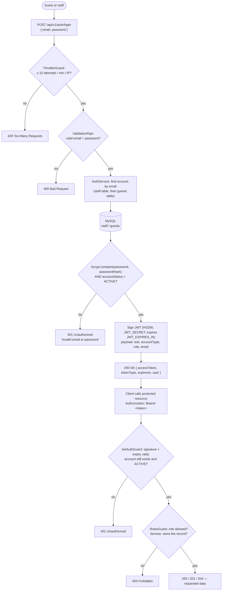

# Authentication and Security

This chapter implements the Lab 06 design (authentication flow diagram + security measures table).

## 6.1 Login flow (Lab 06 Part A, as implemented)

Differences from the Lab 06 diagram: the "Users table" is two tables (`guests`, `staff`) behind one `AuthService`; the account-status check is performed again on **every** request (not only at login), so a deactivated user's existing token stops working immediately.

## 6.2 JWT authentication

| Item | Implementation |
|---|---|
| Library | `@nestjs/jwt` (signing) + `passport-jwt` via `@nestjs/passport` (verification) |
| Algorithm | HS256 only (other algorithms, including `none`, are rejected) |
| Secret | `JWT_SECRET` environment variable, min 32 chars; the app refuses to start without it or with the placeholder — there is **no fallback secret** ([`env.validation.ts`](../src/config/env.validation.ts)) |
| Expiry | `JWT_EXPIRES_IN` (default `1h`); expired tokens → 401 "Access token has expired" |
| Issuer | `maristay-api` (verified) |
| Payload | `{ sub, accountType: GUEST|STAFF, role, email, iat, exp, iss }` — no password or personal data beyond email |
| Transport | `Authorization: Bearer <token>` header |
| Per-request check | [`JwtStrategy.validate()`](../src/auth/strategies/jwt.strategy.ts) reloads the account; INACTIVE or deleted → 401; the role is taken from the database, so role changes apply immediately |

## 6.3 Password hashing

* **bcrypt** with cost factor 10 (`BCRYPT_ROUNDS`), salted automatically; hashes look like `$2b$10$…` (verified in MySQL).
* Plaintext passwords are never stored or logged. `passwordHash` columns are `select: false` (not loaded unless explicitly requested) **and** `@Exclude()` (removed from every JSON response by `ClassSerializerInterceptor`).
* Password policy: 8–72 characters, at least one letter and one number (72 = bcrypt's input limit).
* Login uses the same error message for unknown email, wrong password and inactive account, and compares against a dummy bcrypt hash when the email is unknown so response timing does not reveal which emails exist.
* Guests change their own password with `currentPassword` + `newPassword`; managers can reset staff passwords.

## 6.4 Protected routes

`JwtAuthGuard` is registered **globally** (`APP_GUARD`), so every endpoint requires a valid token unless it is explicitly marked `@Public()`. Public endpoints: `POST /auth/login`, `POST /guests`, `GET /rooms`, `GET /rooms/:id`. All other 40 endpoints are protected.

## 6.5 Role-based access control (RBAC)

Roles: `GUEST`, `FRONT_DESK`, `HOUSEKEEPING`, `MANAGER`. Controllers declare who may call each route with `@Roles(...)`; the global [`RolesGuard`](../src/common/guards/roles.guard.ts) returns **403** when an authenticated user's role is not listed. Public registration can only create `GUEST` accounts (unknown properties such as `role` are rejected with 400); staff accounts are created only by a manager.

## 6.6 Ownership verification

Role checks are not enough — a guest must not see *another guest's* data. Services call [`assertGuestOwnerOrStaff()`](../src/common/utilities/ownership.util.ts) after loading a record:

| Resource | Rule |
|---|---|
| Guest profile, history | guest only if `guestId === token.sub` |
| Reservation, check-in/out, cancel | guest only if `reservation.guestId === token.sub` |
| Payment, digital key, service order | guest only if the parent reservation belongs to them |
| Housekeeping task | housekeeper only if `task.staffId === token.sub` |
| Lists (`GET /reservations`, `/payments`, …) | guests are automatically filtered to their own records |

Violations return **403 Forbidden**. Housekeeping staff cannot read payments, reservations or guest data at all.

## 6.7 Input validation

* Global `ValidationPipe` with `whitelist: true`, `forbidNonWhitelisted: true`, `transform: true` — every request body and query is validated against a DTO (class-validator), and **unknown properties are rejected** (prevents mass assignment such as sending `accountStatus`, `reservationStatus`, `totalAmount` or `role`).
* Services copy allowed fields explicitly into entities; client input is never spread into an entity.
* Validated: email format; names; phone numbers; password policy; positive integer ids (`ParseIdPipe`); real calendar dates `YYYY-MM-DD` (`@IsDateOnly`, rejects 2026-02-30); date ranges (check-out after check-in, not in the past, ≤ 30 nights); money (`> 0` or `≥ 0`, max 2 decimals); enum values (case-normalised); quantities 1–20; string lengths matching the column sizes.
* Business validation in services: overlapping bookings, payment ≤ outstanding balance, allowed status transitions, room readiness.
* Database CHECK constraints are a final safety net.

## 6.8 Rate limiting

`@nestjs/throttler` registered globally:
* **Login**: 10 attempts per IP per 60 s (`LOGIN_RATE_LIMIT`), then **429 Too Many Requests** — reduces brute-force password guessing (Lab 06).
* **All other routes**: 300 requests per IP per 60 s (`API_RATE_LIMIT`).

## 6.9 Credential and data protection

| Measure | Where |
|---|---|
| No hardcoded secrets | DB credentials, JWT secret and demo password come only from `.env` (git-ignored); `.env.example` has placeholders |
| Environment validation at startup | [`env.validation.ts`](../src/config/env.validation.ts) |
| Password hashes never returned | `select: false` + `@Exclude()` |
| Digital key credentials | 256-bit random `MSK-…` code; only its SHA-256 hash is stored (unique index); plaintext returned once at issue; never logged; notifications do not contain it |
| SQL injection | All queries go through TypeORM with bound parameters (`:param`); no string-concatenated SQL with user input; ids validated as integers |
| Safe errors | `AllExceptionsFilter` returns generic messages; SQL errors and stack traces stay in the server log |
| Logging | Request bodies, passwords, tokens and key codes are never logged; notification recipients are masked (`0912****789`, `g***@example.com`) |
| Security headers | `helmet()` — verified in responses: `Content-Security-Policy`, `Strict-Transport-Security`, `X-Content-Type-Options: nosniff`, `X-Frame-Options: SAMEORIGIN`; `X-Powered-By` removed. In development the CSP omits `upgrade-insecure-requests` because the local demo is plain HTTP |
| CORS | Restricted to `CORS_ORIGIN` (default `http://localhost:5173`); verified: an allowed origin receives `Access-Control-Allow-Origin`, any other origin receives none (browser blocks it) |
| Inactive accounts | Cannot log in and lose access to protected routes immediately |
| Historical data | FKs are `ON DELETE RESTRICT`; reservations are cancelled, accounts deactivated — never destroyed |
| Postman exports | Environment file contains no passwords or tokens (`demoPassword` is entered locally) |
| Git | `.gitignore` excludes `.env`, `node_modules/`, `dist/`, `coverage/`, logs, and `references/` |

## 6.10 Lab 06 security measures — traceability

| Lab 06 measure | Purpose | Implemented by | Status |
|---|---|---|---|
| Password hashing | Secure passwords | bcrypt (cost 10) | ✔ Implemented and tested |
| HTTPS | Secure communication | Not configured locally — the demo uses HTTP on localhost. Production must terminate TLS at a reverse proxy | ✖ Deployment requirement (documented, not claimed) |
| JWT authentication | Verify users | HS256 JWT, global `JwtAuthGuard` | ✔ |
| RBAC | Restrict access | `@Roles` + `RolesGuard` + ownership checks | ✔ |
| Input validation | Prevent invalid/harmful data | Global `ValidationPipe`, DTOs, custom validators, DB constraints | ✔ |
| Rate limiting | Limit repeated requests / brute force | `@nestjs/throttler` | ✔ (429 verified) |

Threats from Lab 06 Part C and how MariStay addresses them: **SQL injection** → parameterised TypeORM queries; **XSS** → JSON-only API, Helmet CSP headers, no HTML rendering; **brute force** → login rate limit + bcrypt cost; **phishing / session hijacking** → short-lived signed tokens, HTTPS required in deployment, per-request account checks.

**Authentication vs authorization** (Lab 06 Q5): authentication (`JwtAuthGuard`) answers *who are you?* and fails with 401; authorization (`RolesGuard` + ownership) answers *what may you do?* and fails with 403.
