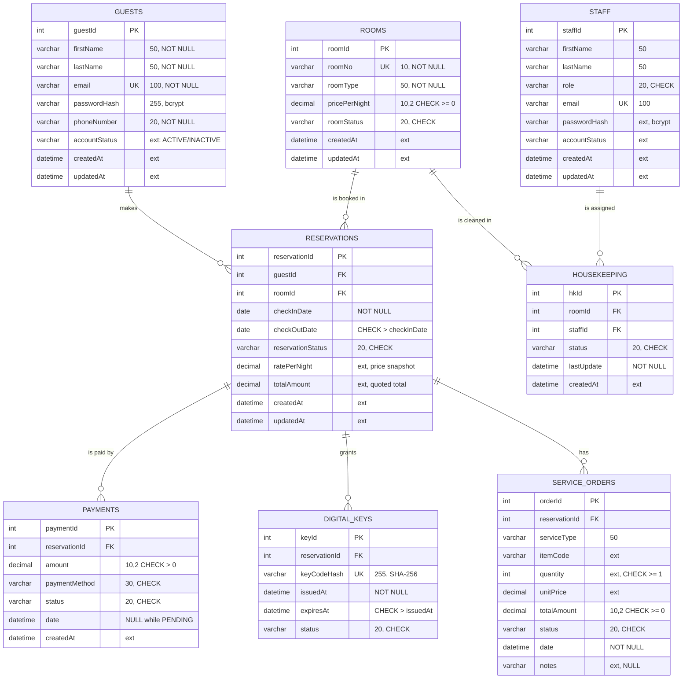

# Database Design

Database: **`maristay_db`** (MySQL, InnoDB, `utf8mb4_unicode_ci`). Schema created by the TypeORM migration [`1764086400000-InitialSchema.ts`](../src/database/migrations/1764086400000-InitialSchema.ts); exported in [`exports/maristay.sql`](../exports/maristay.sql).

## 4.1 Entity relationship diagram

The ERD below matches the implemented entities and the actual MySQL schema (verified with `npm run schema:check` and `information_schema`). Columns marked *(ext)* extend the Lab 04 design.

## 4.2 Database tables

| # | Table | Purpose (Lab 04) | Entity class |
|---|---|---|---|
| 1 | `guests` | Registered hotel guest information and authentication details | [`Guest`](../src/guests/entities/guest.entity.ts) |
| 2 | `rooms` | Hotel room information, pricing and availability status | [`Room`](../src/rooms/entities/room.entity.ts) |
| 3 | `reservations` | Guest room reservations and check-in/check-out schedule | [`Reservation`](../src/reservations/entities/reservation.entity.ts) |
| 4 | `payments` | Payments associated with reservations | [`Payment`](../src/payments/entities/payment.entity.ts) |
| 5 | `digital_keys` | Digital room access credentials issued to checked-in guests | [`DigitalKey`](../src/digital-keys/entities/digital-key.entity.ts) |
| 6 | `housekeeping` | Room cleaning tasks and assigned housekeeping staff | [`Housekeeping`](../src/housekeeping/entities/housekeeping.entity.ts) |
| 7 | `staff` | Hotel employees and their roles | [`Staff`](../src/staff/entities/staff.entity.ts) |
| 8 | `service_orders` | Guest requests for food, amenities and other services | [`ServiceOrder`](../src/service-orders/entities/service-order.entity.ts) |

A ninth table, `migrations`, is created automatically by TypeORM to record which migrations have run.

## 4.3 Data dictionary

### Table 1 — guests
| Field | Type | Constraints | Description |
|---|---|---|---|
| guestId | INT | PK, AUTO_INCREMENT | Unique guest identifier |
| firstName | VARCHAR(50) | NOT NULL | Guest's first name |
| lastName | VARCHAR(50) | NOT NULL | Guest's last name |
| email | VARCHAR(100) | UNIQUE (`UQ_guests_email`), NOT NULL | Login email, stored lower-case |
| passwordHash | VARCHAR(255) | NOT NULL | bcrypt hash; never selected by default or returned |
| phoneNumber | VARCHAR(20) | NOT NULL | Contact number (digits, optional +) |
| accountStatus *(ext)* | VARCHAR(20) | NOT NULL, DEFAULT 'ACTIVE', CHECK IN ('ACTIVE','INACTIVE') | Deactivated accounts cannot log in |
| createdAt / updatedAt *(ext)* | DATETIME(6) | NOT NULL, defaults | Audit timestamps |

### Table 2 — rooms
| Field | Type | Constraints | Description |
|---|---|---|---|
| roomId | INT | PK, AUTO_INCREMENT | Unique room identifier |
| roomNo | VARCHAR(10) | UNIQUE (`UQ_rooms_roomNo`), NOT NULL | Hotel room number (e.g. 101) |
| roomType | VARCHAR(50) | NOT NULL | Standard, Deluxe, Suite or Family (validated by the API) |
| pricePerNight | DECIMAL(10,2) | NOT NULL, CHECK ≥ 0 | Current nightly rate (PHP) |
| roomStatus | VARCHAR(20) | NOT NULL, DEFAULT 'AVAILABLE', CHECK IN ('AVAILABLE','OCCUPIED','CLEANING','MAINTENANCE') | Current physical state of the room |
| createdAt / updatedAt *(ext)* | DATETIME(6) | NOT NULL | Audit timestamps |

Index: `IDX_rooms_status_type (roomStatus, roomType)` for the public room filter.

### Table 3 — reservations
| Field | Type | Constraints | Description |
|---|---|---|---|
| reservationId | INT | PK, AUTO_INCREMENT | Unique reservation identifier |
| guestId | INT | FK → guests.guestId, NOT NULL, ON DELETE RESTRICT | Guest making the reservation |
| roomId | INT | FK → rooms.roomId, NOT NULL, ON DELETE RESTRICT | Reserved room |
| checkInDate | DATE | NOT NULL | Scheduled arrival date |
| checkOutDate | DATE | NOT NULL, CHECK > checkInDate | Scheduled departure date |
| reservationStatus | VARCHAR(20) | NOT NULL, DEFAULT 'PENDING', CHECK IN ('PENDING','CONFIRMED','CHECKED_IN','CHECKED_OUT','CANCELLED') | Booking lifecycle state |
| ratePerNight *(ext)* | DECIMAL(10,2) | NOT NULL, CHECK ≥ 0 | Room price captured at booking time |
| totalAmount *(ext)* | DECIMAL(10,2) | NOT NULL, CHECK ≥ 0 | Quoted room total = rate × nights |
| createdAt / updatedAt *(ext)* | DATETIME(6) | NOT NULL | Audit timestamps |

Indexes: `IDX_reservations_room_dates (roomId, checkInDate, checkOutDate)` (overlap check), `IDX_reservations_guest`, `IDX_reservations_status`.

### Table 4 — payments
| Field | Type | Constraints | Description |
|---|---|---|---|
| paymentId | INT | PK, AUTO_INCREMENT | Unique payment identifier |
| reservationId | INT | FK → reservations.reservationId, NOT NULL, ON DELETE RESTRICT | Associated reservation |
| amount | DECIMAL(10,2) | NOT NULL, CHECK > 0 | Payment amount |
| paymentMethod | VARCHAR(30) | NOT NULL, CHECK IN ('CASH','CARD','E_WALLET') | Card, cash or e-wallet |
| status | VARCHAR(20) | NOT NULL, DEFAULT 'PENDING', CHECK IN ('PENDING','PAID','FAILED','REFUNDED') | Payment state |
| date | DATETIME | NULL | When the payment was processed (NULL while PENDING) |
| createdAt *(ext)* | DATETIME(6) | NOT NULL | When the record was created |

### Table 5 — digital_keys
| Field | Type | Constraints | Description |
|---|---|---|---|
| keyId | INT | PK, AUTO_INCREMENT | Unique digital key identifier |
| reservationId | INT | FK → reservations.reservationId, NOT NULL, ON DELETE RESTRICT | Associated reservation |
| keyCodeHash | VARCHAR(255) | UNIQUE, NOT NULL | SHA-256 hash of the access credential (plaintext never stored) |
| issuedAt | DATETIME | NOT NULL | When the key was issued |
| expiresAt | DATETIME | NOT NULL, CHECK > issuedAt | Expiry (default 12:00 on the check-out date) |
| status | VARCHAR(20) | NOT NULL, DEFAULT 'ACTIVE', CHECK IN ('ACTIVE','EXPIRED','REVOKED') | Key state |

### Table 6 — housekeeping
| Field | Type | Constraints | Description |
|---|---|---|---|
| hkId | INT | PK, AUTO_INCREMENT | Unique cleaning record |
| roomId | INT | FK → rooms.roomId, NOT NULL, ON DELETE RESTRICT | Room being cleaned |
| staffId | INT | FK → staff.staffId, NOT NULL, ON DELETE RESTRICT | Assigned housekeeper |
| status | VARCHAR(20) | NOT NULL, DEFAULT 'PENDING', CHECK IN ('PENDING','IN_PROGRESS','COMPLETED') | Task state |
| lastUpdate | DATETIME | NOT NULL | Last status change |
| createdAt *(ext)* | DATETIME(6) | NOT NULL | When the task was assigned |

Indexes: `IDX_housekeeping_room_status`, `IDX_housekeeping_staff_status`.

### Table 7 — staff
| Field | Type | Constraints | Description |
|---|---|---|---|
| staffId | INT | PK, AUTO_INCREMENT | Unique employee identifier |
| firstName | VARCHAR(50) | NOT NULL | Employee's first name |
| lastName | VARCHAR(50) | NOT NULL | Employee's last name |
| role | VARCHAR(20) | NOT NULL, CHECK IN ('FRONT_DESK','HOUSEKEEPING','MANAGER') | Assigned role |
| email | VARCHAR(100) | UNIQUE, NOT NULL | Employee email / login |
| passwordHash *(ext)* | VARCHAR(255) | NOT NULL | bcrypt hash (required for staff login) |
| accountStatus *(ext)* | VARCHAR(20) | NOT NULL, DEFAULT 'ACTIVE', CHECK | Deactivated staff cannot log in |
| createdAt / updatedAt *(ext)* | DATETIME(6) | NOT NULL | Audit timestamps |

### Table 8 — service_orders
| Field | Type | Constraints | Description |
|---|---|---|---|
| orderId | INT | PK, AUTO_INCREMENT | Unique order identifier |
| reservationId | INT | FK → reservations.reservationId, NOT NULL, ON DELETE RESTRICT | Associated guest reservation |
| serviceType | VARCHAR(50) | NOT NULL | Food, Beverage, Amenities, Laundry or Other |
| itemCode *(ext)* | VARCHAR(50) | NOT NULL | Catalog item ordered |
| quantity *(ext)* | INT | NOT NULL, DEFAULT 1, CHECK ≥ 1 | Units ordered |
| unitPrice *(ext)* | DECIMAL(10,2) | NOT NULL, CHECK ≥ 0 | Catalog price at order time |
| totalAmount | DECIMAL(10,2) | NOT NULL, CHECK ≥ 0 | Total service charge (server-calculated) |
| status | VARCHAR(20) | NOT NULL, DEFAULT 'PENDING', CHECK IN ('PENDING','PREPARING','DELIVERED','CANCELLED') | Order state |
| date | DATETIME | NOT NULL | Date and time of order |
| notes *(ext)* | VARCHAR(255) | NULL | Guest instructions |

## 4.4 Primary keys and foreign keys

| Table | Primary key | Foreign keys |
|---|---|---|
| guests | guestId | — |
| rooms | roomId | — |
| staff | staffId | — |
| reservations | reservationId | guestId → guests, roomId → rooms |
| payments | paymentId | reservationId → reservations |
| digital_keys | keyId | reservationId → reservations |
| service_orders | orderId | reservationId → reservations |
| housekeeping | hkId | roomId → rooms, staffId → staff |

All foreign keys are `ON DELETE RESTRICT ON UPDATE CASCADE` with explicit names (`FK_<table>_<parent>`). RESTRICT means a guest, room or reservation that has history can never be deleted by accident, so reservation and payment history is always preserved.

## 4.5 Relationships (TypeORM)

| Relationship | Cardinality | TypeORM mapping |
|---|---|---|
| Guest — Reservation | 1 : N | `Guest.@OneToMany(reservations)` ↔ `Reservation.@ManyToOne(guest) @JoinColumn(guestId)` |
| Room — Reservation | 1 : N | `Room.@OneToMany(reservations)` ↔ `Reservation.@ManyToOne(room) @JoinColumn(roomId)` |
| Reservation — Payment | 1 : N | `Reservation.@OneToMany(payments)` ↔ `Payment.@ManyToOne(reservation)` |
| Reservation — DigitalKey | 1 : N | `Reservation.@OneToMany(digitalKeys)` ↔ `DigitalKey.@ManyToOne(reservation)` |
| Reservation — ServiceOrder | 1 : N | `Reservation.@OneToMany(serviceOrders)` ↔ `ServiceOrder.@ManyToOne(reservation)` |
| Room — Housekeeping | 1 : N | `Room.@OneToMany(housekeepingTasks)` ↔ `Housekeeping.@ManyToOne(room)` |
| Staff — Housekeeping | 1 : N | `Staff.@OneToMany(housekeepingTasks)` ↔ `Housekeeping.@ManyToOne(staff)` |

Each FK is also exposed as a plain column (e.g. `Reservation.guestId`) so services can filter by id without loading the related entity.

## 4.6 Normalization

* **1NF** — every column holds one atomic value (no lists, no repeating groups); each table has a primary key.
* **2NF** — all primary keys are single surrogate columns, so no partial dependencies are possible.
* **3NF** — non-key columns depend only on their own table's key: guest details live only in `guests`, room details only in `rooms`; reservations, payments, keys, orders and tasks store only foreign keys to them.
* **Deliberate, documented denormalization**: `reservations.ratePerNight/totalAmount` and `service_orders.unitPrice/totalAmount` copy prices at the moment of the transaction. These are *historical facts* (what the guest was charged), not duplicates of current prices — a later price change must not rewrite past bookings.
* Lab 04's Part D reasoning holds: normalization reduces duplicate data, and the `pricePerNight` CHECK prevents negative prices and billing errors.

## 4.7 Database constraints summary

| Kind | Where |
|---|---|
| PRIMARY KEY | All 8 tables (`AUTO_INCREMENT INT`) |
| UNIQUE | guests.email, staff.email, rooms.roomNo, digital_keys.keyCodeHash |
| FOREIGN KEY (RESTRICT) | 7 relationships (§4.4) |
| CHECK — allowed values | every status / role / method column |
| CHECK — amounts | pricePerNight ≥ 0, payments.amount > 0, reservation and order amounts ≥ 0, quantity ≥ 1 |
| CHECK — dates | reservations.checkOutDate > checkInDate, digital_keys.expiresAt > issuedAt |
| NOT NULL / DEFAULT | per data dictionary |
| Application-level | email unique across guests **and** staff; no overlapping active reservations per room (row lock + transaction); status transitions |

CHECK constraints are enforced by MySQL 8.0.16+ and MariaDB 10.2+ (verified on MariaDB 10.4: inserting a negative price fails with `CONSTRAINT CHK_rooms_pricePerNight failed`).

## 4.8 Migrations and seed data

| Command | What it does |
|---|---|
| `npm run db:create` | `CREATE DATABASE IF NOT EXISTS` (never drops anything) |
| `npm run migration:run` | Creates the 8 tables, keys, indexes and CHECK constraints |
| `npm run migration:show` / `migration:revert` | Show / undo migrations |
| `npm run schema:check` | Compares entities with the live schema (prints SQL TypeORM *would* run) |
| `npm run seed` | Inserts demo data; re-runnable without duplicates; never updates or deletes |
| `npm run db:setup` | All three: create → migrate → seed |

`synchronize` is always `false`; the schema changes only through migrations.

Seed data (fictional): 1 manager, 1 front desk, 2 housekeeping staff, 2 guests, 9 rooms (101–104 Standard, 201–202 Deluxe, 301 Suite, 302–303 Family; 104 CLEANING, 303 MAINTENANCE), 3 reservations (one checked-out past stay with a delivered order and payment, one confirmed future stay, one pending future stay), 2 housekeeping records.

> Known cosmetic note: on MariaDB, `npm run schema:check` lists two `ALTER … NULL` statements for the nullable `payments.date` and `service_orders.notes` columns because MariaDB reports their default as the text `'NULL'`. The statements would not change anything. (MySQL 8 reports a real `NULL` default, so the diff is empty there: on Oracle MySQL 8.4.11 LTS, `npm run schema:check` reported "Your schema is up to date" on 2026-11-27.)

## 4.9 Database server and SQL export

* **Server used:** XAMPP's bundled "MySQL" server, which is **MariaDB 10.4.32**, a MySQL-compatible fork. The application connects with the MySQL driver (`mysql2`, TypeORM `type: 'mysql'`). Development and the results in this document used this server. On 2026-11-27 the same migration, seed data, e2e tests (46/46) and Postman collection (177/177) were also verified on **Oracle MySQL 8.4.11 LTS**, and the schema was identical on both servers: 8 tables, 64 columns, 7 foreign keys, 17 CHECK constraints and 13 unique indexes (Requirements Compliance Checklist §6, Testing §8.9).
* **Other databases:** the project uses three databases on the shared XAMPP server:
  * `maristay_db`, the demonstration data;
  * `maristay_test_db`, recreated by the e2e tests;
  * `maristay_postman_db`, recreated before each full Postman/Newman run.

  The tools never create, change or drop any other database. The e2e and Postman reset commands refuse to touch a database with a different name.
* **SQL export:** `exports/maristay.sql` was produced by `mysqldump` from the migrated and seeded `maristay_db`. It contains the 8 tables, the `migrations` table, 7 foreign keys, 17 CHECK constraints, 23 indexes and the demonstration records. It begins with `CREATE DATABASE IF NOT EXISTS maristay_db; USE maristay_db;` and contains no `DROP TABLE` statements. It is meant for a server **without** an existing `maristay_db`. If one already exists with tables, the import stops at the first `CREATE TABLE` and changes nothing. Re-import was verified on 2026-11-26 into a scratch database: all objects were created without errors. On 2026-11-27 a copy without the `CREATE DATABASE`/`USE` lines was also imported into Oracle MySQL 8.4.11 LTS. Only deprecation warnings appeared, and the FK, CHECK and UNIQUE constraints were enforced. Foreign keys imported from this MariaDB dump show `ON DELETE NO ACTION`, which InnoDB treats exactly like `RESTRICT`.
