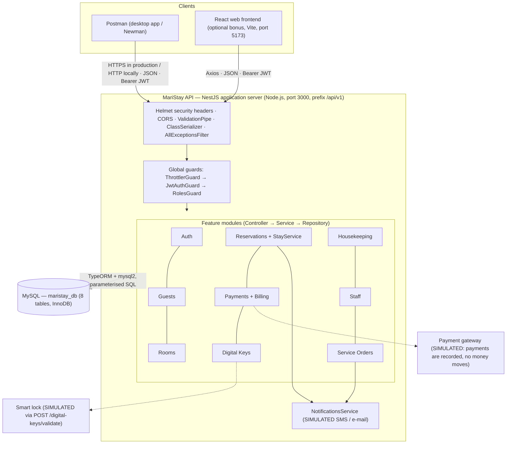
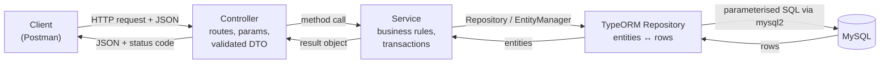
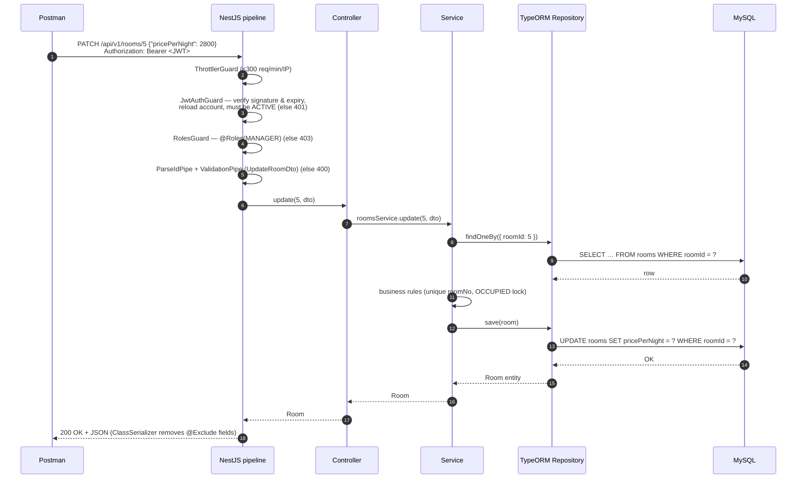
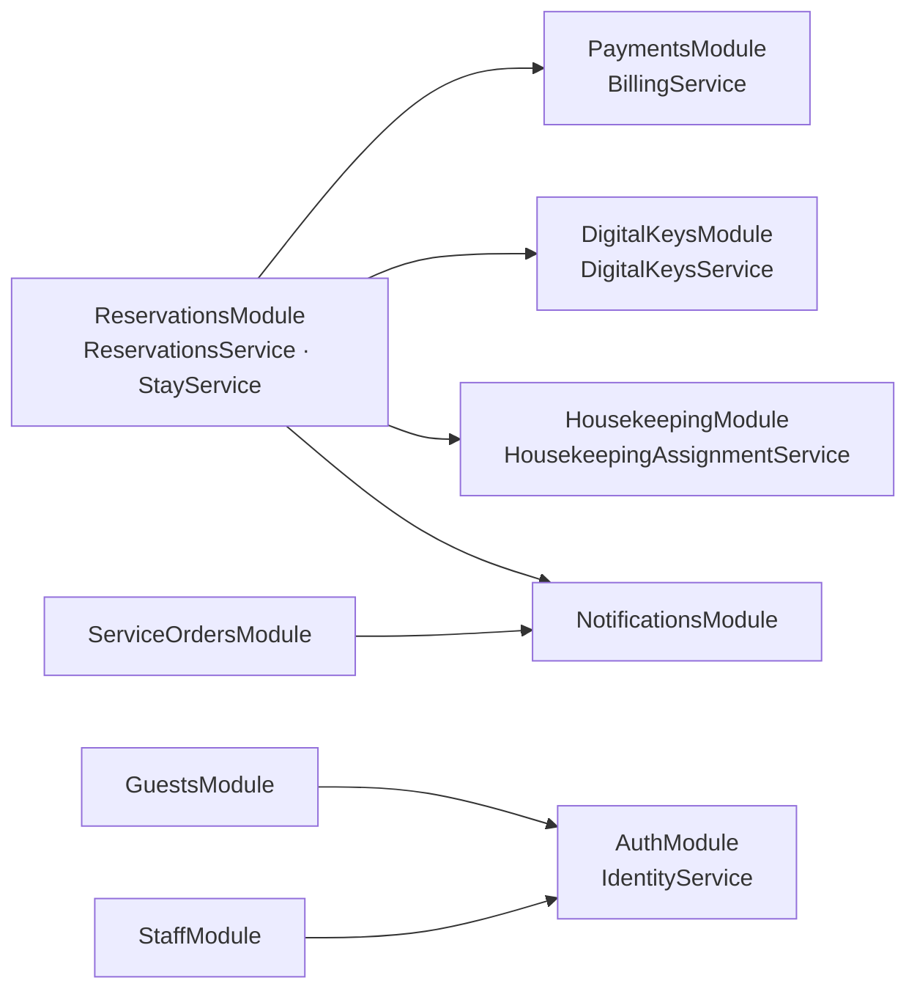
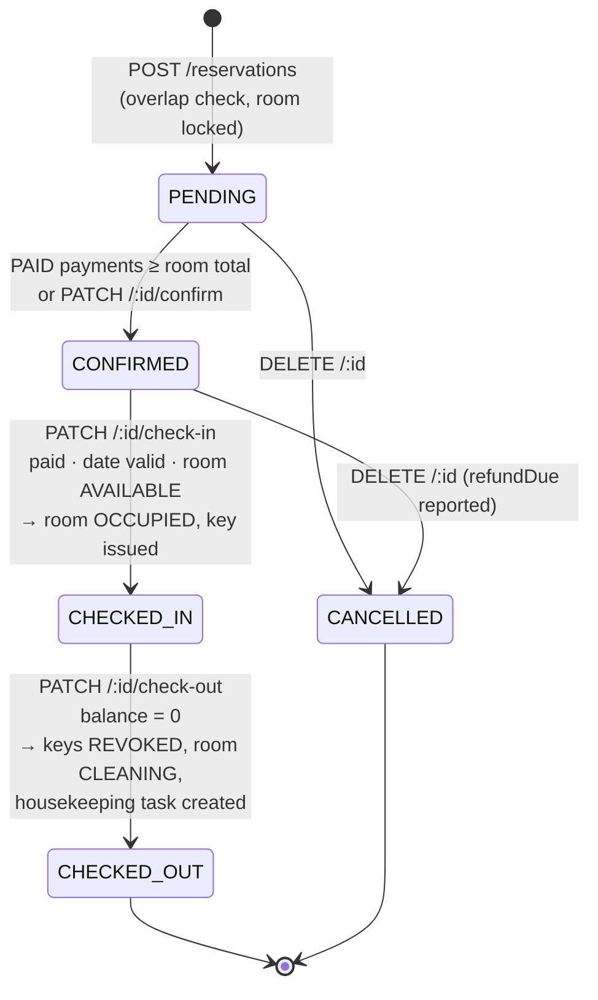
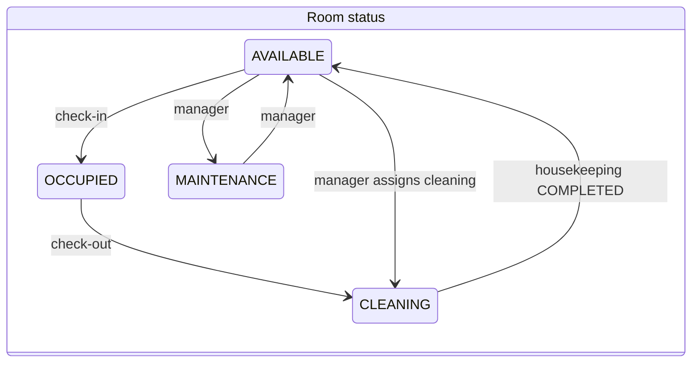

# System Architecture

## 3.1 Architecture overview

MariStay is a **modular monolith**: one NestJS application, organised into nine feature modules, backed by one MySQL database. It keeps the layers of Lab 03 (client → API → application server → database / auth service / notifications) and implements them as code.

| Lab 03 component | MariStay implementation |
|---|---|
| Users: guests, front desk, housekeeping, management | Roles `GUEST`, `FRONT_DESK`, `HOUSEKEEPING`, `MANAGER` enforced by `RolesGuard` |
| Client application (web/mobile) | Postman, the required API testing tool, plus an optional React web frontend in `frontend/` for all four roles (15 screens, 36 of the 44 endpoints; see `docs/FRONTEND.md`). A mobile app is future work. |
| API calls | REST/JSON under `/api/v1` (44 endpoints) |
| Application / web server | NestJS 11 on Node.js 24 (Express platform) |
| Auth service | `AuthModule` — bcrypt + JWT (HS256) + passport-jwt |
| Database server | MySQL-compatible server accessed with TypeORM 0.3 and `mysql2`: XAMPP MariaDB 10.4.32 for development, also verified on Oracle MySQL 8.4.11 LTS (Testing §8.9) |
| SMS / e-mail notification | `NotificationsService` — simulated adapter (logs masked messages) |
| Payment gateway | Simulated: `PaymentsModule` records payments only |
| Smart locks | Simulated: `POST /digital-keys/validate` returns an access decision |

## 3.2 System components

| Module | Responsibility | Main files |
|---|---|---|
| AuthModule | Login for guests and staff, JWT issuing/validation, cross-table email uniqueness | `auth.service.ts`, `strategies/jwt.strategy.ts`, `guards/jwt-auth.guard.ts`, `identity.service.ts` |
| GuestsModule | Registration, profiles, deactivation, reservation history | `guests.service.ts` |
| RoomsModule | Room catalogue, filtering, date-range availability, manager CRUD | `rooms.service.ts` |
| ReservationsModule | Booking with conflict prevention, updates, confirmation, cancellation, **check-in/check-out orchestration** | `reservations.service.ts`, `stay.service.ts` |
| PaymentsModule | Payment recording/verification, balance computation (`BillingService`) | `payments.service.ts`, `billing.service.ts` |
| DigitalKeysModule | Key issuing/revoking (used by check-in/out), validation (smart-lock simulation) | `digital-keys.service.ts`, `digital-key-access.service.ts` |
| HousekeepingModule | Cleaning tasks, automatic assignment, room release | `housekeeping.service.ts`, `housekeeping-assignment.service.ts` |
| StaffModule | Employee accounts (manager only) | `staff.service.ts` |
| ServiceOrdersModule | Food/amenity/service orders with server-side catalog pricing | `service-orders.service.ts`, `service-catalog.ts` |
| NotificationsModule | Simulated SMS/e-mail adapter | `notifications.service.ts` |
| common/ | Enums, decorators (`@Public`, `@Roles`, `@CurrentUser`), RolesGuard, exception filter, pipes, validators, utilities | `src/common/**` |
| database/ | Connection options, migration, seed, data source for the CLI | `src/database/**` |

## 3.3 Layered architecture

* **Controller layer** — receives the request, reads path/query parameters, receives the already-validated DTO, calls one service method and returns its result. Controllers contain no business logic (e.g. [`rooms.controller.ts`](../src/rooms/rooms.controller.ts)).
* **Service layer** — enforces business rules (availability, ownership, status transitions, payment rules) and opens database transactions when several rows must change together (e.g. [`stay.service.ts`](../src/reservations/stay.service.ts)).
* **Repository layer** — TypeORM `Repository<Entity>` or the transaction's `EntityManager` turns entities into parameterised SQL.
* **Database layer** — MySQL stores the data and enforces primary keys, foreign keys (`ON DELETE RESTRICT`), unique indexes and CHECK constraints.

## 3.4 Request and response flow (with security)

Errors at any step become a consistent JSON body via `AllExceptionsFilter`:
`{ "statusCode": 409, "error": "CONFLICT", "message": "Room number 101 already exists", "path": "/api/v1/rooms", "timestamp": "…" }`.
Database errors are translated (duplicate → 409, FK violation → 400/409, CHECK violation → 400) and never expose SQL.

## 3.5 Module integration

The arrows are NestJS module imports. `ReservationsModule` orchestrates the guest stay and imports the helpers it needs; none of those modules imports `ReservationsModule` back, so there are **no circular dependencies**. Helpers that take part in a workflow accept the caller's `EntityManager`, so their writes join the caller's transaction.

| Workflow | Modules involved (one transaction) |
|---|---|
| Book room | Reservations (+ Rooms row lock, Guests) |
| Record payment | Payments + Billing + Reservations (auto-confirm) |
| Check-in | Reservations + Billing + Rooms (→ OCCUPIED) + Digital Keys (issue) → Notifications (after commit) |
| Service order | Service Orders + Reservations (lock, must be CHECKED_IN) |
| Check-out | Reservations + Service Orders (cancel open) + Billing + Digital Keys (revoke) + Rooms (→ CLEANING) + Housekeeping (assign) → Notifications |
| Finish cleaning | Housekeeping + Rooms (→ AVAILABLE) |

## 3.6 Integrated business workflow

## 3.7 External service integration

All three external services from Lab 03 are **simulated** so the prototype runs offline with no paid subscriptions. Each lives behind a single class so a real provider can be plugged in later without touching callers.

| External service | Prototype behaviour | Integration point for a real provider |
|---|---|---|
| Payment gateway | Front desk records payments (`POST /payments`); no card data is collected and no money moves | Call the gateway in `PaymentsService.create()` before saving, store its transaction reference |
| SMS / e-mail | `NotificationsService` logs masked recipients and returns `{ status: "SIMULATED_SENT" }`; messages never contain key codes | Replace `NotificationsService.deliver()` with an SMS API / SMTP client |
| Smart lock | `POST /digital-keys/validate` returns `accessGranted: true` or 403; no door is opened | A lock controller would call this endpoint (or a signed variant) and act on the decision |

## 3.8 Deployment note (HTTP vs HTTPS)

The local demonstration runs on plain **HTTP** at `http://localhost:3000`. Lab 03/06 specify HTTPS; in a real deployment TLS would be terminated by a reverse proxy (e.g. Nginx or a cloud load balancer) in front of the API, and `CORS_ORIGIN` would be set to the real front-end origin. HTTPS is **not** configured in this prototype.
