# API Testing and Validation Report

**Test dates:** 2026-11-25 (development and full suite); 2026-11-26 (Newman runs; unit + e2e regression after rotating the JWT secret; Postman desktop Runner 177/177; screenshot evidence in §8.7); 2026-11-27 (final regression on MariaDB and Oracle MySQL 8.4.11 LTS, §8.9) · **Environment:** Windows 11, Node.js 24.21.0, NestJS 11.2, TypeORM 0.3.31, XAMPP MariaDB 10.4.32 (MySQL-compatible) on localhost:3306.

All results in this report were produced by actually running the tests on the development machine. Nothing is estimated. The screenshots in §8.7 were captured by the student on the same machine; only redaction and cropping were applied.

## 8.1 Testing approach

| Level | Tool | Database | What it proves |
|---|---|---|---|
| Unit tests | Jest + ts-jest (`npm run test`) | none (mocks) | Pure logic: dates, money, id validation, ownership, RolesGuard, login rules, env validation |
| End-to-end (integration) tests | Jest + Supertest (`npm run test:e2e`) | real MySQL, isolated `maristay_test_db` — dropped, migrated and seeded at the start of every run | The whole stack (guards → pipes → controllers → services → TypeORM → MySQL) and the integrated workflow |
| Collection testing | Postman collection (`postman/MariStay.postman_collection.json`), run with Newman (`npm run postman:newman`) or the Postman Runner | isolated `maristay_postman_db` on port 3001, reset before every run | All 122 requests in order, with 177 assertions: the integrated workflow, security and negative cases |
| Manual API testing / live demo | Individual Postman requests | local `maristay_db` on port 3000 | Live demonstration (Login and room CRUD only, not the full collection); request/response inspection |
| Manual smoke scripts | Node `fetch` scripts during development | `maristay_test_db` | Every endpoint, positive and negative cases, while building each module |
| Database checks | `mysql` CLI | both | CHECK / FK constraints reject bad data; SQL export re-imports cleanly |

The e2e database name must end with `_test` (or `_test_db`); the test refuses to reset any other database, so demo data in `maristay_db` is never touched.

## 8.2 Automated test results

### Unit tests — `npm run test` → **33 passed, 0 failed** (4 / 4 suites; latest run 37.441 s, Figure 8.17)

| Suite | Tests |
|---|---|
| `config/env.validation.spec.ts` | accepts a complete configuration · refuses to start without a JWT secret (no insecure fallback) · refuses the placeholder or a short secret · rejects an unsafe database name |
| `common/utilities/utilities.spec.ts` | nights in a half-open range · only real YYYY-MM-DD dates · key expiry 12:00 local on check-out date · centavo arithmetic avoids float errors · ParseIdPipe accepts positive integers and rejects `0`, `-1`, `abc`, `1.5`, `1 OR 1=1`, empty (400) · guest can access own record · guest blocked from another guest's record (403) · operations staff allowed · disallowed staff roles blocked · custom role list honoured · unique high-entropy key codes · deterministic SHA-256 key hashing · password policy |
| `common/guards/roles.guard.spec.ts` | routes without @Roles allowed · public routes allowed · listed role allowed · wrong role → 403 (not 401) |
| `auth/auth.service.spec.ts` | valid guest gets JWT with id/accountType/role and no hash · staff login carries staff role · wrong password → 401 · unknown email → same 401 message · INACTIVE account → 401 · deactivated account's token resolves to no user |

### End-to-end tests — `npm run test:e2e` → **46 passed, 0 failed** (latest run 13.62 s, Figure 8.18)

| # | Scenario (test name) | Expected | Actual |
|---|---|---|---|
| 1 | registers a guest without exposing the password hash | 201 | ✔ 201 |
| 2 | rejects a duplicate email, also across staff accounts | 409 | ✔ 409 |
| 3 | rejects invalid registration data and unknown properties | 400 | ✔ 400 |
| 4 | logs in with valid credentials and returns a JWT | 200 | ✔ 200 |
| 5 | rejects invalid credentials | 401 | ✔ 401 |
| 6 | protected route without a token | 401 | ✔ 401 |
| 7 | protected route with invalid / tampered token | 401 | ✔ 401 |
| 8 | current profile with a valid token | 200 | ✔ 200 |
| 9 | guest calls a manager-only route | 403 | ✔ 403 |
| 10 | guest reads another guest's profile | 403 | ✔ 403 |
| 11 | non-numeric id | 400 | ✔ 400 |
| 12 | deactivated account blocked immediately, even with an unexpired token | 204 then 401 | ✔ |
| 13 | public room list with `?roomStatus=Available` | 200, all AVAILABLE | ✔ |
| 14 | invalid status filter | 400 | ✔ 400 |
| 15 | create room | 201 | ✔ 201 |
| 16 | invalid room data / duplicate room number | 400 / 409 | ✔ |
| 17 | retrieve room | 200 | ✔ 200 |
| 18 | update room with PATCH | 200 | ✔ 200 |
| 19 | replace room with PUT (missing field → 400) | 400 / 200 | ✔ |
| 20 | delete test room, then GET | 204 / 404 | ✔ |
| 21 | delete room with reservation history | 409 | ✔ 409 |
| 22 | invalid reservation dates (reversed, past, 2026-02-30) | 400 | ✔ 400 |
| 23 | book a room → PENDING, total = 3 × 1800 | 201 | ✔ 201 |
| 24 | overlapping reservation rejected; same-day turnover allowed | 409 / 201 | ✔ |
| 25 | **6 concurrent conflicting bookings** | exactly one 201, five 409 | ✔ `[201, 409, 409, 409, 409, 409]` |
| 26 | guest views another guest's reservation; guest lists only own | 403 | ✔ |
| 27 | housekeeping lists reservations | 403 | ✔ 403 |
| 28 | client-controlled status / booking for someone else | 400 / 403 | ✔ |
| 29 | workflow step 4: guest books a room for today | 201 | ✔ |
| 30 | check-in without sufficient payment (pending, then confirmed-but-unpaid) | 409 | ✔ 409 "Payment required…" |
| 31 | invalid payment information; guest tries to record payment | 400 / 403 | ✔ |
| 32 | step 5: FAILED payment not counted; PAID payment auto-confirms | 201, CONFIRMED | ✔ |
| 33 | check-in when room is not ready (CLEANING) | 409 | ✔ 409 "not ready" |
| 34 | step 6: digital check-in → CHECKED_IN, room OCCUPIED, key issued, notifications simulated | 200 | ✔ |
| 35 | only a SHA-256 hash of the key is stored in MySQL | hash ≠ code | ✔ |
| 36 | step 7: valid key → access granted; invalid key → denied | 200 / 403 | ✔ |
| 37 | expired key and revoked key rejected | 403 / 403 | ✔ |
| 38 | step 8: service order priced by server (2 × 450 = 900); client price rejected | 201 / 400 | ✔ |
| 39 | unauthorized service order (other guest / not checked in) | 403 / 409 | ✔ |
| 40 | step 9: check-out blocked by unpaid 900.00, then succeeds; key no longer works | 409 / 200 / 403 | ✔ |
| 41 | step 10: housekeeper cannot touch another housekeeper's task or payments | 403 | ✔ |
| 42 | step 10: invalid transition 409; IN_PROGRESS → COMPLETED; room becomes AVAILABLE | 409 / 200 | ✔ |
| 43 | manager assigns housekeeping task; duplicate open task | 201 / 409 | ✔ |
| 44 | staff create / read / update / deactivate; deactivated staff cannot log in | 201/200/200/204/401 | ✔ |
| 45 | staff endpoints are manager-only | 403 | ✔ 403 |
| 46 | login rate limit | 429 | ✔ 429 |

Raw output (last run):
```
Test Suites: 1 passed, 1 total
Tests:       46 passed, 46 total
```

### Coverage of the required test scenarios

| Required scenario | Covered by |
|---|---|
| Successful guest registration / duplicate email | e2e 1, 2 · Postman 2, 11 |
| Valid login / invalid credentials | e2e 4, 5 · Postman 1, 11 |
| Protected route without token / invalid token | e2e 6, 7 · Postman 11 |
| Guest attempting manager-only operations | e2e 9 · Postman 11 |
| Guest accessing another guest's reservation | e2e 26 · Postman 11 |
| Valid / invalid room creation, retrieval, update, deletion | e2e 15–21 · Postman 3, 11 |
| Invalid reservation dates / successful reservation / overlap | e2e 22–24 · Postman 4, 11 |
| Concurrent conflicting reservation attempts | e2e 25 · Postman 11 (4 parallel `pm.sendRequest`) |
| Successful payment / invalid payment information | e2e 31–32 · Postman 5 |
| Check-in without sufficient payment / room not ready | e2e 30, 33 · Postman 10, 11 |
| Successful digital check-in / digital key generation | e2e 34–35 · Postman 6 |
| Invalid / expired / revoked digital key | e2e 36–37 · Postman 6 |
| Successful / unauthorized service order | e2e 38–39 · Postman 9 |
| Successful check-out | e2e 40 · Postman 9, 10 |
| Housekeeping assignment / status update / room availability restoration | e2e 41–43 · Postman 7, 9, 10 |

## 8.3 Manual verification performed during development

| Check | Result |
|---|---|
| `npm run build` | ✔ 0 TypeScript errors |
| `npm run start:dev` against `maristay_db` | ✔ "Found 0 errors", 44 routes mapped, API + Swagger URLs logged (Swagger UI was removed on 2026-11-27; see Testing §8.11.) |
| Video flow on `maristay_db`: manager login → create room → GET → PATCH → DELETE → POST without token | ✔ 200 → 201 → 200 → 200 → 204 → 401 |
| Swagger `/api/docs-json` | ✔ 200, 44 operations, 18 schemas; UI assets load under CSP (Swagger UI was removed on 2026-11-27; see Testing §8.11.) |
| Security headers / CORS | ✔ CSP, HSTS, nosniff, SAMEORIGIN present; `X-Powered-By` absent; only the configured origin receives `Access-Control-Allow-Origin` |
| CHECK constraints (MariaDB) | ✔ negative price → `CONSTRAINT CHK_rooms_pricePerNight failed`; checkOut = checkIn → `CHK_reservations_dates failed` |
| FK RESTRICT | ✔ deleting a room with history → error 1451 |
| Seed idempotency | ✔ second run creates 0 records |
| SQL export | ✔ `database/maristay.sql` re-imported into a scratch database: 8 tables + migrations, 7 FKs, all rows |
| Secret scan of every file to be committed | ✔ JWT secret and demo password found in 0 files; `.env` and `references/` ignored |

## 8.4 Error handling verification

Every error returns the same JSON shape with a correct status code (never 200 on failure):
```json
{ "statusCode": 409, "error": "CONFLICT", "message": "Room already booked for the selected dates", "path": "/api/v1/reservations", "timestamp": "…" }
```
Database exceptions are mapped (duplicate → 409, FK → 400/409, CHECK → 400, other → 500 generic) without exposing SQL text.

## 8.5 Bugs found by testing and fixed

| # | Found by | Problem | Fix |
|---|---|---|---|
| B1 | Smoke test (500 on every booking) | TypeORM's `pessimistic_read` lock emits MySQL 8 `FOR SHARE`, a syntax error on MariaDB 10.4 | Booking transactions use `READ COMMITTED` + `SELECT … FOR UPDATE` on the room row (portable); concurrency re-verified |
| B2 | Captured API samples | `createdAt` (DB default, local time) and app-written datetimes (UTC) differed by 8 h | Use the `local` time zone for both; corrected seeded rows; re-exported SQL |
| B3 | Postman design review | Login limit of 5/min was below the 6 role logins in folder 1 | Default raised to 10/min (still blocks brute force; 429 test updated) |
| B4 | e2e test | Test tried to set `expiresAt` before `issuedAt`; the CHECK constraint correctly refused | Test fixed (constraint confirmed working) |
| B5 | Header review | Helmet CSP `upgrade-insecure-requests` could break Swagger UI over plain HTTP | Directive sent only in production. Since Swagger was removed (2026-11-27), Helmet defaults apply everywhere |
| B6 | First full Postman run | 32 request bodies sent numeric ids and amounts as quoted placeholders (`"roomId": "{{stayRoomId}}"`), so the API correctly answered 400 (`roomId must be an integer number`), and payments, same-day bookings, check-in and the workflow cascaded into failures | Placeholders unquoted (`"roomId": {{stayRoomId}}`) in the collection; API validation unchanged |
| B7 | Second Postman desktop run (port 3001): 38 passed, 138 failed, 10 script errors, every protected request 401 | Not a code bug: all six logins failed, so no tokens were saved. Newman reproduced the same signature only when `demoPassword` was empty (400 on every login) or wrong (401), each giving 36 passed / 140 failed. Spending the login rate limit beforehand produced different counts. | Login - Manager now has a pre-request guard that stops with a clear message when `demoPassword` is empty. No assertion, validation or authentication was changed. |

## 8.6 Postman collection

* **Files:** `postman/MariStay.postman_collection.json` (Postman v2.1, the submitted collection) and `postman/MariStay.postman_environment.json` (no passwords or tokens; `demoPassword` is left empty).
* **Content:** 11 folders and **122 requests**. Each request has test assertions (status codes and business rules). Scripts save tokens and ids into environment variables. Every `{{variable}}` used is defined in the environment or set by an earlier request.
* **Isolated run target:** the full collection creates guests, staff, rooms, reservations and payments, so it runs against a separate database, `maristay_postman_db`, served by a second instance on port 3001 (`baseUrl` = `http://localhost:3001/api/v1`). `maristay_db` is never touched.
  * `npm run postman:setup` creates and seeds the database.
  * `npm run postman:reset` rebuilds only that database.
  * `npm run postman:start` serves it.
  * `npm run postman:env` writes a matching Postman environment to the git-ignored `postman/tmp/`.
* **Preconditions:** a freshly seeded database (room ids 1, 2, 3 and 5 = rooms 101, 102, 103 and 201; room 302 is the only available Family room). A freshly started server, because the login limit of 10/min is kept in memory: the run makes 8 logins before the final rate-limit request sends 12.
* **Collection fixes found by running it** (see 8.5 B6 and B7):
  * 32 numeric placeholders were unquoted.
  * *Login - Manager* now stops with a clear message if `demoPassword` is empty.
  * The deliberately invalid token in *Protected Route With Invalid Token → 401* is built at run time, so Postman's secret scanner no longer rewrites it. It still sends `Bearer invalid.token.value` and expects 401.

  No assertion, validation rule or security control was weakened.
* **Newman command:** `npm install --no-save newman` once, then `npm run postman:newman` while the port-3001 server runs. It runs `postman/MariStay.postman_collection.json` and passes the demo password from `.env` in memory, so it never appears on a command line, in a file or in the report. It writes a token-free summary to `postman/tmp/newman-summary.json`.

**Newman results.** Actual runs on 2026-11-26 with Newman 6.2.3 on port 3001. Before each run, `maristay_postman_db` was reset and the server restarted:

| Run | Collection source | Requests (collection / HTTP) | Assertions passed | Failed | Script errors | Duration |
|---|---|---|---|---|---|---|
| 1 | Collection (converted from the Postman YAML copy) | 122 / 137 | 177 / 177 | 0 | 0 | 16.9 s |
| 2 | Same, repeated | 122 / 137 | 177 / 177 | 0 | 0 | 16.2 s |
| 3 | `postman/MariStay.postman_collection.json`, after rotating the JWT secret | 122 / 137 | 177 / 177 | 0 | 0 | 14.8 s |

The 137 HTTP requests include 15 sent by `pm.sendRequest`: 4 concurrent bookings and 11 rate-limit logins. HTTP status mix in each run: 200 ×64, 201 ×24, 204 ×3, 400 ×7, 401 ×5, 403 ×10, 404 ×1, 409 ×13, 429 ×10. Every 4xx response is the expected result of a negative test. The Newman output contained no tokens or passwords.

* **Postman desktop app:** ✔ **passed** on 2026-11-26 (Runner started 12:12:44 PM). The run used the *MariStay Postman 3001* environment against a freshly reset `maristay_postman_db` on port 3001.
  * Totals reported by the Runner: 1 iteration, **177 tests, 177 passed, 0 failed, 0 skipped, 0 errors**.
  * Duration **17 s 347 ms**; average response time **13 ms**.
  * Evidence: Figures 8.12 to 8.15.

  Two earlier desktop runs had failed for reasons outside the API (B6 and B7). Newman counts 177 assertions only when every request succeeds; failing runs count fewer, because a failed test stops before its later assertions. A total of 177 passed therefore means all 122 requests ran successfully. To repeat the run:
  1. Stop the port-3001 server, then run `npm run postman:reset` and `npm run postman:start`.
  2. Select the *MariStay Postman 3001* environment. Set `demoPassword` and **save** the environment.
  3. Run all 122 requests in their default order, sequentially.

## 8.7 Evidence and representative screenshots

All screenshots were captured by the student on 2026-11-26 on the development machine. They were then prepared for publication as follows:

* **Redacted:**
  * the JWT payload and signature in the two login responses (Figures 8.1 and 8.2);
  * the plain digital key code in the check-in response (Figure 8.14).
* **Cropped:** each image is cropped to the relevant part of the screen. This removed the Postman AI side panel and collection sidebar, and the phpMyAdmin database list, which showed database names unrelated to this project.

Nothing else was edited. The server start-up is Figure 7.1 (Chapter 7). The Swagger UI screenshot (formerly Figure 5.1) was removed together with Swagger on 2026-11-27.

**Environments used.** Two groups of screenshots use two different databases:

* **Manual requests (Figures 8.1–8.11):** sent one at a time with the *MariStay Local* environment to the demonstration instance on port 3000 (`maristay_db`). Only login, room CRUD and the 401/403 checks were run there.
* **Collection Runner (Figures 8.12–8.15):** the full collection, run on the isolated instance on port 3001 (`maristay_postman_db`). This keeps the demonstration data clean, as described in §8.6.

### Summary of verified results

| # | Evidence | Result | Figure |
|---|---|---|---|
| 1 | Server start-up, routes mapped | ✔ | 7.1 |
| 2 | Manager login | ✔ 200 OK, JWT issued | 8.1 |
| 3 | Guest login | ✔ 200 OK, JWT issued | 8.2 |
| 4 | Create room | ✔ 201 Created (Room ID 13, 2500.00) | 8.3 |
| 5 | Retrieve room | ✔ 200 OK (Room ID 13) | 8.4 |
| 6 | Update room with PATCH | ✔ 200 OK, price 2500 → 2800 (Room ID 13) | 8.5, 8.6 |
| 7 | Retrieve a deleted room | ✔ 404 Not Found (Room ID 13) | 8.7, 8.8 |
| 8 | Delete room | ✔ 204 No Content (temporary Room ID 14, see note below) | 8.9 |
| 9 | Protected route without a token | ✔ 401 Unauthorized | 8.10 |
| 10 | Guest calls a manager-only route | ✔ 403 Forbidden | 8.11 |
| 11 | Full collection in the Postman desktop Runner | ✔ 177 / 177 assertions, 0 failed, 0 errors, 17.347 s, avg 13 ms | 8.12 |
| 12 | Digital check-in issues a key; simulated smart lock grants access | ✔ 200 OK, "Key issued", "Access granted" | 8.13, 8.14 |
| 13 | Overlapping reservation | ✔ 409 Conflict | 8.15 |
| 14 | `reservations` table unchanged by the manual requests | ✔ | 8.16 |
| 15 | Unit tests | ✔ 33 / 33 passed, 4 / 4 suites, 37.441 s | 8.17 |
| 16 | End-to-end tests | ✔ 46 / 46 passed, 1 / 1 suite, 13.62 s | 8.18 |
| 17 | Newman (command-line runner) | ✔ 177 / 177 in three runs (table in §8.6) | text only |

**Protected route with an invalid token → 401.** This case has no separate screenshot. It is covered by the passing Runner assertion *Protected Route With Invalid Token → 401* (inside the 177 in Figure 8.12), by e2e test 7 (Figure 8.18), and by all three Newman runs.

### 8.7.1 Authentication

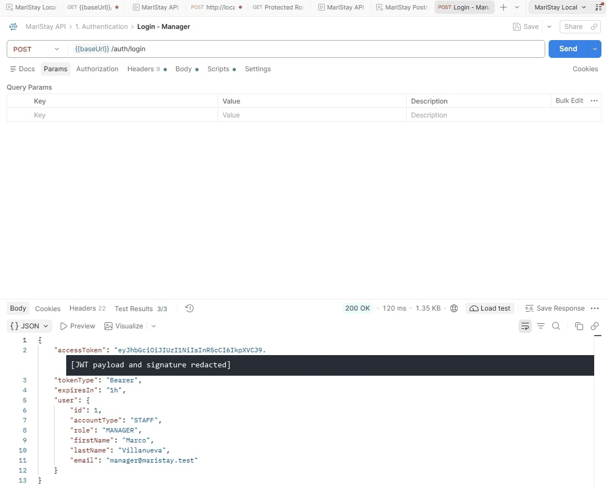\
**Figure 8.1.** *Login - Manager* (`POST /auth/login`) on port 3000 returns **200 OK** with an access token (JWT payload and signature redacted).

The response gives `tokenType: "Bearer"` and `expiresIn: "1h"`, and the user's role is `MANAGER`. The password hash is not part of the response. All three test assertions passed (Test Results 3/3).

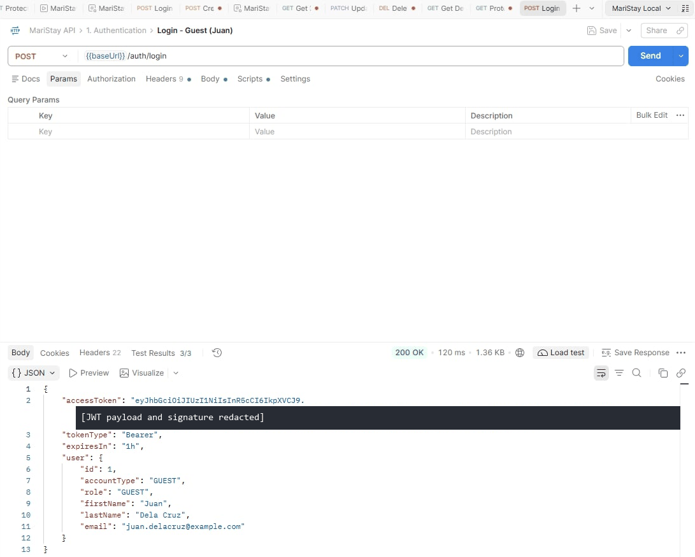\
**Figure 8.2.** *Login - Guest (Juan)* returns **200 OK** with an access token for the fictional demo guest, whose role is `GUEST` (token redacted).

This token is used for the 403 check in Figure 8.11.

### 8.7.2 Room management: full CRUD

Figures 8.3 to 8.8 follow one test room, **Room ID 13** (room number `T91562`, generated by the collection). It was created, read, updated, and is shown to be gone. The **204 response in Figure 8.9 belongs to a second, temporary room, Room ID 14**. That room was created the same way, only to capture a clean DELETE screenshot, because the DELETE response for Room 13 was not captured. Neither room still exists. A read-only query of `maristay_db` on 2026-11-26 found no room with an ID of 10 or higher and `AUTO_INCREMENT = 15`, which confirms that rooms 13 and 14 were both created and then deleted.

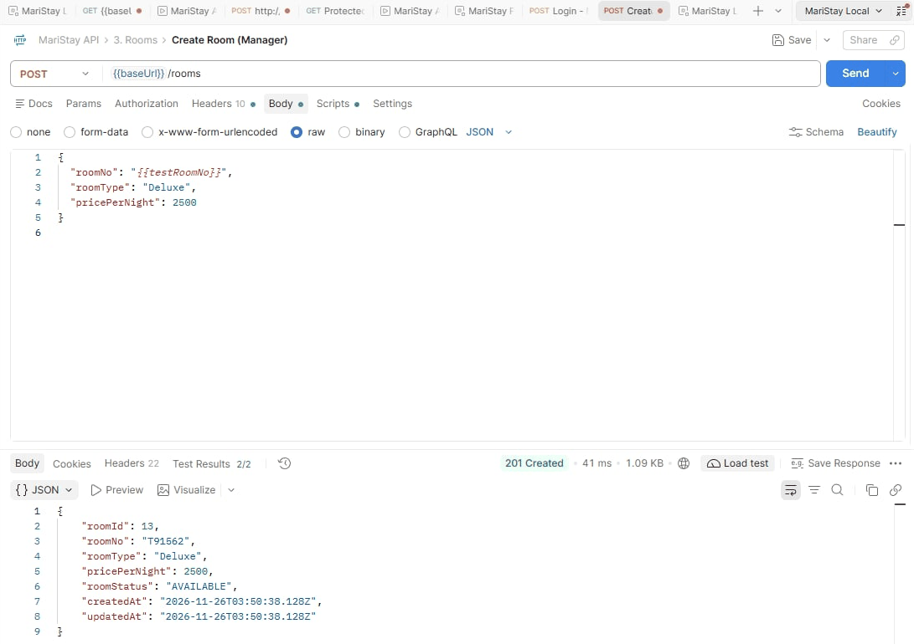\
**Figure 8.3.** *Create Room (Manager)* returns **201 Created**. The new room has `roomId: 13`, type Deluxe, `pricePerNight: 2500` and `roomStatus: "AVAILABLE"`.

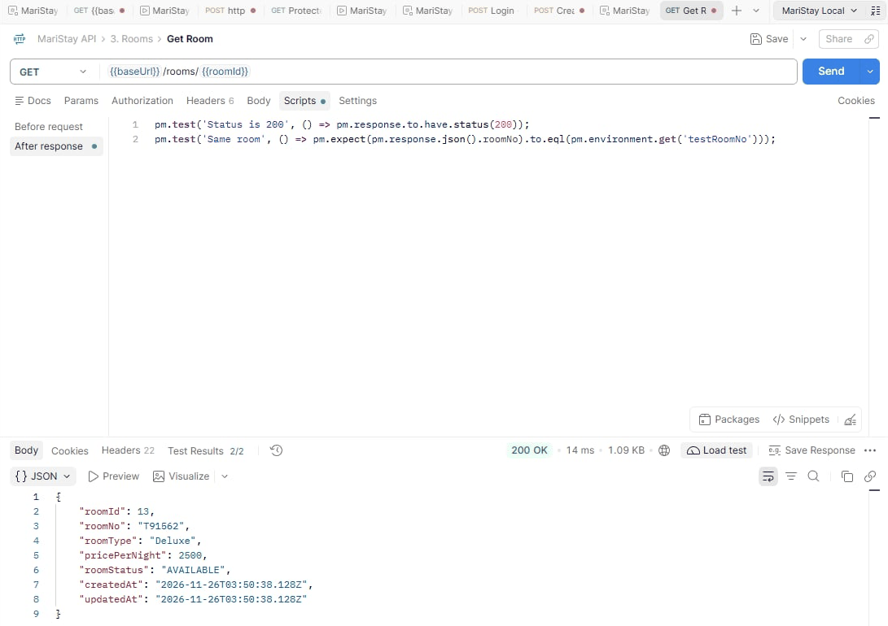\
**Figure 8.4.** *Get Room* (`GET /rooms/{{roomId}}`) returns **200 OK** with the same record, Room ID 13. The test script shown checks both the status and the room number.

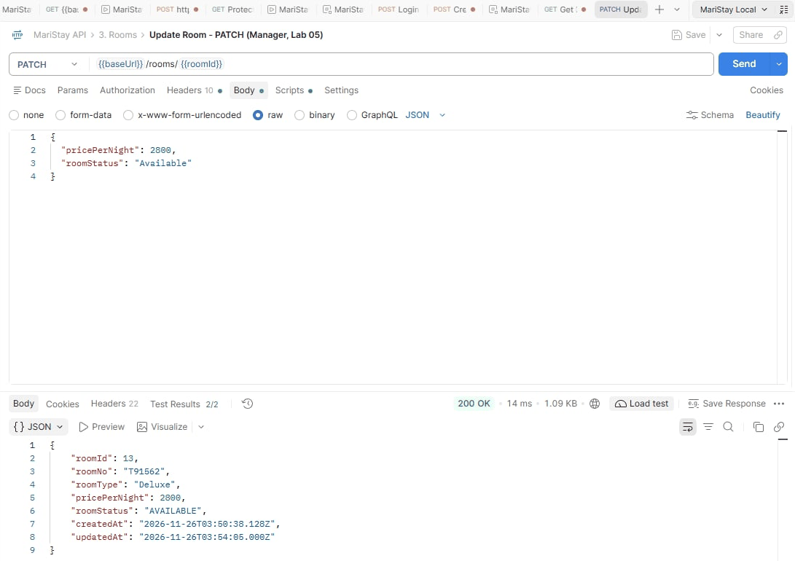\
**Figure 8.5.** *Update Room - PATCH* returns **200 OK**. `pricePerNight` changes from **2500 to 2800**, and `updatedAt` advances while `createdAt` stays the same.

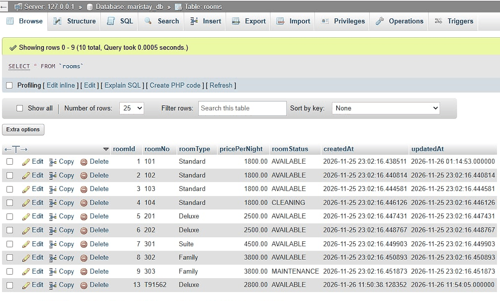\
**Figure 8.6.** phpMyAdmin, `maristay_db.rooms`, after the PATCH. Room 13 (`T91562`) is stored with **2800.00**, and the nine other rooms are not affected by these requests.

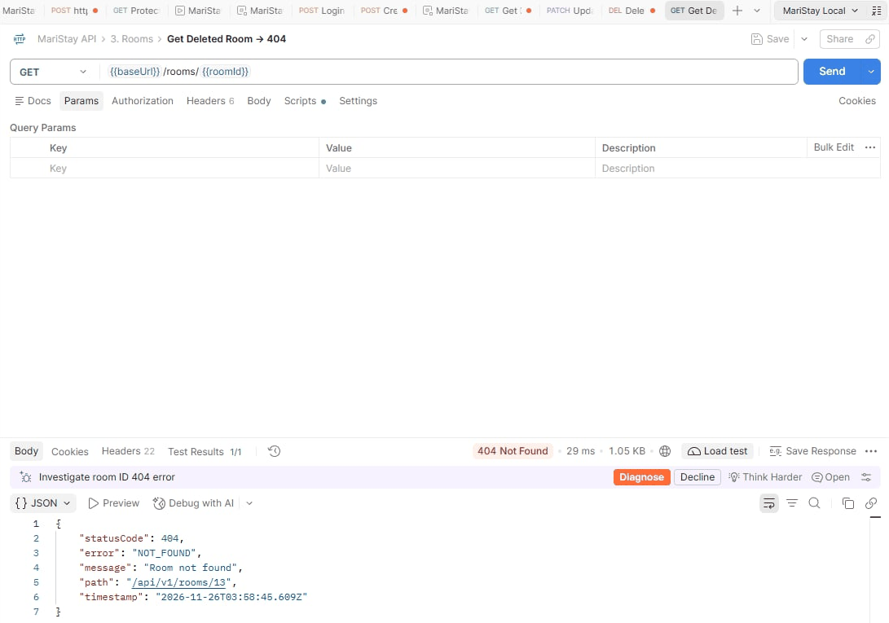\
**Figure 8.7.** *Get Deleted Room → 404* returns **404 Not Found** for `/api/v1/rooms/13`, with the standard error body ("Room not found"). The purple bar is Postman's built-in AI suggestion and is not part of the API response.

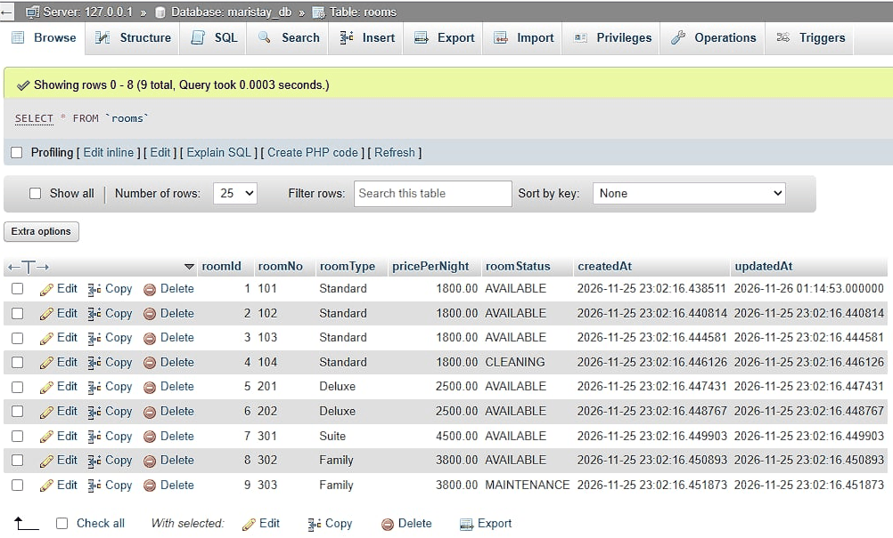\
**Figure 8.8.** phpMyAdmin, `maristay_db.rooms`, after Room 13 was deleted. Nine rows remain: the seeded rooms 101–303, none affected by these requests.

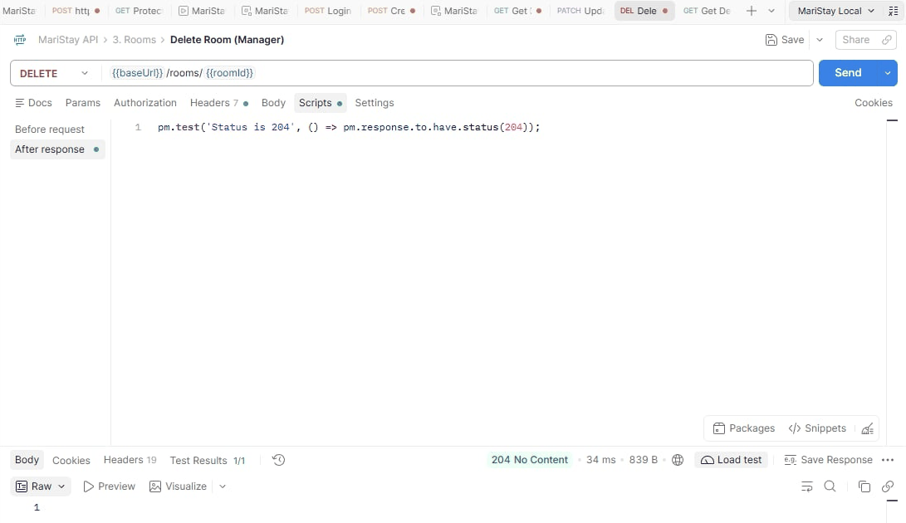\
**Figure 8.9.** *Delete Room (Manager)* returns **204 No Content**, and the test "Status is 204" passed (1/1). This request deleted the **temporary Room ID 14**, not Room 13 (see the note above).

### 8.7.3 Authorization: 401 and 403

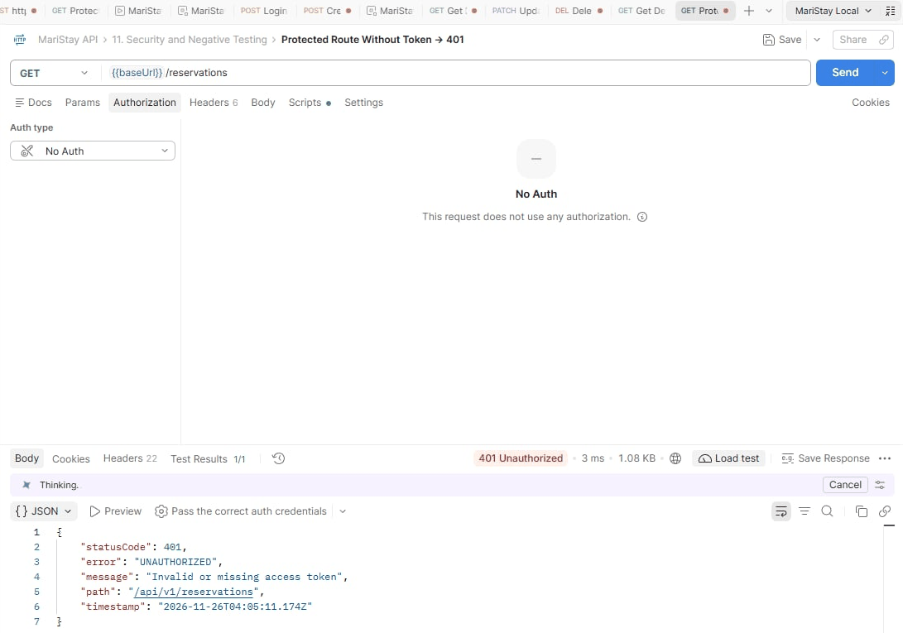\
**Figure 8.10.** *Protected Route Without Token → 401*: `GET /reservations` with Auth type **No Auth** returns **401 Unauthorized** ("Invalid or missing access token"). The global `JwtAuthGuard` rejects the request before any controller runs.

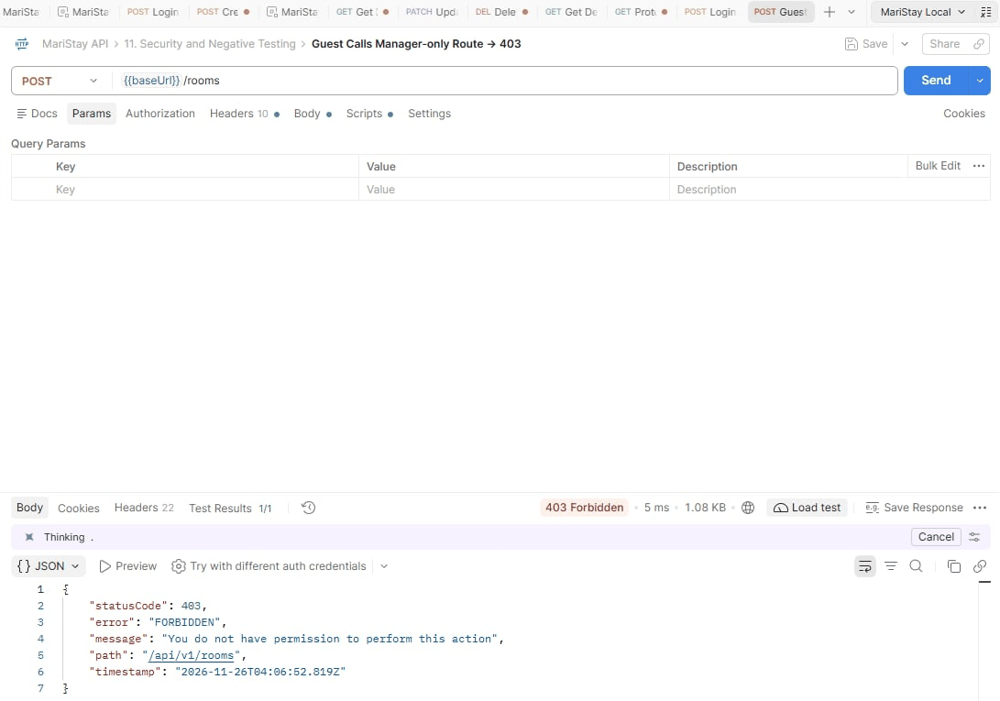\
**Figure 8.11.** *Guest Calls Manager-only Route → 403*: the guest's valid token on `POST /rooms` returns **403 Forbidden** ("You do not have permission to perform this action"). Authentication succeeded, but `RolesGuard` refused the role. No room was created.

### 8.7.4 Postman desktop Collection Runner (port 3001)

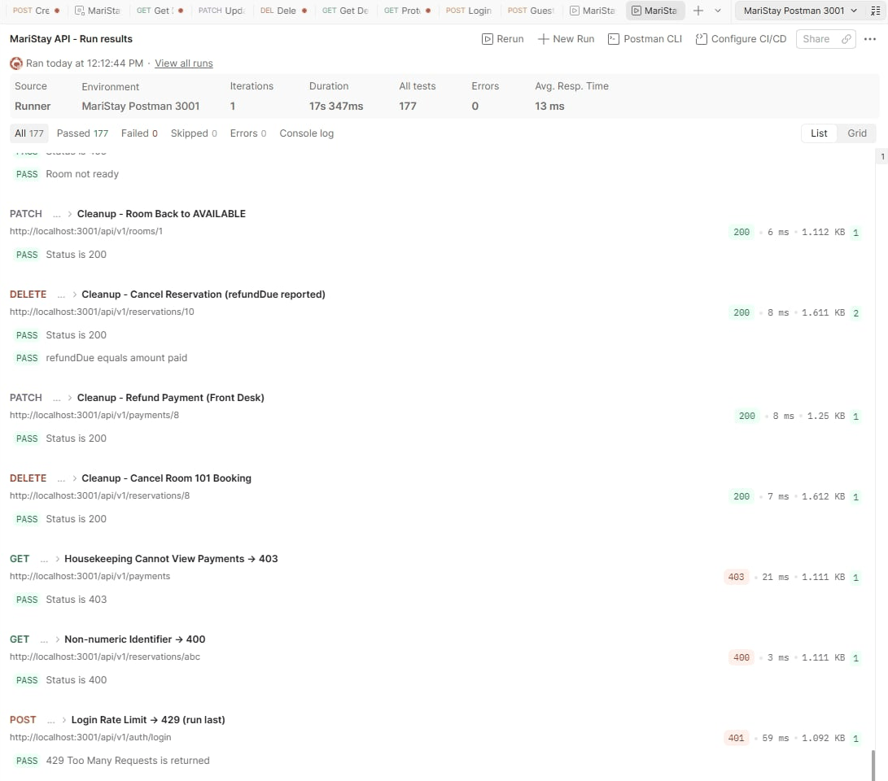\
**Figure 8.12.** Run summary of the Collection Runner, environment *MariStay Postman 3001*: **177 tests, 177 passed, 0 failed, 0 skipped, 0 errors**; duration 17 s 347 ms; average response 13 ms. The list shows the final security tests.

The last request, *Login Rate Limit → 429*, displays its own response, a 401 caused by a deliberately wrong password. Its test script then sends 11 more logins and asserts that a **429 Too Many Requests** is returned, and that assertion passed.

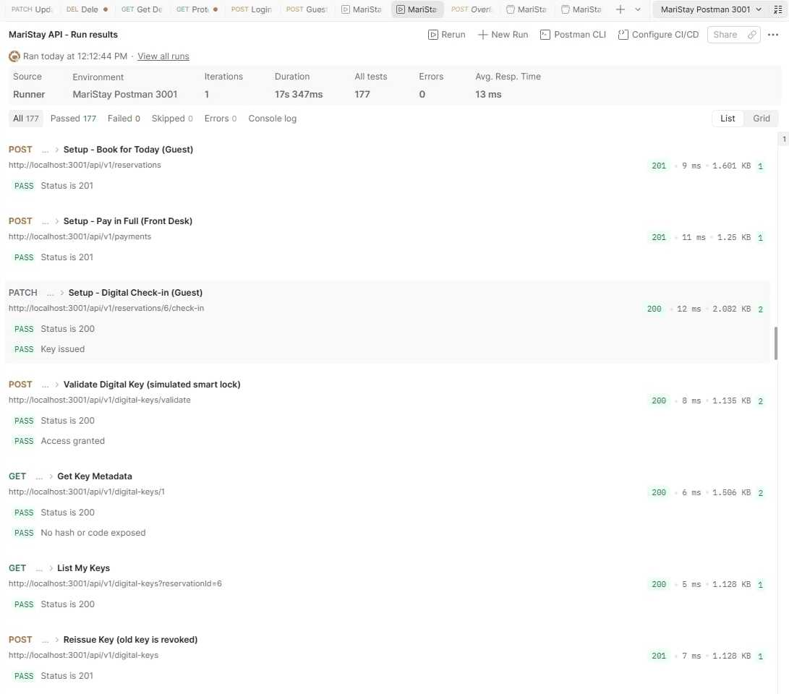\
**Figure 8.13.** The *6. Digital Keys* results from the same run:

* *Setup - Digital Check-in (Guest)* → **200**, "Key issued".
* *Validate Digital Key (simulated smart lock)* → **200**, "Access granted".
* *Get Key Metadata* → "No hash or code exposed".
* *Reissue Key* → **201**.

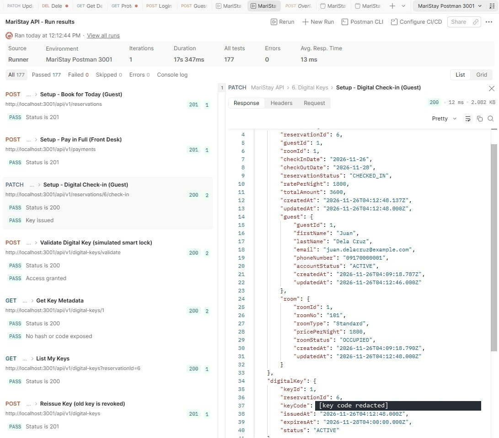\
**Figure 8.14.** The digital check-in response, opened from the Runner. Reservation 6 is `CHECKED_IN`, room 101 is `OCCUPIED`, and a `digitalKey` with `status: "ACTIVE"` expires at 12:00 on the check-out date. The plain key code, returned once at issue, is redacted here. The database stores only its SHA-256 hash.

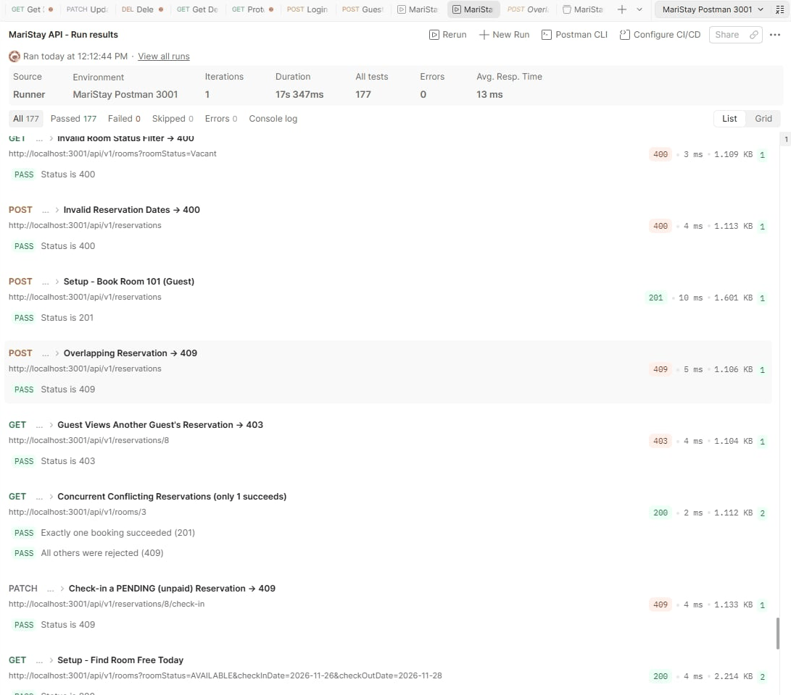\
**Figure 8.15.** *11. Security and Negative Testing* results from the same run:

* *Overlapping Reservation* → **409 Conflict**.
* *Concurrent Conflicting Reservations*: exactly one of the concurrent bookings succeeded (201) and all the others were rejected (409).
* Invalid reservation dates → 400.
* Another guest's reservation → 403.

### 8.7.5 Database state of the demonstration database

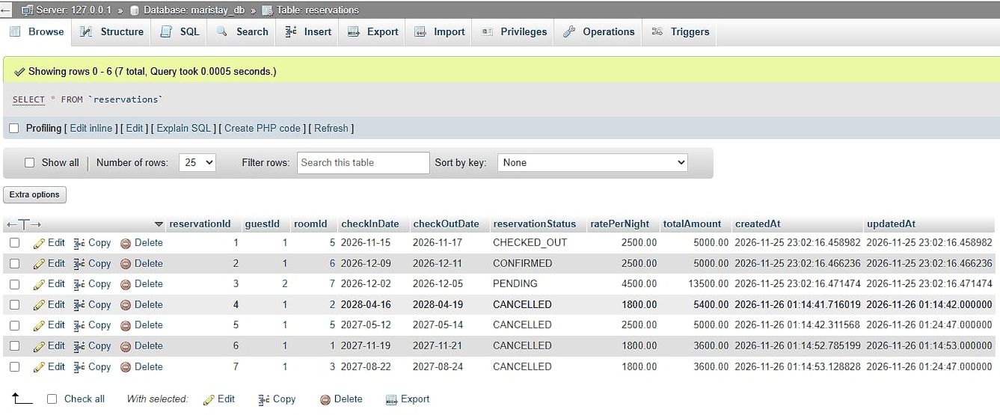\
**Figure 8.16.** phpMyAdmin, `maristay_db.reservations`. It holds the same seven rows as after the approved clean-up at 01:24:47. Rows 4–7 are cancelled test bookings from that clean-up, and no row was added afterwards. This confirms that the manual port-3000 requests in Figures 8.1–8.11 created no reservations. The overlapping-reservation test ran only on the isolated port-3001 database.

### 8.7.6 Automated test runs

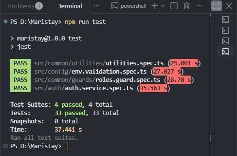\
**Figure 8.17.** `npm run test`: **4 of 4 suites, 33 of 33 tests passed** in 37.441 s.

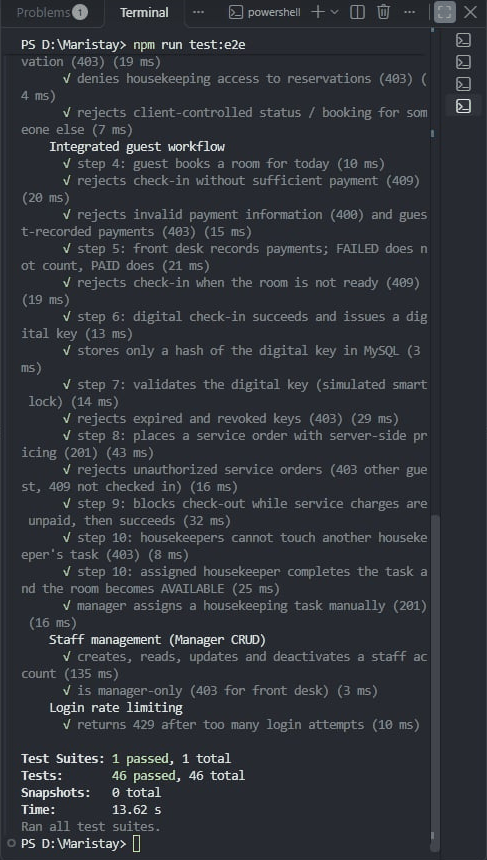\
**Figure 8.18.** `npm run test:e2e`: **46 of 46 tests passed** in 13.62 s against the isolated `maristay_test_db`. The visible part shows the integrated guest workflow, staff management and login rate-limiting tests.

**Not captured as screenshots:**

* Newman: its results are given as text in §8.6.
* The `Found 0 errors` line of `npm run start:dev`: Figure 7.1 shows the route-mapping part of the start-up log; the 0-error compile is recorded in §8.3.
* The video demonstration: pending.

## 8.8 How to reproduce

Run these in `backend/`:

```bash
npm run test            # unit tests (no database needed)
npm run test:e2e        # real MySQL-compatible test database (TEST_DB_DATABASE, default maristay_test_db)

# Full Postman collection with Newman, isolated database on port 3001
npm run postman:reset   # rebuild maristay_postman_db only
npm run postman:start   # terminal 1: API on http://localhost:3001/api/v1
npm install --no-save newman
npm run postman:newman  # terminal 2
npm run security:check  # terminal 2: 126 security and role-access checks
```

## 8.9 Final regression and Oracle MySQL verification (2026-11-27)

Run after the functional scope was frozen. Every run used an isolated database; `maristay_db` was only read (schema comparison), never written. No code was changed by this verification.

### Final regression (MariaDB 10.4.32)

| Check | Command / database | Result |
|---|---|---|
| Backend production build | `nest build -p tsconfig.postman.json` (same compiler options as `npm run build`, output `dist-postman/`) | ✔ 0 errors |
| Frontend production build | `cd frontend && npm run build` (tsc + Vite) | ✔ |
| Unit tests | `npm run test` | ✔ **33/33**, 4/4 suites, 10.1 s |
| End-to-end tests | `npm run test:e2e` → `maristay_test_db` | ✔ **46/46**, 9.1 s |
| Postman collection | `npm run postman:reset`, `postman:start`, `postman:newman` → `maristay_postman_db`, port 3001 | ✔ **177/177** assertions, 137 requests, 0 failures, 12 s, avg 10 ms |
| Browser integration test | `frontend/tests/ui-e2e.mjs` (Microsoft Edge) → fresh `maristay_postman_db` | ✔ **37/37** |
| Guest registration API + database | `npm run verify:registration` | ✔ **49/49** |
| Security and RBAC matrix | one-off script, isolated API | ✔ **126/126** (below) |
| Integrated hotel workflow | Newman folder 10, e2e steps 1–10, browser test | ✔ booking → payment → automatic confirmation → check-in with key → smart lock → service order → check-out blocked by balance → payment → check-out (keys revoked, cleaning task) → housekeeping completes → room available |

**Security and RBAC matrix (126 checks).**
* Each role's login returns a JWT carrying that role.
* 21 representative endpoints × {no token, GUEST, FRONT_DESK, HOUSEKEEPING, MANAGER}: 401 without a token, 403 for roles that are not allowed, and the guard passes for allowed roles. Allowed write calls used invalid bodies (400) or nonexistent ids (404), so no data changed.
* Tokens rejected with 401: a guest token with its role edited to MANAGER (bad signature), `alg: none`, a garbage token, a correctly signed but expired token, and a token signed with another secret.
* Ownership: a guest cannot read another guest's profile (403), and a guest's reservation list contains only their own reservations.
* No `passwordHash` or `keyCodeHash` in the staff, guest, key or `/auth/me` responses.
* `' OR 1=1 -- ` in a search is treated as text (0 rows).
* An extra `reservationStatus` field in a booking is rejected (400).
* Helmet headers: `nosniff`, CSP, no `X-Powered-By`.
* CORS allows only the configured origin.
* Error bodies contain no stack trace.

### Oracle MySQL 8.4.11 LTS

A temporary, portable MySQL Community Server 8.4.11 LTS ran on `127.0.0.1:3307`, with its own data folder in a temporary directory. The binaries were verified as signed by Oracle America, Inc. It was stopped and removed afterwards. Only environment variables pointed MariStay at it.

| Check | Result |
|---|---|
| `npm run db:setup` (create, migrate, seed) → `maristay_mysql8_db` | ✔ |
| `npm run schema:check` | ✔ schema up to date |
| Schema vs MariaDB `maristay_db` (`information_schema`) | ✔ identical: 9 tables, 67 columns (64 application), 7 FKs, 17 CHECKs, 13 unique indexes |
| `npm run test:e2e` → `maristay_mysql8_test` | ✔ **46/46**, 19.8 s |
| Newman, API on port 3001 backed by MySQL → `maristay_mysql8_postman` | ✔ **177/177** assertions, 137 requests, 19.7 s, avg 47 ms |
| `database/maristay.sql` import (copy without `CREATE DATABASE`/`USE`) → `maristay_mysql8_import` | ✔ imported; deprecation warnings only |
| Constraints on imported data | ✔ FK 1451/1452, CHECK 3819, UNIQUE 1062 enforced |

The only difference is cosmetic: foreign keys imported from the MariaDB dump show `ON DELETE NO ACTION` instead of `RESTRICT`, which InnoDB treats identically (Compliance Checklist §6).

### Documentation checks

* **ERD:** the Mermaid ERD in `DATABASE_DESIGN.md` was parsed and compared with `information_schema`. All 8 tables, 64 columns, data types, PK/FK/UK markers and 7 relationships match.
* **API documentation:** the endpoint table covers all 44 operations reported by Swagger (`/api/docs-json`, 9 tags), checked before Swagger was removed. After the removal, the start-up log maps the same 44 routes (§8.11).

### Frontend screenshots

37 screenshots of all four roles were captured on the isolated database into `docs/screenshots/frontend/`, with key codes masked (`docs/FRONTEND.md` §9).

### Reproduce the additional checks

```bash
cd backend && npm run verify:registration           # isolated API on port 3001 (postman:start)
cd ../frontend && node --env-file=../backend/.env tests/ui-e2e.mjs
```

## 8.10 Frontend verification after the UI redesign (2026-11-27)

The React frontend was restyled (Modern Luxury Minimalist) after the functional scope was frozen. No backend file, route, API call or test assertion changed. Results on a freshly reset `maristay_postman_db` with the final UI:

| Check | Result |
|---|---|
| Frontend production build (`npm run build`) | ✔ |
| Browser integration test (`frontend/tests/ui-e2e.mjs`) | ✔ **37/37**. A first run had 32/37: a required-field asterisk had been placed inside the sign-up labels, which changed their text. The asterisk was moved outside the labels; the test was not changed |
| `npm run verify:registration` | ✔ **49/49** |
| Responsive and accessibility audit (Microsoft Edge, 1440 / 1280 / 768 / 390 px, every screen of all four roles, plus the Add room dialog) | ✔ **331** checks, 0 findings, 0 console errors |
| Main configuration (read-only) | ✔ the main frontend calls the API on port 3000, which is connected to `maristay_db` (confirmed by comparing record timestamps); manager login shows live data |

### Result history

| Suite | Earlier | Latest (2026-11-27) |
|---|---|---|
| Unit tests | 33/33 (2026-11-25/26) | 33/33 (final regression, §8.9) |
| E2E tests, MariaDB | 46/46 (2026-11-25/26) | 46/46 (§8.9) |
| E2E tests, Oracle MySQL 8.4.11 | — | 46/46 (§8.9) |
| Postman / Newman | 177/177 × 3 Newman + 1 desktop Runner (2026-11-26) | 177/177 on MariaDB and 177/177 on MySQL 8.4 (§8.9) |
| Browser UI test | 30/30 (before sign-up) | 37/37 (after the UI redesign, §8.10) |
| Registration checks | 49/49 (when sign-up was added) | 49/49 (after the UI redesign) |
| Security / RBAC matrix | — | 126/126 (§8.9) |

## 8.11 Swagger UI removal and regression (2026-11-27)

The ITEC 116 guidelines name Postman as the required API testing tool, so Swagger UI was removed. Only documentation tooling changed:
* `@nestjs/swagger`, its Nest CLI plugin, the `/api/docs` setup, the start-up log line and 193 `@Api…` decorators were removed. Each endpoint's summary is kept as a one-line code comment.
* The update DTOs now import `PartialType`/`OmitType` from `@nestjs/mapped-types`, the official package Swagger re-exported. It copies the same class-validator rules.
* Helmet now uses its defaults in every environment. The development-only CSP exception existed only for Swagger's HTML page.

No endpoint, DTO rule, guard, role, business rule, database object or frontend file changed. Results, on isolated databases only:

| Check | Result |
|---|---|
| TypeScript (`src` + `test`) and `nest build` | ✔ 0 errors |
| `npm run start:dev` (isolated database, port 3101) | ✔ "Found 0 errors", **44 routes mapped**, application started; no Swagger log line; `/api/docs` and `/api/docs-json` return 404 |
| Unit tests | ✔ **33/33** |
| End-to-end tests (`maristay_test_db`) | ✔ **46/46** |
| Postman collection with Newman (fresh `maristay_postman_db`, port 3001) | ✔ **177/177** assertions, 137 requests, 0 failures |
| Browser integration test (fresh database) | ✔ **37/37** |
| `npm run verify:registration` | ✔ **49/49** |
| Security and RBAC matrix | ✔ **126/126** (Helmet CSP, `nosniff`, no `X-Powered-By`, CORS) |


## 8.12 Repository restructure and regression (2026-11-28)

The repository was reorganized into `backend/` (NestJS source, tests, scripts and configuration), `database/` (`maristay.sql`), `postman/` (collection and environment), `frontend/` and `docs/`. Files were moved with `git mv`; every file in `backend/src/` and `backend/test/` is a pure rename with unchanged content, and the SQL export and Postman files are byte-identical. Only paths in scripts, documentation and the README changed. No endpoint, DTO rule, guard, role, business rule or frontend behaviour changed, and `maristay_db` was not written (table checksums identical before and after).

| Check | Result |
|---|---|
| `npm run build` (in `backend/`) | ✔ 0 errors |
| `npm run start:dev` | ✔ "Found 0 errors", **44 routes mapped**; `/api/docs` and `/api/docs-json` return 404 |
| Unit tests | ✔ **33/33** |
| End-to-end tests (`maristay_test_db`) | ✔ **46/46** |
| Postman collection with Newman (fresh `maristay_postman_db`, port 3001) | ✔ **177/177** assertions, 137 requests, 0 failures; all 44 mapped routes are called |
| Frontend production build | ✔ |
| Browser integration test (fresh database) | ✔ **37/37** |
| `npm run verify:registration` (fresh database) | ✔ **49/49** |
| Security and RBAC matrix (`npm run security:check`) | ✔ **126/126** |
| Fresh clone following the README (new `.env` from `.env.example`, new scratch database) | ✔ `npm ci`, `db:setup`, build, start-up with 44 routes, unit 33/33, e2e 46/46, frontend `npm ci` and build |
| Git ignore and credentials | ✔ `backend/.env`, `postman/tmp/` and Postman workspace files ignored; no `.env` value, JWT or key code in the 240 tracked files |

Total: **468/468** checks passed, the same as the previous baseline.
