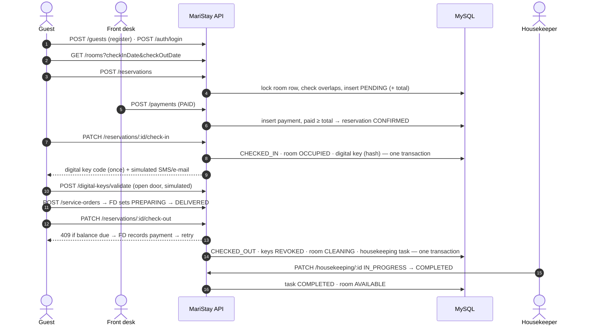

# System Analysis

## 2.1 Existing problems

| Problem (Lab 03) | Effect | MariStay response |
|---|---|---|
| Long queues at check-in and check-out | Guests wait; front desk overloaded | Digital check-in/check-out endpoints that guests call themselves |
| Delayed room cleaning / availability updates | Rooms stay empty or are given out dirty | Check-out automatically creates a housekeeping task; completing it sets the room AVAILABLE |
| Manual reservation management | Double bookings, lost bookings | Reservations stored in MySQL with overlap prevention and row locking |
| Manual room-service tracking | Orders forgotten, charges missed | Service orders with status workflow; delivered orders are billed at check-out |
| Poor guest–staff communication | Guests not informed | Simulated SMS/e-mail notifications at check-in, check-out and delivery |
| Fragmented information across departments | No single view of a stay | One database: reservation links guest, room, payments, keys and orders |

## 2.2 Functional requirements

| ID | Requirement | Endpoint(s) |
|---|---|---|
| FR1 | Guests can register with a password; duplicate emails are rejected | `POST /guests` |
| FR2 | Guests and staff can log in and receive a JWT | `POST /auth/login`, `GET /auth/me` |
| FR3 | Anyone can view and filter rooms, including availability for dates | `GET /rooms`, `GET /rooms/:id` |
| FR4 | Managers can create, update (PATCH/PUT) and delete rooms | `POST/PATCH/PUT/DELETE /rooms` |
| FR5 | Guests can book, view, change and cancel their reservations | `/reservations` |
| FR6 | Overlapping reservations for the same room are rejected | `POST/PATCH /reservations` |
| FR7 | Front desk can confirm reservations and record/verify payments | `PATCH /reservations/:id/confirm`, `/payments` |
| FR8 | Fully paid reservations are confirmed automatically | `POST/PATCH /payments` |
| FR9 | Guests can check in digitally when eligible and receive a digital key | `PATCH /reservations/:id/check-in` |
| FR10 | Digital keys can be validated (simulated lock), reissued and revoked | `/digital-keys` |
| FR11 | Checked-in guests can order food, amenities and services | `/service-orders` |
| FR12 | Guests can check out when their balance is settled; keys are revoked and the room goes to cleaning | `PATCH /reservations/:id/check-out` |
| FR13 | Housekeepers see and update only their own tasks; completion releases the room | `/housekeeping` |
| FR14 | Managers manage staff accounts and housekeeping assignments | `/staff`, `POST /housekeeping` |
| FR15 | Guests can view their reservation history, payments, keys and orders | nested and filtered GET endpoints |

## 2.3 Non-functional requirements

| Category | Requirement | How it is met |
|---|---|---|
| Security | Passwords hashed; JWT on protected routes; RBAC; ownership; validation; rate limiting; no secrets in code | §6 Authentication and Security |
| Integrity | No double bookings; multi-table changes are atomic; history never cascade-deleted | Transactions, row locks, FK RESTRICT, CHECK constraints |
| Reliability | Consistent error format; correct status codes; never 200 on failure | Global exception filter |
| Maintainability | Modular structure, layered controller/service/repository code, typed DTOs, comments on business rules | NestJS modules, TypeScript |
| Usability (API) | RESTful URIs, versioning, pagination, case-insensitive filters, Swagger docs, Postman collection | §5 REST API |
| Performance | Indexed lookups for availability, status filters and FKs; pagination (≤100 per page) | §4 Database |
| Portability | Runs on any machine with Node.js and MySQL; configuration via `.env` | README |
| Testability | Automated unit + e2e tests on an isolated database | §8 Testing |

## 2.4 User roles

| Role | Created by | Main permissions |
|---|---|---|
| GUEST | Public registration | Own profile, reservations, payments (read), keys, service orders |
| FRONT_DESK | Manager | Guests, reservations, confirmations, payments, keys, service orders, check-in/out assistance |
| HOUSEKEEPING | Manager | Own cleaning tasks only |
| MANAGER | Manager (seeded first manager) | Everything, plus rooms, staff and housekeeping assignment |

## 2.5 Business processes

### Guest stay (end-to-end)

### Reservation business rules
1. Dates are calendar days in a half-open range `[checkIn, checkOut)`: a guest may check out on the same day the next guest checks in.
2. Check-in date cannot be in the past; check-out must be after check-in; maximum 30 nights.
3. A room is unavailable for a range if any PENDING, CONFIRMED or CHECKED_IN reservation overlaps it. `roomStatus` (the room's current condition) is **not** used to block future dates, except that MAINTENANCE rooms cannot be booked.
4. The nightly rate is copied into the reservation at booking time.

### Payment process
Front desk records payments (CASH, CARD, E_WALLET). Only PAID payments count; FAILED and REFUNDED never do. A PAID amount cannot exceed the outstanding balance. When the paid total reaches the room total, the reservation becomes CONFIRMED automatically. Refunds are allowed for cancelled reservations or overpayments.

### Check-in policy
Allowed for the reservation owner or front desk/manager when: the reservation is CONFIRMED; today is on or after the check-in date and before the check-out date; the room total is fully paid; the room is AVAILABLE.

### Check-out policy
Open service orders (PENDING/PREPARING) are cancelled; delivered orders are added to the bill. The balance (room total + delivered orders − paid) must be zero. Keys are revoked, the room goes to CLEANING and a housekeeping task is assigned to the active housekeeper with the fewest open tasks.

### Housekeeping process
Tasks move PENDING → IN_PROGRESS → COMPLETED (no skipping, no going back). Only the assigned housekeeper (or a manager) can update a task. When the last open task of a CLEANING room is completed, the room becomes AVAILABLE.
