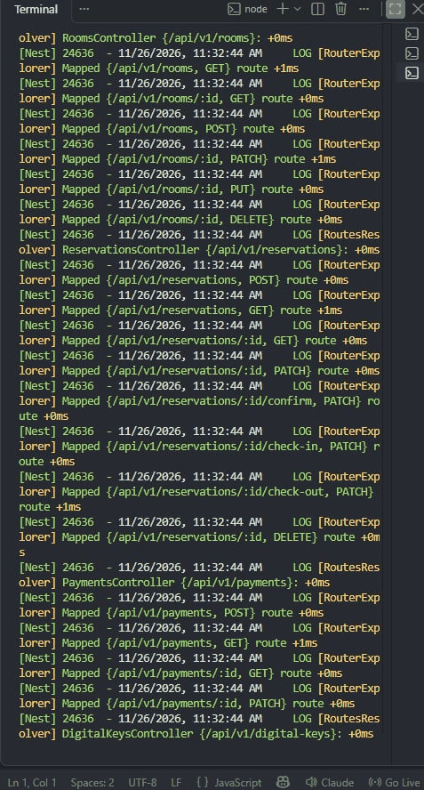

# Backend Implementation

## 7.1 Technology and project structure

| Component | Version / package |
|---|---|
| Runtime | Node.js 24, TypeScript 5.8 |
| Framework | NestJS 11.2 (`@nestjs/common`, `core`, `platform-express`) |
| ORM / driver | TypeORM 0.3.31 + `mysql2` 3 (`@nestjs/typeorm` 11) |
| Database | MySQL protocol — XAMPP MariaDB 10.4.32 locally; also verified on Oracle MySQL 8.4.11 LTS |
| Auth | `@nestjs/jwt` 11, `@nestjs/passport` 11, `passport-jwt` 4, `bcrypt` 6 |
| Validation | `class-validator` 0.14, `class-transformer` 0.5 |
| Security | `helmet` 8, `@nestjs/throttler` 6 |
| Tests | Jest 29, Supertest 7, Postman / Newman |

The repository root has five folders: `backend/` (the NestJS application below, with its `package.json`, tests and utility scripts), `database/` (`maristay.sql`), `postman/` (collection and environment), `frontend/` (optional React client) and `docs/`.

```text
backend/src/
├── auth/            login, JWT strategy, JwtAuthGuard, IdentityService, rate-limit config
├── guests/          GuestsModule (controller, service, entity, DTOs)
├── rooms/           RoomsModule
├── reservations/    ReservationsModule + StayService (check-in / check-out)
├── payments/        PaymentsModule + BillingService
├── digital-keys/    DigitalKeysModule (issue/revoke helpers + API service)
├── housekeeping/    HousekeepingModule (+ automatic assignment service)
├── staff/           StaffModule
├── service-orders/  ServiceOrdersModule + server-side service catalog
├── notifications/   simulated SMS / e-mail adapter
├── common/          enums, decorators, RolesGuard, exception filter, pipes, validators, utilities
├── config/          environment validation
├── database/        connection options, migration, seed, CLI data source, db:create
├── app.module.ts    root module (imports + global guards)
├── app.setup.ts     global HTTP pipeline (prefix, Helmet, CORS, validation, serializer, filter)
└── main.ts          bootstrap
backend/test/        e2e tests (Supertest) + isolated test-database setup
backend/scripts/     Postman instance, registration check, documentation and slide builders
```

## 7.2 NestJS modules

Each functional module follows the same pattern — **module** (wiring), **controller** (HTTP), **service** (business logic), **entity** (table), **DTOs** (input contracts):

| Module | Controller routes | Service highlights |
|---|---|---|
| AuthModule | `/auth/login`, `/auth/me` | bcrypt compare, JWT signing, per-request account reload |
| GuestsModule | `/guests` (6 routes) | registration, cross-table email check, deactivation guard |
| RoomsModule | `/rooms` (6 routes) | availability query (`NOT EXISTS` overlap), history-safe delete |
| ReservationsModule | `/reservations` (8 routes) | locked booking transaction, confirm, cancel, StayService check-in/out |
| PaymentsModule | `/payments` (4 routes) | balance validation, status transitions, auto-confirmation |
| DigitalKeysModule | `/digital-keys` (5 routes) | random key + SHA-256 hash, validation rules, revoke |
| HousekeepingModule | `/housekeeping` (4 routes) | least-loaded assignment, strict transitions, room release |
| StaffModule | `/staff` (5 routes) | manager-only CRUD, self-lockout and open-task guards |
| ServiceOrdersModule | `/service-orders` (4 routes) | catalog pricing, status workflow, guest cancellation |

## 7.3 Controller layer

Controllers only translate HTTP into a service call. Example — the room endpoints used in the video demo ([`rooms.controller.ts`](../../backend/src/rooms/rooms.controller.ts)):

```typescript
@Controller('rooms')
export class RoomsController {
  constructor(private readonly roomsService: RoomsService) {}   // dependency injection

  @Public()                                   // no token needed (Lab 05: public)
  @Get()
  findAll(@Query() query: RoomQueryDto) {     // query string validated by RoomQueryDto
    return this.roomsService.findAll(query);
  }

  @Roles(Role.MANAGER)                        // RolesGuard → 403 for other roles
  @Patch(':id')
  update(@Param('id', ParseIdPipe) id: number, @Body() dto: UpdateRoomDto) {
    return this.roomsService.update(id, dto); // returns the updated Room → 200 + JSON
  }

  @Roles(Role.MANAGER)
  @Delete(':id')
  @HttpCode(HttpStatus.NO_CONTENT)            // 204
  async remove(@Param('id', ParseIdPipe) id: number) {
    await this.roomsService.remove(id);
  }
}
```

## 7.4 Service layer

Services hold the rules. Example ([`rooms.service.ts`](../../backend/src/rooms/rooms.service.ts)):

```typescript
async update(roomId: number, dto: UpdateRoomDto): Promise<Room> {
  const room = await this.findOne(roomId);               // 404 if missing
  return this.applyChanges(room, dto);
}

private async applyChanges(room: Room, dto: UpdateRoomDto): Promise<Room> {
  if (dto.roomNo !== undefined && dto.roomNo !== room.roomNo) {
    await this.assertRoomNoAvailable(dto.roomNo);         // 409 duplicate room number
    room.roomNo = dto.roomNo;
  }
  if (dto.roomStatus !== undefined && dto.roomStatus !== room.roomStatus) {
    if (room.roomStatus === RoomStatus.OCCUPIED) {
      throw new ConflictException('Room is occupied by a checked-in guest; its status changes at check-out');
    }
    room.roomStatus = dto.roomStatus;
  }
  if (dto.roomType !== undefined) room.roomType = dto.roomType;
  if (dto.pricePerNight !== undefined) room.pricePerNight = dto.pricePerNight;
  return this.rooms.save(room);                           // Repository → UPDATE rooms …
}
```

## 7.5 TypeORM repository layer

Services receive repositories through dependency injection (`@InjectRepository(Room) private readonly rooms: Repository<Room>`). Simple reads use `findOneBy`/`findAndCount`; filters use the QueryBuilder with **bound parameters**:

```typescript
qb.andWhere('room.roomStatus <> :maintenance', { maintenance: RoomStatus.MAINTENANCE }).andWhere(
  `NOT EXISTS (
     SELECT 1 FROM reservations r
     WHERE r.roomId = room.roomId
       AND r.reservationStatus IN (:...active)
       AND r.checkInDate < :checkOutDate
       AND r.checkOutDate > :checkInDate)`,
  { active: ACTIVE_RESERVATION_STATUSES, checkInDate: query.checkInDate, checkOutDate: query.checkOutDate },
);
```

Inside workflows the service uses the transaction's `EntityManager` (`em`) so that every write belongs to the same transaction.

## 7.6 Entity implementation

Entities map classes to tables. Example — `Reservation` with both sides of its relationships ([`reservation.entity.ts`](../../backend/src/reservations/entities/reservation.entity.ts)):

```typescript
@Entity({ name: 'reservations' })
@Index('IDX_reservations_room_dates', ['roomId', 'checkInDate', 'checkOutDate'])
export class Reservation {
  @PrimaryGeneratedColumn({ name: 'reservationId', type: 'int' })
  reservationId!: number;

  @Column({ type: 'int' }) guestId!: number;
  @Column({ type: 'int' }) roomId!: number;
  @Column({ type: 'date' }) checkInDate!: string;
  @Column({ type: 'date' }) checkOutDate!: string;
  @Column({ type: 'varchar', length: 20, default: ReservationStatus.PENDING })
  reservationStatus!: ReservationStatus;
  @Column({ type: 'decimal', precision: 10, scale: 2, transformer: decimalTransformer })
  totalAmount!: number;
  // …ratePerNight, createdAt, updatedAt

  @ManyToOne(() => Guest, (guest) => guest.reservations, { onDelete: 'RESTRICT', onUpdate: 'CASCADE' })
  @JoinColumn({ name: 'guestId', foreignKeyConstraintName: 'FK_reservations_guest' })
  guest?: Guest;

  @ManyToOne(() => Room, (room) => room.reservations, { onDelete: 'RESTRICT', onUpdate: 'CASCADE' })
  @JoinColumn({ name: 'roomId', foreignKeyConstraintName: 'FK_reservations_room' })
  room?: Room;

  @OneToMany(() => Payment, (payment) => payment.reservation) payments?: Payment[];
  @OneToMany(() => DigitalKey, (key) => key.reservation) digitalKeys?: DigitalKey[];
  @OneToMany(() => ServiceOrder, (order) => order.reservation) serviceOrders?: ServiceOrder[];
}
```

Sensitive columns are protected in the entity itself:

```typescript
@Exclude()                                                    // never serialized to JSON
@Column({ type: 'varchar', length: 255, select: false })      // never loaded unless asked
passwordHash!: string;
```

## 7.7 Database connection

One function builds the connection options from environment variables and is shared by the app, the TypeORM CLI, the seed script and the tests ([`database.config.ts`](../../backend/src/database/database.config.ts)):

```typescript
export function buildDataSourceOptions(env = process.env, databaseOverride?: string): DataSourceOptions {
  return {
    type: 'mysql',                       // mysql2 driver
    host: required(env, 'DB_HOST'),
    port: Number(env.DB_PORT ?? 3306),
    username: required(env, 'DB_USERNAME'),
    password: env.DB_PASSWORD ?? '',
    database: databaseOverride ?? required(env, 'DB_DATABASE'),
    entities: ENTITIES,                  // the 8 entity classes
    migrations: MIGRATIONS,
    synchronize: false,                  // schema changes only via migrations
    timezone: 'local',
    dateStrings: ['DATE'],
  };
}
```

`AppModule` registers it with `TypeOrmModule.forRootAsync(...)`, and the app refuses to start if any required variable is missing or the JWT secret is weak.

**Figure 7.1.** Part of the `npm run start:dev` log on 2026-11-26 (process 24636, 11:32:44 AM). NestJS's `RoutesResolver` and `RouterExplorer` map the *Rooms*, *Reservations* and *Payments* routes under `/api/v1`, including PATCH/PUT/DELETE `/rooms/:id` and the reservation `confirm`, `check-in` and `check-out` actions. The routes are mapped only after the database connection succeeds. The whole log maps 44 routes; the 0-error compile is recorded in §8.3.

## 7.8 Important business logic

### Preventing double bookings ([`reservations.service.ts`](../../backend/src/reservations/reservations.service.ts))

```typescript
const reservationId = await this.dataSource.transaction('READ COMMITTED', async (em) => {
  const guest = await em.findOneBy(Guest, { guestId });
  // …404 / inactive checks
  const room = await em.findOne(Room, { where: { roomId: dto.roomId }, lock: { mode: 'pessimistic_write' } });
  //            ^ SELECT … FOR UPDATE: a second booking for this room waits here
  if (room.roomStatus === RoomStatus.MAINTENANCE) throw new ConflictException('Room is under maintenance …');
  await this.assertNoOverlap(em, room.roomId, dto.checkInDate, dto.checkOutDate);  // 409 if overlap
  const nights = nightsBetween(dto.checkInDate, dto.checkOutDate);
  const reservation = em.create(Reservation, {
    guestId, roomId: room.roomId, checkInDate: dto.checkInDate, checkOutDate: dto.checkOutDate,
    reservationStatus: ReservationStatus.PENDING,
    ratePerNight: room.pricePerNight,                                   // price snapshot
    totalAmount: fromCents(toCents(room.pricePerNight) * nights),
  });
  return (await em.save(reservation)).reservationId;
});
```
Why it works: both competing requests try to lock the same room row; the second waits until the first commits, then (because of `READ COMMITTED`) its overlap query sees the new reservation and returns 409. Verified with 6 simultaneous requests: one 201, five 409.

### Digital check-in ([`stay.service.ts`](../../backend/src/reservations/stay.service.ts))

```typescript
const issued = await this.dataSource.transaction(BOOKING_ISOLATION, async (em) => {
  const reservation = await this.lockReservation(em, reservationId);
  assertGuestOwnerOrStaff(user, reservation.guestId);                 // 403 for other guests
  // status must be CONFIRMED; today within [checkInDate, checkOutDate)   → 409 otherwise
  const summary = await this.billing.summarize(em, reservation);
  if (toCents(summary.paidTotal) < toCents(summary.roomTotal)) throw new ConflictException('Payment required …');
  const room = await em.findOne(Room, { where: { roomId: reservation.roomId }, lock: { mode: 'pessimistic_write' } });
  if (room.roomStatus !== RoomStatus.AVAILABLE) throw new ConflictException(`Room ${room.roomNo} is not ready …`);

  await em.update(Reservation, { reservationId }, { reservationStatus: ReservationStatus.CHECKED_IN });
  await em.update(Room, { roomId: room.roomId }, { roomStatus: RoomStatus.OCCUPIED });
  return this.digitalKeys.issueKey(em, reservation);                   // stores only the hash
});
// after commit: simulated SMS + e-mail, response includes the key code once
```

### Digital check-out
In one transaction: cancel open service orders → compute balance (409 if anything is due) → reservation CHECKED_OUT → revoke active keys → room CLEANING → `HousekeepingAssignmentService.assignCleaning()` picks the active housekeeper with the fewest open tasks. If any step throws, **everything** rolls back.

### Digital keys
```typescript
export function generateDigitalKeyCode(): string {
  return `MSK-${randomBytes(32).toString('base64url')}`;       // 256 bits of randomness
}
export function hashDigitalKeyCode(code: string): string {
  return createHash('sha256').update(code, 'utf8').digest('hex'); // what is stored in MySQL
}
```
Validation hashes the submitted code, looks it up, and checks status, expiry, reservation status, room and ownership.

### Money
DECIMAL values are converted to numbers by a column transformer, and all arithmetic is done in integer centavos (`toCents`/`fromCents`) so `0.1 + 0.2` problems cannot affect balances.

## 7.9 Cross-cutting implementation

| Concern | Implementation |
|---|---|
| Global guards | `APP_GUARD` providers in `AppModule`: ThrottlerGuard → JwtAuthGuard → RolesGuard |
| Decorators | `@Public()`, `@Roles(...)`, `@CurrentUser()` in `common/decorators` |
| Validation | Global `ValidationPipe` (whitelist + forbidNonWhitelisted + transform), DTO classes, `ParseIdPipe`, `@IsDateOnly()` |
| Serialization | `ClassSerializerInterceptor` honours `@Exclude()` |
| Errors | `AllExceptionsFilter` — consistent JSON, DB error translation |
| Configuration | `ConfigModule` + `validateEnv()` |
| Documentation | Endpoint reference in Chapter 5; each controller method has a one-line summary comment |
| Migrations / seed | `backend/src/database/migrations`, `backend/src/database/seeds` (idempotent) |
