<!-- GENERATED by `npm run docs:build` from docs/final/*.md and the docs/*.md chapters. Edit those files, not this one. -->

<div class="cover">

# MariStay: Hotel Management and Digital Guest Services System

### Technical Reference — Systems Integration Backend Prototype

Archived detailed report. The official submitted documentation is `docs/MariStay_Final_Project_Documentation.pdf`.

| | |
|---|---|
| **Student** | Geero Andrei E. Reyes |
| **Section** | BSIT 4C |
| **Course** | ITEC 116 — IT Elective 4 (Systems Integration and Architecture 2) |
| **Instructor** | John Vincent A. Dallego, MIT |
| **Project type** | Individual Final Project |
| **GitHub repository** | [https://github.com/reyesgeero001/Maristay](https://github.com/reyesgeero001/Maristay) |
| **Video demonstration** | `[TO BE ADDED: shareable Google Drive / YouTube (unlisted) link]` |
| **Date** | `[TO BE ADDED: submission date]` |

</div>

<div class="page-break"></div>

# Table of Contents

- [Chapter 1 — Project Overview](#chapter-1-project-overview)
  - [1.1 Introduction](#11-introduction)
  - [1.2 System description](#12-system-description)
  - [1.3 Background and problem statement](#13-background-and-problem-statement)
  - [1.4 Objectives](#14-objectives)
  - [1.5 Intended users](#15-intended-users)
  - [1.6 Scope and limitations](#16-scope-and-limitations)
  - [1.7 Technologies used](#17-technologies-used)
- [Chapter 2 — System Analysis](#chapter-2-system-analysis)
  - [2.1 Existing problems](#21-existing-problems)
  - [2.2 Functional requirements](#22-functional-requirements)
  - [2.3 Non-functional requirements](#23-non-functional-requirements)
  - [2.4 User roles](#24-user-roles)
  - [2.5 Business processes](#25-business-processes)
- [Chapter 3 — System Architecture](#chapter-3-system-architecture)
  - [3.1 Architecture overview](#31-architecture-overview)
  - [3.2 System components](#32-system-components)
  - [3.3 Layered architecture](#33-layered-architecture)
  - [3.4 Request and response flow (with security)](#34-request-and-response-flow-with-security)
  - [3.5 Module integration](#35-module-integration)
  - [3.6 Integrated business workflow](#36-integrated-business-workflow)
  - [3.7 External service integration](#37-external-service-integration)
  - [3.8 Deployment note (HTTP vs HTTPS)](#38-deployment-note-http-vs-https)
- [Chapter 4 — Database Design](#chapter-4-database-design)
  - [4.1 Entity relationship diagram](#41-entity-relationship-diagram)
  - [4.2 Database tables](#42-database-tables)
  - [4.3 Data dictionary](#43-data-dictionary)
  - [4.4 Primary keys and foreign keys](#44-primary-keys-and-foreign-keys)
  - [4.5 Relationships (TypeORM)](#45-relationships-typeorm)
  - [4.6 Normalization](#46-normalization)
  - [4.7 Database constraints summary](#47-database-constraints-summary)
  - [4.8 Migrations and seed data](#48-migrations-and-seed-data)
  - [4.9 Database server and SQL export](#49-database-server-and-sql-export)
- [Chapter 5 — REST API Design](#chapter-5-rest-api-design)
  - [5.1 API conventions (Lab 05 Part B)](#51-api-conventions-lab-05-part-b)
  - [5.2 Resource identification (Lab 05 Part A, extended)](#52-resource-identification-lab-05-part-a-extended)
  - [5.3 Complete endpoint table (44 endpoints)](#53-complete-endpoint-table-44-endpoints)
  - [5.4 Request and response examples](#54-request-and-response-examples)
  - [5.5 HTTP status codes used](#55-http-status-codes-used)
  - [5.6 Authorization requirements summary](#56-authorization-requirements-summary)
- [Chapter 6 — Authentication and Security](#chapter-6-authentication-and-security)
  - [6.1 Login flow (Lab 06 Part A, as implemented)](#61-login-flow-lab-06-part-a-as-implemented)
  - [6.2 JWT authentication](#62-jwt-authentication)
  - [6.3 Password hashing](#63-password-hashing)
  - [6.4 Protected routes](#64-protected-routes)
  - [6.5 Role-based access control (RBAC)](#65-role-based-access-control-rbac)
  - [6.6 Ownership verification](#66-ownership-verification)
  - [6.7 Input validation](#67-input-validation)
  - [6.8 Rate limiting](#68-rate-limiting)
  - [6.9 Credential and data protection](#69-credential-and-data-protection)
  - [6.10 Lab 06 security measures — traceability](#610-lab-06-security-measures-traceability)
  - [6.11 Guest self-registration and the optional frontend](#611-guest-self-registration-and-the-optional-frontend)
  - [6.12 Final security verification (2026-11-27)](#612-final-security-verification-2026-11-27)
- [Chapter 7 — Backend Implementation](#chapter-7-backend-implementation)
  - [7.1 Technology and project structure](#71-technology-and-project-structure)
  - [7.2 NestJS modules](#72-nestjs-modules)
  - [7.3 Controller layer](#73-controller-layer)
  - [7.4 Service layer](#74-service-layer)
  - [7.5 TypeORM repository layer](#75-typeorm-repository-layer)
  - [7.6 Entity implementation](#76-entity-implementation)
  - [7.7 Database connection](#77-database-connection)
  - [7.8 Important business logic](#78-important-business-logic)
  - [7.9 Cross-cutting implementation](#79-cross-cutting-implementation)
- [Chapter 8 — API Testing and Validation](#chapter-8-api-testing-and-validation)
  - [8.1 Testing approach](#81-testing-approach)
  - [8.2 Automated test results](#82-automated-test-results)
  - [8.3 Manual verification performed during development](#83-manual-verification-performed-during-development)
  - [8.4 Error handling verification](#84-error-handling-verification)
  - [8.5 Bugs found by testing and fixed](#85-bugs-found-by-testing-and-fixed)
  - [8.6 Postman collection](#86-postman-collection)
  - [8.7 Evidence and representative screenshots](#87-evidence-and-representative-screenshots)
  - [8.8 How to reproduce](#88-how-to-reproduce)
  - [8.9 Final regression and Oracle MySQL verification (2026-11-27)](#89-final-regression-and-oracle-mysql-verification-2026-11-27)
  - [8.10 Frontend verification after the UI redesign (2026-11-27)](#810-frontend-verification-after-the-ui-redesign-2026-11-27)
  - [8.11 Swagger UI removal and regression (2026-11-27)](#811-swagger-ui-removal-and-regression-2026-11-27)
  - [8.12 Repository restructure and regression (2026-11-28)](#812-repository-restructure-and-regression-2026-11-28)
- [Chapter 9 — Conclusion](#chapter-9-conclusion)
  - [9.1 Project accomplishments](#91-project-accomplishments)
  - [9.2 Challenges encountered](#92-challenges-encountered)
  - [9.3 Lessons learned](#93-lessons-learned)
  - [9.4 Current limitations](#94-current-limitations)
  - [9.5 Recommendations and future improvements](#95-recommendations-and-future-improvements)
- [References](#references)
- [Appendix](#appendix)
  - [A. Installation and configuration](#a-installation-and-configuration)
  - [B. Demo accounts (fictional)](#b-demo-accounts-fictional)
  - [C. Environment variables](#c-environment-variables)
  - [D. Status values](#d-status-values)
  - [E. Git commit history](#e-git-commit-history)
  - [F. Deviations from the laboratory designs](#f-deviations-from-the-laboratory-designs)
  - [G. Optional React frontend (bonus)](#g-optional-react-frontend-bonus)
- [Requirements Compliance Checklist](#requirements-compliance-checklist)
  - [1. Backend application](#1-backend-application)
  - [2. Database](#2-database)
  - [3. Authentication and security](#3-authentication-and-security)
  - [4. API testing](#4-api-testing)
  - [5. Repository, documentation, video and presentation](#5-repository-documentation-video-and-presentation)
  - [6. MySQL requirement: MariaDB and Oracle MySQL verification](#6-mysql-requirement-mariadb-and-oracle-mysql-verification)

<div class="page-break"></div>

# Chapter 1 — Project Overview

## 1.1 Introduction

Hotels still handle many guest services by hand: guests queue at the front desk to check in and out, housekeeping status is passed along by phone or paper, and room-service requests are written down and tracked manually. Information about one guest is scattered across reservations, billing, housekeeping and the kitchen.

**MariStay** is a hotel management and digital guest services backend that connects these departments through one REST API. It was proposed in Laboratory Activity 03, designed in Laboratory Activities 04 (database), 05 (REST API) and 06 (security), and implemented for this final project with NestJS, TypeORM and MySQL.

## 1.2 System description

MariStay unifies guest room reservations, digital check-in/check-out, keyless room access and real-time room-service ordering into a single platform (Lab 03, Part A). Guests register, browse available rooms, book a stay, check in from their phone, receive a digital room key, order food and amenities, and check out. Staff use the same API: the front desk records payments and assists guests, housekeepers receive and complete cleaning tasks, and managers maintain rooms and staff accounts.

The system is a **backend prototype**: it exposes 44 REST endpoints, stores everything in a MySQL database of 8 related tables, and protects the API with JWT authentication and role-based authorization. Payment gateways, SMS/e-mail and smart locks are simulated.

## 1.3 Background and problem statement

Lab 03 identified the real-world problems MariStay addresses: long check-in lines at the front desk, slow updates on room cleaning status, and manual room-service tracking. These are *integration* problems — each department has the information another one needs. A reservation must know whether it is paid; a room cannot be given to a guest until housekeeping has cleaned it; a room key must stop working the moment the guest checks out. MariStay demonstrates how a well-designed backend makes these modules work together inside database transactions.

**Problem statement.** Hotel departments that keep their own records cannot coordinate a guest's stay reliably. This leads to:

1. **Front-desk bottlenecks.** Every check-in and check-out needs a staff member to verify the booking, the payment and the room by hand.
2. **Unsafe room assignment.** Without one shared booking record and atomic checks, a room can be double-booked, or given to a guest before it is cleaned or paid for.
3. **Slow housekeeping updates.** Rooms stay unavailable longer than needed because cleaning status is passed on by phone or paper.
4. **Untracked guest services and charges.** Room-service orders are tracked manually, so charges can be missed at check-out.
5. **Weak access control.** Physical keys and shared records cannot ensure that each user sees and changes only what their role allows.

How can one secure backend system integrate reservations, payments, room access, housekeeping and guest services, so that each step updates the others automatically and consistently?

## 1.4 Objectives

**General objective:** to develop a working, secure and documented backend that integrates hotel reservations, payments, digital keys, housekeeping and guest services.

**Specific objectives:**
1. Implement a relational MySQL database of the 8 Lab 04 entities through TypeORM, with correct primary keys, foreign keys and relationships.
2. Expose at least 20 RESTful endpoints (44 delivered) using GET, POST, PUT, PATCH and DELETE with correct status codes, following Lab 05.
3. Secure the API with JWT authentication, bcrypt password hashing, role-based access control, ownership checks, input validation and rate limiting, following Lab 06.
4. Integrate the hotel workflow: reservation → payment → digital check-in → digital key → service orders → check-out → housekeeping → room availability.
5. Prevent double bookings, unpaid check-ins and unauthorized access with server-side business rules and transactions.
6. Test the system with automated tests and a Postman collection, and document it for presentation and defense.

## 1.5 Intended users

| User | Role in the system |
|---|---|
| Hotel guests | Register, book rooms, pay (via front desk), check in/out digitally, use digital keys, order services |
| Front desk staff | Manage reservations, confirm bookings, record and verify payments, assist check-in/check-out, view guests and orders |
| Housekeeping staff | View and update their own cleaning tasks; completing a task releases the room |
| Hotel management (manager) | Manage rooms, staff accounts, housekeeping assignments; view all operations |

## 1.6 Scope and limitations

**In scope**
* NestJS REST API with 9 functional modules and 44 endpoints, documented in Chapter 5 and tested with a Postman collection.
* MySQL database (8 tables) with migrations, constraints and seed data.
* JWT authentication, RBAC with 4 roles, ownership checks, validation, rate limiting, security headers.
* Integrated workflows with transactional consistency and booking-conflict prevention.
* Automated unit and end-to-end tests; a Postman collection (also run with Newman); SQL export.

**Limitations**
* **Simulated integrations:** no real payment gateway (payments are recorded by the front desk; no card data), no real SMS/e-mail (messages are logged), no physical smart lock (key validation only returns a decision).
* **Front-end is optional and basic:** the required API testing tool is Postman. An optional React web frontend (bonus) covers the main workflows of all four roles, including guest sign-up, and uses 36 of the 44 endpoints (Appendix G). There is no mobile app.
* **HTTP only locally:** HTTPS must be provided by a reverse proxy in deployment.
* **Single property, single currency (PHP)**, no taxes, discounts, invoices, or partial-night pricing; early check-out does not refund unused nights.
* **Service catalog** prices are defined in code, not in a database table.
* **Refresh tokens / logout blacklist** are not implemented; access tokens simply expire (1 h) and deactivation takes effect immediately.
* **Database server:** developed on XAMPP's "MySQL" server, which is MariaDB 10.4.32, a MySQL-compatible fork. It was also verified on Oracle MySQL 8.4.11 LTS: migration, seed, end-to-end tests and the full Postman collection all passed (§8.9 and the Requirements Compliance Checklist §6).

## 1.7 Technologies used

| Component | Technology (version used) | Purpose |
|---|---|---|
| Runtime and language | Node.js 24, TypeScript 5.8 | Server runtime and typed source code |
| Backend framework | NestJS 11 | Modules, controllers, dependency injection, guards, pipes |
| ORM | TypeORM 0.3 with the `mysql2` driver | Entities, relations, migrations, transactions, row locks |
| Database | MySQL-compatible server: XAMPP MariaDB 10.4.32; phpMyAdmin | Stores the 8 tables; administration and demonstration |
| Authentication | `@nestjs/jwt`, `@nestjs/passport`, `passport-jwt`, `bcrypt` | JWT issuing and verification; password hashing |
| Validation and security | `class-validator`, `class-transformer`, `helmet`, `@nestjs/throttler` | Input validation, security headers, rate limiting |
| API testing | Postman (desktop app and Newman) | 122-request collection with 177 assertions |
| Testing | Jest, Supertest, Postman, Newman 6 | Unit, end-to-end and collection tests |
| Version control | Git, GitHub | Source history and submission |

<div class="page-break"></div>

# Chapter 2 — System Analysis

## 2.1 Existing problems

| Problem (Lab 03) | Effect | MariStay response |
|---|---|---|
| Long queues at check-in and check-out | Guests wait; front desk overloaded | Digital check-in/check-out endpoints that guests call themselves |
| Delayed room cleaning / availability updates | Rooms stay empty or are given out dirty | Check-out automatically creates a housekeeping task; completing it sets the room AVAILABLE |
| Manual reservation management | Double bookings, lost bookings | Reservations stored in MySQL with overlap prevention and row locking |
| Manual room-service tracking | Orders forgotten, charges missed | Service orders with status workflow; delivered orders are billed at check-out |
| Poor guest–staff communication | Guests not informed | Simulated SMS/e-mail notifications at check-in, check-out and delivery |
| Fragmented information across departments | No single view of a stay | One database: reservation links guest, room, payments, keys and orders |

## 2.2 Functional requirements

| ID | Requirement | Endpoint(s) |
|---|---|---|
| FR1 | Guests can register with a password; duplicate emails are rejected | `POST /guests` |
| FR2 | Guests and staff can log in and receive a JWT | `POST /auth/login`, `GET /auth/me` |
| FR3 | Anyone can view and filter rooms, including availability for dates | `GET /rooms`, `GET /rooms/:id` |
| FR4 | Managers can create, update (PATCH/PUT) and delete rooms | `POST/PATCH/PUT/DELETE /rooms` |
| FR5 | Guests can book, view, change and cancel their reservations | `/reservations` |
| FR6 | Overlapping reservations for the same room are rejected | `POST/PATCH /reservations` |
| FR7 | Front desk can confirm reservations and record/verify payments | `PATCH /reservations/:id/confirm`, `/payments` |
| FR8 | Fully paid reservations are confirmed automatically | `POST/PATCH /payments` |
| FR9 | Guests can check in digitally when eligible and receive a digital key | `PATCH /reservations/:id/check-in` |
| FR10 | Digital keys can be validated (simulated lock), reissued and revoked | `/digital-keys` |
| FR11 | Checked-in guests can order food, amenities and services | `/service-orders` |
| FR12 | Guests can check out when their balance is settled; keys are revoked and the room goes to cleaning | `PATCH /reservations/:id/check-out` |
| FR13 | Housekeepers see and update only their own tasks; completion releases the room | `/housekeeping` |
| FR14 | Managers manage staff accounts and housekeeping assignments | `/staff`, `POST /housekeeping` |
| FR15 | Guests can view their reservation history, payments, keys and orders | nested and filtered GET endpoints |

## 2.3 Non-functional requirements

| Category | Requirement | How it is met |
|---|---|---|
| Security | Passwords hashed; JWT on protected routes; RBAC; ownership; validation; rate limiting; no secrets in code | §6 Authentication and Security |
| Integrity | No double bookings; multi-table changes are atomic; history never cascade-deleted | Transactions, row locks, FK RESTRICT, CHECK constraints |
| Reliability | Consistent error format; correct status codes; never 200 on failure | Global exception filter |
| Maintainability | Modular structure, layered controller/service/repository code, typed DTOs, comments on business rules | NestJS modules, TypeScript |
| Usability (API) | RESTful URIs, versioning, pagination, case-insensitive filters, endpoint documentation (Chapter 5), Postman collection | §5 REST API |
| Performance | Indexed lookups for availability, status filters and FKs; pagination (≤100 per page) | §4 Database |
| Portability | Runs on any machine with Node.js and MySQL; configuration via `.env` | README |
| Testability | Automated unit + e2e tests on an isolated database | §8 Testing |

## 2.4 User roles

| Role | Created by | Main permissions |
|---|---|---|
| GUEST | Public registration | Own profile, reservations, payments (read), keys, service orders |
| FRONT_DESK | Manager | Guests, reservations, confirmations, payments, keys, service orders, check-in/out assistance |
| HOUSEKEEPING | Manager | Own cleaning tasks only |
| MANAGER | Manager (seeded first manager) | Everything, plus rooms, staff and housekeeping assignment |

## 2.5 Business processes

### Guest stay (end-to-end)

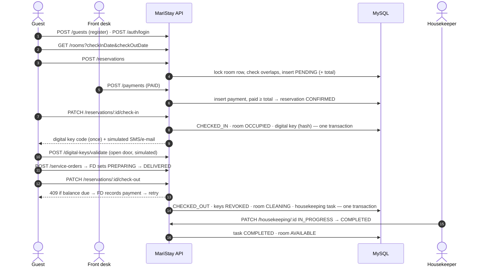

### Reservation business rules
1. Dates are calendar days in a half-open range `[checkIn, checkOut)`: a guest may check out on the same day the next guest checks in.
2. Check-in date cannot be in the past; check-out must be after check-in; maximum 30 nights.
3. A room is unavailable for a range if any PENDING, CONFIRMED or CHECKED_IN reservation overlaps it. `roomStatus` (the room's current condition) is **not** used to block future dates, except that MAINTENANCE rooms cannot be booked.
4. The nightly rate is copied into the reservation at booking time.

### Payment process
Front desk records payments (CASH, CARD, E_WALLET). Only PAID payments count; FAILED and REFUNDED never do. A PAID amount cannot exceed the outstanding balance. When the paid total reaches the room total, the reservation becomes CONFIRMED automatically. Refunds are allowed for cancelled reservations or overpayments.

### Check-in policy
Allowed for the reservation owner or front desk/manager when: the reservation is CONFIRMED; today is on or after the check-in date and before the check-out date; the room total is fully paid; the room is AVAILABLE.

### Check-out policy
Open service orders (PENDING/PREPARING) are cancelled; delivered orders are added to the bill. The balance (room total + delivered orders − paid) must be zero. Keys are revoked, the room goes to CLEANING and a housekeeping task is assigned to the active housekeeper with the fewest open tasks.

### Housekeeping process
Tasks move PENDING → IN_PROGRESS → COMPLETED (no skipping, no going back). Only the assigned housekeeper (or a manager) can update a task. When the last open task of a CLEANING room is completed, the room becomes AVAILABLE.

<div class="page-break"></div>

# Chapter 3 — System Architecture

## 3.1 Architecture overview

MariStay is a **modular monolith**: one NestJS application, organised into nine feature modules, backed by one MySQL database. It keeps the layers of Lab 03 (client → API → application server → database / auth service / notifications) and implements them as code.

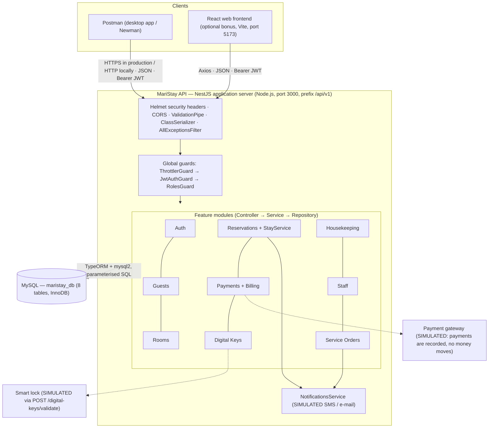

| Lab 03 component | MariStay implementation |
|---|---|
| Users: guests, front desk, housekeeping, management | Roles `GUEST`, `FRONT_DESK`, `HOUSEKEEPING`, `MANAGER` enforced by `RolesGuard` |
| Client application (web/mobile) | Postman, the required API testing tool, plus an optional React web frontend in `frontend/` for all four roles (15 screens, 36 of the 44 endpoints; see `docs/FRONTEND.md`). A mobile app is future work. |
| API calls | REST/JSON under `/api/v1` (44 endpoints) |
| Application / web server | NestJS 11 on Node.js 24 (Express platform) |
| Auth service | `AuthModule` — bcrypt + JWT (HS256) + passport-jwt |
| Database server | MySQL-compatible server accessed with TypeORM 0.3 and `mysql2`: XAMPP MariaDB 10.4.32 for development, also verified on Oracle MySQL 8.4.11 LTS (Testing §8.9) |
| SMS / e-mail notification | `NotificationsService` — simulated adapter (logs masked messages) |
| Payment gateway | Simulated: `PaymentsModule` records payments only |
| Smart locks | Simulated: `POST /digital-keys/validate` returns an access decision |

## 3.2 System components

| Module | Responsibility | Main files |
|---|---|---|
| AuthModule | Login for guests and staff, JWT issuing/validation, cross-table email uniqueness | `auth.service.ts`, `strategies/jwt.strategy.ts`, `guards/jwt-auth.guard.ts`, `identity.service.ts` |
| GuestsModule | Registration, profiles, deactivation, reservation history | `guests.service.ts` |
| RoomsModule | Room catalogue, filtering, date-range availability, manager CRUD | `rooms.service.ts` |
| ReservationsModule | Booking with conflict prevention, updates, confirmation, cancellation, **check-in/check-out orchestration** | `reservations.service.ts`, `stay.service.ts` |
| PaymentsModule | Payment recording/verification, balance computation (`BillingService`) | `payments.service.ts`, `billing.service.ts` |
| DigitalKeysModule | Key issuing/revoking (used by check-in/out), validation (smart-lock simulation) | `digital-keys.service.ts`, `digital-key-access.service.ts` |
| HousekeepingModule | Cleaning tasks, automatic assignment, room release | `housekeeping.service.ts`, `housekeeping-assignment.service.ts` |
| StaffModule | Employee accounts (manager only) | `staff.service.ts` |
| ServiceOrdersModule | Food/amenity/service orders with server-side catalog pricing | `service-orders.service.ts`, `service-catalog.ts` |
| NotificationsModule | Simulated SMS/e-mail adapter | `notifications.service.ts` |
| common/ | Enums, decorators (`@Public`, `@Roles`, `@CurrentUser`), RolesGuard, exception filter, pipes, validators, utilities | `backend/src/common/**` |
| database/ | Connection options, migration, seed, data source for the CLI | `backend/src/database/**` |

## 3.3 Layered architecture

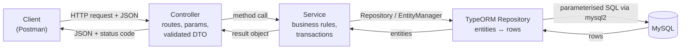

* **Controller layer** — receives the request, reads path/query parameters, receives the already-validated DTO, calls one service method and returns its result. Controllers contain no business logic (e.g. [`rooms.controller.ts`](../../backend/src/rooms/rooms.controller.ts)).
* **Service layer** — enforces business rules (availability, ownership, status transitions, payment rules) and opens database transactions when several rows must change together (e.g. [`stay.service.ts`](../../backend/src/reservations/stay.service.ts)).
* **Repository layer** — TypeORM `Repository<Entity>` or the transaction's `EntityManager` turns entities into parameterised SQL.
* **Database layer** — MySQL stores the data and enforces primary keys, foreign keys (`ON DELETE RESTRICT`), unique indexes and CHECK constraints.

## 3.4 Request and response flow (with security)

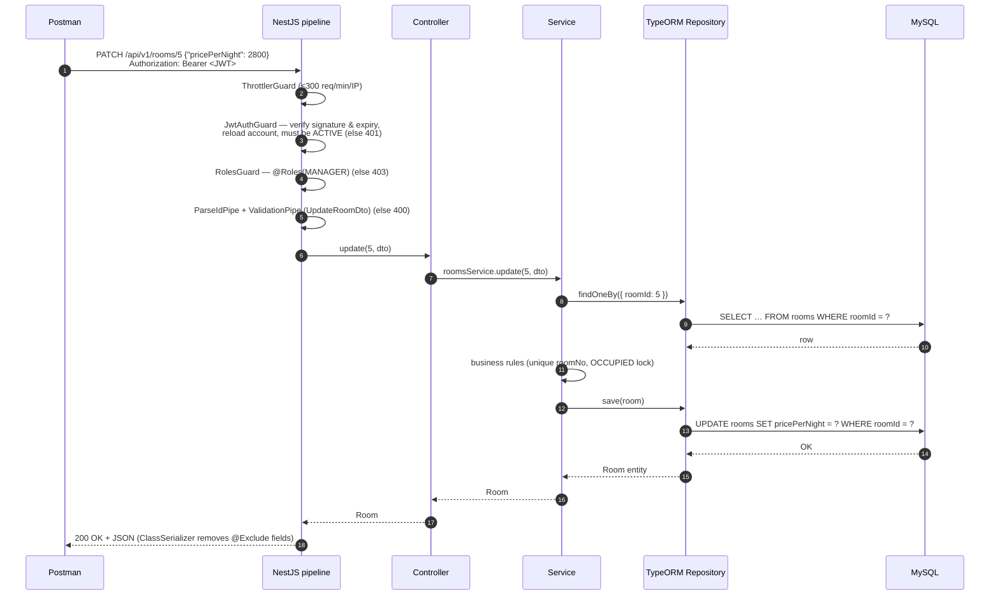

Errors at any step become a consistent JSON body via `AllExceptionsFilter`:
`{ "statusCode": 409, "error": "CONFLICT", "message": "Room number 101 already exists", "path": "/api/v1/rooms", "timestamp": "…" }`.
Database errors are translated (duplicate → 409, FK violation → 400/409, CHECK violation → 400) and never expose SQL.

## 3.5 Module integration

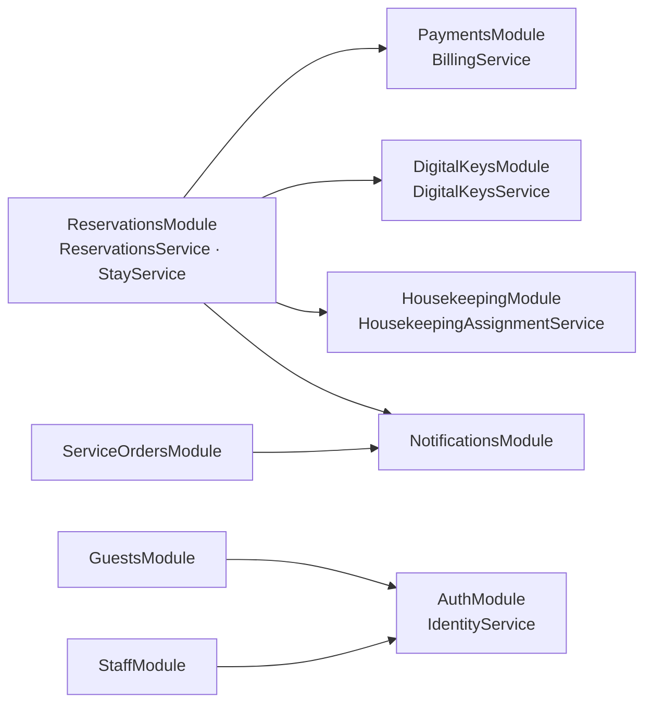

The arrows are NestJS module imports. `ReservationsModule` orchestrates the guest stay and imports the helpers it needs; none of those modules imports `ReservationsModule` back, so there are **no circular dependencies**. Helpers that take part in a workflow accept the caller's `EntityManager`, so their writes join the caller's transaction.

| Workflow | Modules involved (one transaction) |
|---|---|
| Book room | Reservations (+ Rooms row lock, Guests) |
| Record payment | Payments + Billing + Reservations (auto-confirm) |
| Check-in | Reservations + Billing + Rooms (→ OCCUPIED) + Digital Keys (issue) → Notifications (after commit) |
| Service order | Service Orders + Reservations (lock, must be CHECKED_IN) |
| Check-out | Reservations + Service Orders (cancel open) + Billing + Digital Keys (revoke) + Rooms (→ CLEANING) + Housekeeping (assign) → Notifications |
| Finish cleaning | Housekeeping + Rooms (→ AVAILABLE) |

## 3.6 Integrated business workflow

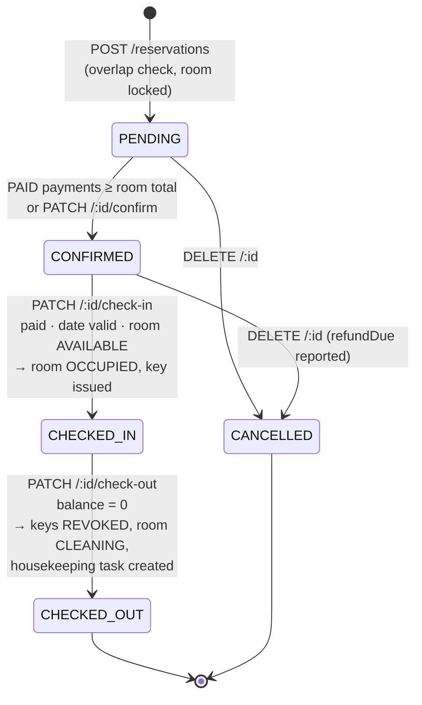

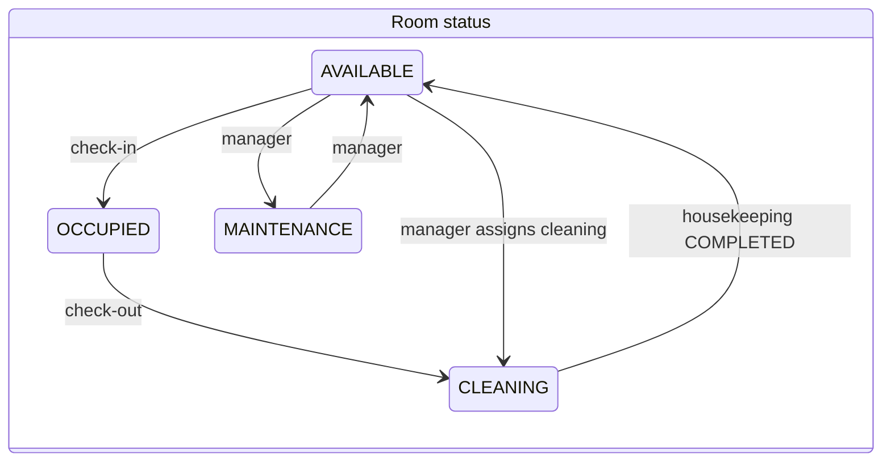

## 3.7 External service integration

All three external services from Lab 03 are **simulated** so the prototype runs offline with no paid subscriptions. Each lives behind a single class so a real provider can be plugged in later without touching callers.

| External service | Prototype behaviour | Integration point for a real provider |
|---|---|---|
| Payment gateway | Front desk records payments (`POST /payments`); no card data is collected and no money moves | Call the gateway in `PaymentsService.create()` before saving, store its transaction reference |
| SMS / e-mail | `NotificationsService` logs masked recipients and returns `{ status: "SIMULATED_SENT" }`; messages never contain key codes | Replace `NotificationsService.deliver()` with an SMS API / SMTP client |
| Smart lock | `POST /digital-keys/validate` returns `accessGranted: true` or 403; no door is opened | A lock controller would call this endpoint (or a signed variant) and act on the decision |

## 3.8 Deployment note (HTTP vs HTTPS)

The local demonstration runs on plain **HTTP** at `http://localhost:3000`. Lab 03/06 specify HTTPS; in a real deployment TLS would be terminated by a reverse proxy (e.g. Nginx or a cloud load balancer) in front of the API, and `CORS_ORIGIN` would be set to the real front-end origin. HTTPS is **not** configured in this prototype.

<div class="page-break"></div>

# Chapter 4 — Database Design

Database: **`maristay_db`** (MySQL, InnoDB, `utf8mb4_unicode_ci`). Schema created by the TypeORM migration [`1764086400000-InitialSchema.ts`](../../backend/src/database/migrations/1764086400000-InitialSchema.ts); exported in [`database/maristay.sql`](../../database/maristay.sql).

## 4.1 Entity relationship diagram

The ERD below matches the implemented entities and the actual MySQL schema (verified with `npm run schema:check` and `information_schema`). Columns marked *(ext)* extend the Lab 04 design.

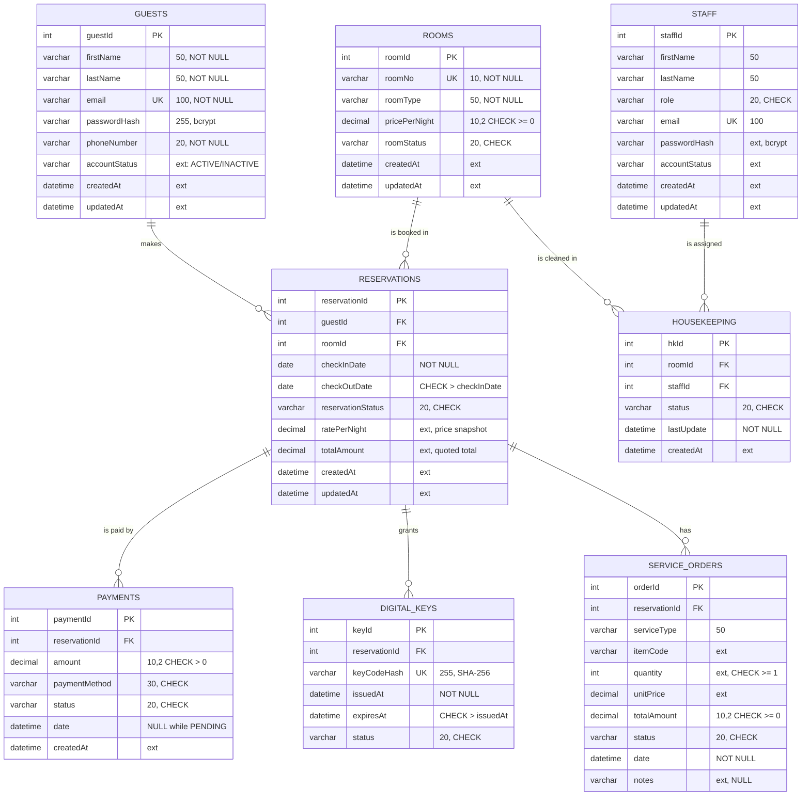

## 4.2 Database tables

| # | Table | Purpose (Lab 04) | Entity class |
|---|---|---|---|
| 1 | `guests` | Registered hotel guest information and authentication details | [`Guest`](../../backend/src/guests/entities/guest.entity.ts) |
| 2 | `rooms` | Hotel room information, pricing and availability status | [`Room`](../../backend/src/rooms/entities/room.entity.ts) |
| 3 | `reservations` | Guest room reservations and check-in/check-out schedule | [`Reservation`](../../backend/src/reservations/entities/reservation.entity.ts) |
| 4 | `payments` | Payments associated with reservations | [`Payment`](../../backend/src/payments/entities/payment.entity.ts) |
| 5 | `digital_keys` | Digital room access credentials issued to checked-in guests | [`DigitalKey`](../../backend/src/digital-keys/entities/digital-key.entity.ts) |
| 6 | `housekeeping` | Room cleaning tasks and assigned housekeeping staff | [`Housekeeping`](../../backend/src/housekeeping/entities/housekeeping.entity.ts) |
| 7 | `staff` | Hotel employees and their roles | [`Staff`](../../backend/src/staff/entities/staff.entity.ts) |
| 8 | `service_orders` | Guest requests for food, amenities and other services | [`ServiceOrder`](../../backend/src/service-orders/entities/service-order.entity.ts) |

A ninth table, `migrations`, is created automatically by TypeORM to record which migrations have run.

## 4.3 Data dictionary

### Table 1 — guests
| Field | Type | Constraints | Description |
|---|---|---|---|
| guestId | INT | PK, AUTO_INCREMENT | Unique guest identifier |
| firstName | VARCHAR(50) | NOT NULL | Guest's first name |
| lastName | VARCHAR(50) | NOT NULL | Guest's last name |
| email | VARCHAR(100) | UNIQUE (`UQ_guests_email`), NOT NULL | Login email, stored lower-case |
| passwordHash | VARCHAR(255) | NOT NULL | bcrypt hash; never selected by default or returned |
| phoneNumber | VARCHAR(20) | NOT NULL | Contact number (digits, optional +) |
| accountStatus *(ext)* | VARCHAR(20) | NOT NULL, DEFAULT 'ACTIVE', CHECK IN ('ACTIVE','INACTIVE') | Deactivated accounts cannot log in |
| createdAt / updatedAt *(ext)* | DATETIME(6) | NOT NULL, defaults | Audit timestamps |

### Table 2 — rooms
| Field | Type | Constraints | Description |
|---|---|---|---|
| roomId | INT | PK, AUTO_INCREMENT | Unique room identifier |
| roomNo | VARCHAR(10) | UNIQUE (`UQ_rooms_roomNo`), NOT NULL | Hotel room number (e.g. 101) |
| roomType | VARCHAR(50) | NOT NULL | Standard, Deluxe, Suite or Family (validated by the API) |
| pricePerNight | DECIMAL(10,2) | NOT NULL, CHECK ≥ 0 | Current nightly rate (PHP) |
| roomStatus | VARCHAR(20) | NOT NULL, DEFAULT 'AVAILABLE', CHECK IN ('AVAILABLE','OCCUPIED','CLEANING','MAINTENANCE') | Current physical state of the room |
| createdAt / updatedAt *(ext)* | DATETIME(6) | NOT NULL | Audit timestamps |

Index: `IDX_rooms_status_type (roomStatus, roomType)` for the public room filter.

### Table 3 — reservations
| Field | Type | Constraints | Description |
|---|---|---|---|
| reservationId | INT | PK, AUTO_INCREMENT | Unique reservation identifier |
| guestId | INT | FK → guests.guestId, NOT NULL, ON DELETE RESTRICT | Guest making the reservation |
| roomId | INT | FK → rooms.roomId, NOT NULL, ON DELETE RESTRICT | Reserved room |
| checkInDate | DATE | NOT NULL | Scheduled arrival date |
| checkOutDate | DATE | NOT NULL, CHECK > checkInDate | Scheduled departure date |
| reservationStatus | VARCHAR(20) | NOT NULL, DEFAULT 'PENDING', CHECK IN ('PENDING','CONFIRMED','CHECKED_IN','CHECKED_OUT','CANCELLED') | Booking lifecycle state |
| ratePerNight *(ext)* | DECIMAL(10,2) | NOT NULL, CHECK ≥ 0 | Room price captured at booking time |
| totalAmount *(ext)* | DECIMAL(10,2) | NOT NULL, CHECK ≥ 0 | Quoted room total = rate × nights |
| createdAt / updatedAt *(ext)* | DATETIME(6) | NOT NULL | Audit timestamps |

Indexes: `IDX_reservations_room_dates (roomId, checkInDate, checkOutDate)` (overlap check), `IDX_reservations_guest`, `IDX_reservations_status`.

### Table 4 — payments
| Field | Type | Constraints | Description |
|---|---|---|---|
| paymentId | INT | PK, AUTO_INCREMENT | Unique payment identifier |
| reservationId | INT | FK → reservations.reservationId, NOT NULL, ON DELETE RESTRICT | Associated reservation |
| amount | DECIMAL(10,2) | NOT NULL, CHECK > 0 | Payment amount |
| paymentMethod | VARCHAR(30) | NOT NULL, CHECK IN ('CASH','CARD','E_WALLET') | Card, cash or e-wallet |
| status | VARCHAR(20) | NOT NULL, DEFAULT 'PENDING', CHECK IN ('PENDING','PAID','FAILED','REFUNDED') | Payment state |
| date | DATETIME | NULL | When the payment was processed (NULL while PENDING) |
| createdAt *(ext)* | DATETIME(6) | NOT NULL | When the record was created |

### Table 5 — digital_keys
| Field | Type | Constraints | Description |
|---|---|---|---|
| keyId | INT | PK, AUTO_INCREMENT | Unique digital key identifier |
| reservationId | INT | FK → reservations.reservationId, NOT NULL, ON DELETE RESTRICT | Associated reservation |
| keyCodeHash | VARCHAR(255) | UNIQUE, NOT NULL | SHA-256 hash of the access credential (plaintext never stored) |
| issuedAt | DATETIME | NOT NULL | When the key was issued |
| expiresAt | DATETIME | NOT NULL, CHECK > issuedAt | Expiry (default 12:00 on the check-out date) |
| status | VARCHAR(20) | NOT NULL, DEFAULT 'ACTIVE', CHECK IN ('ACTIVE','EXPIRED','REVOKED') | Key state |

### Table 6 — housekeeping
| Field | Type | Constraints | Description |
|---|---|---|---|
| hkId | INT | PK, AUTO_INCREMENT | Unique cleaning record |
| roomId | INT | FK → rooms.roomId, NOT NULL, ON DELETE RESTRICT | Room being cleaned |
| staffId | INT | FK → staff.staffId, NOT NULL, ON DELETE RESTRICT | Assigned housekeeper |
| status | VARCHAR(20) | NOT NULL, DEFAULT 'PENDING', CHECK IN ('PENDING','IN_PROGRESS','COMPLETED') | Task state |
| lastUpdate | DATETIME | NOT NULL | Last status change |
| createdAt *(ext)* | DATETIME(6) | NOT NULL | When the task was assigned |

Indexes: `IDX_housekeeping_room_status`, `IDX_housekeeping_staff_status`.

### Table 7 — staff
| Field | Type | Constraints | Description |
|---|---|---|---|
| staffId | INT | PK, AUTO_INCREMENT | Unique employee identifier |
| firstName | VARCHAR(50) | NOT NULL | Employee's first name |
| lastName | VARCHAR(50) | NOT NULL | Employee's last name |
| role | VARCHAR(20) | NOT NULL, CHECK IN ('FRONT_DESK','HOUSEKEEPING','MANAGER') | Assigned role |
| email | VARCHAR(100) | UNIQUE, NOT NULL | Employee email / login |
| passwordHash *(ext)* | VARCHAR(255) | NOT NULL | bcrypt hash (required for staff login) |
| accountStatus *(ext)* | VARCHAR(20) | NOT NULL, DEFAULT 'ACTIVE', CHECK | Deactivated staff cannot log in |
| createdAt / updatedAt *(ext)* | DATETIME(6) | NOT NULL | Audit timestamps |

### Table 8 — service_orders
| Field | Type | Constraints | Description |
|---|---|---|---|
| orderId | INT | PK, AUTO_INCREMENT | Unique order identifier |
| reservationId | INT | FK → reservations.reservationId, NOT NULL, ON DELETE RESTRICT | Associated guest reservation |
| serviceType | VARCHAR(50) | NOT NULL | Food, Beverage, Amenities, Laundry or Other |
| itemCode *(ext)* | VARCHAR(50) | NOT NULL | Catalog item ordered |
| quantity *(ext)* | INT | NOT NULL, DEFAULT 1, CHECK ≥ 1 | Units ordered |
| unitPrice *(ext)* | DECIMAL(10,2) | NOT NULL, CHECK ≥ 0 | Catalog price at order time |
| totalAmount | DECIMAL(10,2) | NOT NULL, CHECK ≥ 0 | Total service charge (server-calculated) |
| status | VARCHAR(20) | NOT NULL, DEFAULT 'PENDING', CHECK IN ('PENDING','PREPARING','DELIVERED','CANCELLED') | Order state |
| date | DATETIME | NOT NULL | Date and time of order |
| notes *(ext)* | VARCHAR(255) | NULL | Guest instructions |

## 4.4 Primary keys and foreign keys

| Table | Primary key | Foreign keys |
|---|---|---|
| guests | guestId | — |
| rooms | roomId | — |
| staff | staffId | — |
| reservations | reservationId | guestId → guests, roomId → rooms |
| payments | paymentId | reservationId → reservations |
| digital_keys | keyId | reservationId → reservations |
| service_orders | orderId | reservationId → reservations |
| housekeeping | hkId | roomId → rooms, staffId → staff |

All foreign keys are `ON DELETE RESTRICT ON UPDATE CASCADE` with explicit names (`FK_<table>_<parent>`). RESTRICT means a guest, room or reservation that has history can never be deleted by accident, so reservation and payment history is always preserved.

## 4.5 Relationships (TypeORM)

| Relationship | Cardinality | TypeORM mapping |
|---|---|---|
| Guest — Reservation | 1 : N | `Guest.@OneToMany(reservations)` ↔ `Reservation.@ManyToOne(guest) @JoinColumn(guestId)` |
| Room — Reservation | 1 : N | `Room.@OneToMany(reservations)` ↔ `Reservation.@ManyToOne(room) @JoinColumn(roomId)` |
| Reservation — Payment | 1 : N | `Reservation.@OneToMany(payments)` ↔ `Payment.@ManyToOne(reservation)` |
| Reservation — DigitalKey | 1 : N | `Reservation.@OneToMany(digitalKeys)` ↔ `DigitalKey.@ManyToOne(reservation)` |
| Reservation — ServiceOrder | 1 : N | `Reservation.@OneToMany(serviceOrders)` ↔ `ServiceOrder.@ManyToOne(reservation)` |
| Room — Housekeeping | 1 : N | `Room.@OneToMany(housekeepingTasks)` ↔ `Housekeeping.@ManyToOne(room)` |
| Staff — Housekeeping | 1 : N | `Staff.@OneToMany(housekeepingTasks)` ↔ `Housekeeping.@ManyToOne(staff)` |

Each FK is also exposed as a plain column (e.g. `Reservation.guestId`) so services can filter by id without loading the related entity.

## 4.6 Normalization

* **1NF** — every column holds one atomic value (no lists, no repeating groups); each table has a primary key.
* **2NF** — all primary keys are single surrogate columns, so no partial dependencies are possible.
* **3NF** — non-key columns depend only on their own table's key: guest details live only in `guests`, room details only in `rooms`; reservations, payments, keys, orders and tasks store only foreign keys to them.
* **Deliberate, documented denormalization**: `reservations.ratePerNight/totalAmount` and `service_orders.unitPrice/totalAmount` copy prices at the moment of the transaction. These are *historical facts* (what the guest was charged), not duplicates of current prices — a later price change must not rewrite past bookings.
* Lab 04's Part D reasoning holds: normalization reduces duplicate data, and the `pricePerNight` CHECK prevents negative prices and billing errors.

## 4.7 Database constraints summary

| Kind | Where |
|---|---|
| PRIMARY KEY | All 8 tables (`AUTO_INCREMENT INT`) |
| UNIQUE | guests.email, staff.email, rooms.roomNo, digital_keys.keyCodeHash |
| FOREIGN KEY (RESTRICT) | 7 relationships (§4.4) |
| CHECK — allowed values | every status / role / method column |
| CHECK — amounts | pricePerNight ≥ 0, payments.amount > 0, reservation and order amounts ≥ 0, quantity ≥ 1 |
| CHECK — dates | reservations.checkOutDate > checkInDate, digital_keys.expiresAt > issuedAt |
| NOT NULL / DEFAULT | per data dictionary |
| Application-level | email unique across guests **and** staff; no overlapping active reservations per room (row lock + transaction); status transitions |

CHECK constraints are enforced by MySQL 8.0.16+ and MariaDB 10.2+ (verified on MariaDB 10.4: inserting a negative price fails with `CONSTRAINT CHK_rooms_pricePerNight failed`).

## 4.8 Migrations and seed data

| Command | What it does |
|---|---|
| `npm run db:create` | `CREATE DATABASE IF NOT EXISTS` (never drops anything) |
| `npm run migration:run` | Creates the 8 tables, keys, indexes and CHECK constraints |
| `npm run migration:show` / `migration:revert` | Show / undo migrations |
| `npm run schema:check` | Compares entities with the live schema (prints SQL TypeORM *would* run) |
| `npm run seed` | Inserts demo data; re-runnable without duplicates; never updates or deletes |
| `npm run db:setup` | All three: create → migrate → seed |

`synchronize` is always `false`; the schema changes only through migrations.

Seed data (fictional): 1 manager, 1 front desk, 2 housekeeping staff, 2 guests, 9 rooms (101–104 Standard, 201–202 Deluxe, 301 Suite, 302–303 Family; 104 CLEANING, 303 MAINTENANCE), 3 reservations (one checked-out past stay with a delivered order and payment, one confirmed future stay, one pending future stay), 2 housekeeping records.

> Known cosmetic note: on MariaDB, `npm run schema:check` lists two `ALTER … NULL` statements for the nullable `payments.date` and `service_orders.notes` columns because MariaDB reports their default as the text `'NULL'`. The statements would not change anything. (MySQL 8 reports a real `NULL` default, so the diff is empty there: on Oracle MySQL 8.4.11 LTS, `npm run schema:check` reported "Your schema is up to date" on 2026-11-27.)

## 4.9 Database server and SQL export

* **Server used:** XAMPP's bundled "MySQL" server, which is **MariaDB 10.4.32**, a MySQL-compatible fork. The application connects with the MySQL driver (`mysql2`, TypeORM `type: 'mysql'`). Development and the results in this document used this server. On 2026-11-27 the same migration, seed data, e2e tests (46/46) and Postman collection (177/177) were also verified on **Oracle MySQL 8.4.11 LTS**, and the schema was identical on both servers: 8 tables, 64 columns, 7 foreign keys, 17 CHECK constraints and 13 unique indexes (Requirements Compliance Checklist §6, Testing §8.9).
* **Other databases:** the project uses three databases on the shared XAMPP server:
  * `maristay_db`, the demonstration data;
  * `maristay_test_db`, recreated by the e2e tests;
  * `maristay_postman_db`, recreated before each full Postman/Newman run.

  The tools never create, change or drop any other database. The e2e and Postman reset commands refuse to touch a database with a different name.
* **SQL export:** `database/maristay.sql` was produced by `mysqldump` from the migrated and seeded `maristay_db`. It contains the 8 tables, the `migrations` table, 7 foreign keys, 17 CHECK constraints, 23 indexes and the demonstration records. It begins with `CREATE DATABASE IF NOT EXISTS maristay_db; USE maristay_db;` and contains no `DROP TABLE` statements. It is meant for a server **without** an existing `maristay_db`. If one already exists with tables, the import stops at the first `CREATE TABLE` and changes nothing. Re-import was verified on 2026-11-26 into a scratch database: all objects were created without errors. On 2026-11-27 a copy without the `CREATE DATABASE`/`USE` lines was also imported into Oracle MySQL 8.4.11 LTS. Only deprecation warnings appeared, and the FK, CHECK and UNIQUE constraints were enforced. Foreign keys imported from this MariaDB dump show `ON DELETE NO ACTION`, which InnoDB treats exactly like `RESTRICT`.

<div class="page-break"></div>

# Chapter 5 — REST API Design

Base URL (local): `http://localhost:3000/api/v1` · Postman: [`postman/MariStay.postman_collection.json`](../../postman/MariStay.postman_collection.json)

## 5.1 API conventions (Lab 05 Part B)

| Rule | Applied as | Example |
|---|---|---|
| Use nouns, not verbs | Resources are hotel objects | `/api/v1/rooms` |
| Plural resource names | Every collection is plural | `/api/v1/guests`, `/api/v1/service-orders` |
| Path parameters identify one resource | `:id` is a positive integer (validated → 400) | `/api/v1/rooms/5` |
| Versioning | Global prefix `/api/v1` | `/api/v1/reservations` |
| Nested resources | Child collection of a parent | `/api/v1/guests/1/reservations` |
| Query parameters filter and paginate | Case-insensitive enum filters, `page`, `limit` | `/api/v1/rooms?roomStatus=Available` |
| State-changing actions on a resource | Sub-resource with `PATCH` | `/api/v1/reservations/4/check-in` |
| JSON in, JSON out | `Content-Type: application/json` | — |
| Authentication | `Authorization: Bearer <accessToken>` | — |

**Naming notes.** The API uses the Lab 04 column names everywhere (`roomNo`, `status`, `date`) — Lab 05 examples that used `roomNumber`, `paymentStatus` or `paymentDate` were aligned to these names (deviations D1, D5). Status values are returned UPPERCASE; filters and bodies accept any case (`Available` → `AVAILABLE`).

**List responses** are paginated:
```json
{ "data": [ … ], "meta": { "page": 1, "limit": 20, "total": 2, "totalPages": 1 } }
```

**Error responses** always have the same shape (from `AllExceptionsFilter`):
```json
{ "statusCode": 409, "error": "CONFLICT", "message": "Room already booked for the selected dates",
  "path": "/api/v1/reservations", "timestamp": "2026-11-25T15:30:40.072Z" }
```
Validation errors return `message` as an array of all problems. Internal database errors are never exposed.

## 5.2 Resource identification (Lab 05 Part A, extended)

| Resource URI | Source table | Description | Operations |
|---|---|---|---|
| `/auth` | guests, staff | Login and current identity | Login (C), Read |
| `/guests` | guests | Guest accounts | C, R, U, D(deactivate) |
| `/rooms` | rooms | Hotel rooms | C, R, U (PATCH+PUT), D |
| `/reservations` | reservations | Room bookings, check-in/out | C, R, U, D(cancel) |
| `/payments` | payments | Payment recording and review | C, R, U(status) |
| `/digital-keys` | digital_keys | Digital room keys | C(issue), R, U(revoke), validate |
| `/housekeeping` | housekeeping | Cleaning tasks | C, R, U |
| `/staff` | staff | Employee accounts | C, R, U, D(deactivate) |
| `/service-orders` | service_orders | Guest service requests | C, R, U(status) |

## 5.3 Complete endpoint table (44 endpoints)

Access: **Public** = no token · **G** = Guest (own records only) · **FD** = Front Desk · **HK** = Housekeeping (own tasks only) · **M** = Manager. ★ = the 7 endpoints defined in Lab 05 (original access preserved).

| # | Method | Endpoint | Description | Access | Success | Main errors |
|---|---|---|---|---|---|---|
| 1 | POST | `/auth/login` | Log in (guest or staff), returns JWT | Public (10/min) | 200 | 400, 401, 429 |
| 2 | GET | `/auth/me` | Current user profile | Any logged-in | 200 | 401 |
| 3 ★ | POST | `/guests` | Register guest | Public | 201 | 400, 409 |
| 4 | GET | `/guests` | List/search guests | FD, M | 200 | 401, 403 |
| 5 | GET | `/guests/:id` | Guest profile | G(own), FD, M | 200 | 403, 404 |
| 6 | PATCH | `/guests/:id` | Update profile / change own password | G(own), FD, M | 200 | 400, 401, 403, 404, 409 |
| 7 | DELETE | `/guests/:id` | Deactivate account (history kept) | G(own), M | 204 | 403, 404, 409 |
| 8 | GET | `/guests/:id/reservations` | Reservation history (nested) | G(own), FD, M | 200 | 403, 404 |
| 9 ★ | GET | `/rooms` | List/filter rooms, date availability | Public | 200 | 400 |
| 10 | GET | `/rooms/:id` | Room details | Public | 200 | 404 |
| 11 | POST | `/rooms` | Create room | M | 201 | 400, 401, 403, 409 |
| 12 ★ | PATCH | `/rooms/:id` | Partially update room | M | 200 | 400, 403, 404, 409 |
| 13 ★ | PUT | `/rooms/:id` | Replace all room details | M | 200 | 400, 403, 404, 409 |
| 14 | DELETE | `/rooms/:id` | Delete room without history | M | 204 | 403, 404, 409 |
| 15 ★ | POST | `/reservations` | Book room | G (FD, M on behalf) | 201 | 400, 403, 404, 409 |
| 16 | GET | `/reservations` | List reservations (filters) | G(own), FD, M | 200 | 401, 403 |
| 17 | GET | `/reservations/:id` | One reservation | G(own), FD, M | 200 | 403, 404 |
| 18 | PATCH | `/reservations/:id` | Change room/dates | G(own), FD, M | 200 | 400, 403, 404, 409 |
| 19 | PATCH | `/reservations/:id/confirm` | Confirm PENDING reservation | FD, M | 200 | 403, 404, 409 |
| 20 | PATCH | `/reservations/:id/check-in` | Digital check-in + key | G(own), FD, M | 200 | 403, 404, 409 |
| 21 | PATCH | `/reservations/:id/check-out` | Digital check-out | G(own), FD, M | 200 | 403, 404, 409 |
| 22 | DELETE | `/reservations/:id` | Cancel (record kept as CANCELLED) | G(own), FD, M | 200 | 403, 404, 409 |
| 23 ★ | POST | `/payments` | Record payment | FD, M | 201 | 400, 403, 404, 409 |
| 24 | GET | `/payments` | List payments | G(own), FD, M | 200 | 401, 403 |
| 25 | GET | `/payments/:id` | One payment | G(own), FD, M | 200 | 403, 404 |
| 26 | PATCH | `/payments/:id` | Verify / change payment status | FD, M | 200 | 400, 403, 404, 409 |
| 27 | POST | `/digital-keys` | Issue / reissue key | G(own), FD, M | 201 | 400, 403, 404, 409 |
| 28 | POST | `/digital-keys/validate` | Validate key at door (simulated lock) | G(own), FD, M | 200 | 400, 403 |
| 29 | GET | `/digital-keys` | List key metadata | G(own), FD, M | 200 | 401, 403 |
| 30 | GET | `/digital-keys/:id` | Key metadata | G(own), FD, M | 200 | 403, 404 |
| 31 | PATCH | `/digital-keys/:id/revoke` | Revoke key | FD, M | 200 | 403, 404, 409 |
| 32 | POST | `/housekeeping` | Assign cleaning task | M | 201 | 400, 403, 404, 409 |
| 33 | GET | `/housekeeping` | List tasks | HK(own), M | 200 | 401, 403 |
| 34 | GET | `/housekeeping/:id` | One task | HK(own), M | 200 | 403, 404 |
| 35 | PATCH | `/housekeeping/:id` | Update status / reassign (M) | HK(own), M | 200 | 400, 403, 404, 409 |
| 36 | POST | `/staff` | Create staff account | M | 201 | 400, 403, 409 |
| 37 | GET | `/staff` | List staff | M | 200 | 401, 403 |
| 38 | GET | `/staff/:id` | Staff details | M | 200 | 403, 404 |
| 39 | PATCH | `/staff/:id` | Update staff / reset password | M | 200 | 400, 403, 404, 409 |
| 40 | DELETE | `/staff/:id` | Deactivate staff | M | 204 | 403, 404, 409 |
| 41 ★ | POST | `/service-orders` | Place service order | G (FD, M on behalf) | 201 | 400, 403, 404, 409 |
| 42 | GET | `/service-orders` | List orders | G(own), FD, M | 200 | 401, 403 |
| 43 | GET | `/service-orders/:id` | One order | G(own), FD, M | 200 | 403, 404 |
| 44 | PATCH | `/service-orders/:id` | Update order status | G(cancel own PENDING), FD, M | 200 | 403, 404, 409 |

Every protected endpoint can also return **401** (missing/invalid/expired token or deactivated account) and **429** (rate limit). Unexpected failures return **500** with a generic message.

HTTP methods used: **GET** (read), **POST** (create / actions that create something), **PUT** (full replacement of a room), **PATCH** (partial update and state transitions), **DELETE** (delete room; deactivate guest/staff; cancel reservation).

### Query parameters

| Endpoint | Parameters |
|---|---|
| `GET /rooms` | `roomStatus` (AVAILABLE, OCCUPIED, CLEANING, MAINTENANCE — any case), `roomType` (Standard, Deluxe, Suite, Family), `minPrice`, `maxPrice`, `checkInDate` + `checkOutDate` (YYYY-MM-DD, both or neither), `page`, `limit` (≤100) |
| `GET /guests` | `search`, `accountStatus`, `page`, `limit` |
| `GET /reservations` | `reservationStatus`, `guestId` (staff), `roomId`, `fromDate`, `toDate`, `page`, `limit` |
| `GET /payments` | `reservationId`, `status`, `paymentMethod`, `page`, `limit` |
| `GET /digital-keys` | `reservationId`, `status`, `page`, `limit` |
| `GET /housekeeping` | `status`, `roomId`, `staffId` (manager), `page`, `limit` |
| `GET /staff` | `role`, `accountStatus`, `search`, `page`, `limit` |
| `GET /service-orders` | `status`, `serviceType`, `reservationId`, `page`, `limit` |


## 5.4 Request and response examples

All examples below were captured from the running API (tokens and key codes shortened).

### POST /auth/login — 200 OK
```json
// Request
{ "email": "manager@maristay.test", "password": "<demo password>" }
// Response
{
  "accessToken": "eyJhbGciOiJIUzI1NiIsInR5cCI6IkpXVCJ9.<payload>.<signature>",
  "tokenType": "Bearer",
  "expiresIn": "1h",
  "user": { "id": 1, "accountType": "STAFF", "role": "MANAGER", "firstName": "Marco", "lastName": "Villanueva", "email": "manager@maristay.test" }
}
```
401: `{"statusCode":401,"error":"UNAUTHORIZED","message":"Invalid email or password",…}` · 429 after 10 attempts/minute.

### POST /guests — 201 Created (Lab 05 #2)
```json
// Request
{ "firstName": "Geero Andrei", "lastName": "Reyes", "email": "geero.reyes@example.com",
  "password": "SecurePass123", "phoneNumber": "09123456789" }
// Response (no passwordHash)
{ "guestId": 3, "firstName": "Geero Andrei", "lastName": "Reyes", "email": "geero.reyes@example.com",
  "phoneNumber": "09123456789", "accountStatus": "ACTIVE",
  "createdAt": "2026-11-25T15:31:46.597Z", "updatedAt": "2026-11-25T15:31:46.597Z" }
```
409: `"message": "Email already exists"` · 400: e.g. `["password must be 8–72 characters long and contain at least one letter and one number"]`.

### GET /rooms?roomStatus=Available&roomType=Deluxe — 200 OK (Lab 05 #1)
```json
{
  "data": [ { "roomId": 5, "roomNo": "201", "roomType": "Deluxe", "pricePerNight": 2500, "roomStatus": "AVAILABLE",
              "createdAt": "…", "updatedAt": "…" } ],
  "meta": { "page": 1, "limit": 20, "total": 2, "totalPages": 1 }
}
```
400: `["Invalid room status filter"]` (e.g. `?roomStatus=Vacant`).

### POST /rooms — 201 · PATCH /rooms/:id — 200 · PUT /rooms/:id — 200 (Lab 05 #6, #7)
```json
// POST body
{ "roomNo": "401", "roomType": "Deluxe", "pricePerNight": 2500 }
// PATCH body (partial)
{ "roomStatus": "Available", "pricePerNight": 2600 }
// PUT body (all fields required)
{ "roomNo": "401", "roomType": "Standard", "pricePerNight": 1800, "roomStatus": "Available" }
// Response (PUT)
{ "roomId": 10, "roomNo": "401", "roomType": "Standard", "pricePerNight": 1800, "roomStatus": "AVAILABLE", "createdAt": "…", "updatedAt": "…" }
```
404 `Room not found` · 409 `Room number 401 already exists` · 409 when changing the status of an OCCUPIED room · DELETE returns **204** with no body, or 409 if the room has history.

### POST /reservations — 201 Created (Lab 05 #3)
```json
// Request (guestId comes from the JWT; status is set by the server)
{ "roomId": 10, "checkInDate": "2026-11-25", "checkOutDate": "2026-11-27" }
// Response
{ "reservationId": 4, "guestId": 3, "roomId": 10, "checkInDate": "2026-11-25", "checkOutDate": "2026-11-27",
  "reservationStatus": "PENDING", "ratePerNight": 1800, "totalAmount": 3600,
  "createdAt": "…", "updatedAt": "…", "guest": { "guestId": 3, … }, "room": { "roomId": 10, "roomNo": "401", … } }
```
409 `Room already booked for the selected dates` · 400 `checkOutDate must be later than checkInDate` / `checkInDate cannot be in the past` / `A reservation cannot exceed 30 nights` · 403 when a guest books for another guestId.

### POST /payments — 201 Created (Lab 05 #4)
```json
// Request (status defaults to PAID; also PENDING or FAILED)
{ "reservationId": 4, "amount": 3600, "paymentMethod": "cash" }
// Response
{ "paymentId": 3, "reservationId": 4, "amount": 3600, "paymentMethod": "CASH", "status": "PAID",
  "date": "2026-11-25T15:31:46.000Z", "createdAt": "…",
  "reservationStatus": "CONFIRMED",
  "billing": { "roomTotal": 3600, "serviceCharges": 0, "totalBillable": 3600, "paidTotal": 3600, "balanceDue": 0, "overpaid": 0 } }
```
400 `Invalid payment information: amount exceeds the outstanding balance of 3600.00` / invalid method or amount · 409 for cancelled or checked-out reservations · PATCH transitions: PENDING→PAID|FAILED, PAID→REFUNDED (409 otherwise).

### PATCH /reservations/:id/check-in — 200 OK
```json
{
  "message": "Check-in successful",
  "reservation": { "reservationId": 4, "reservationStatus": "CHECKED_IN", "room": { "roomNo": "401", "roomStatus": "OCCUPIED", … }, … },
  "digitalKey": { "keyId": 1, "reservationId": 4, "keyCode": "MSK-<43 random characters>",
                  "issuedAt": "2026-11-25T15:31:46.000Z", "expiresAt": "2026-11-27T04:00:00.000Z", "status": "ACTIVE" },
  "notifications": [
    { "channel": "SMS", "recipient": "0912****789", "status": "SIMULATED_SENT", "sentAt": "…" },
    { "channel": "EMAIL", "recipient": "g***@example.com", "status": "SIMULATED_SENT", "sentAt": "…" } ]
}
```
`keyCode` appears **only** in this response (and on reissue). `expiresAt` = 12:00 local time on the check-out date (UTC+8 → 04:00Z).
409 messages: `Reservation must be confirmed (fully paid) before check-in` · `Payment required before check-in: balance of 2600.00 is still due` · `Check-in opens on 2026-12-09` · `Room 104 is not ready (status: CLEANING)` · `Reservation is already checked in`.

### POST /digital-keys/validate — 200 OK (simulated smart lock)
```json
// Request
{ "keyCode": "MSK-<43 random characters>", "roomId": 10 }
// Response
{ "accessGranted": true, "keyId": 1, "reservationId": 4, "roomId": 10, "roomNo": "401",
  "expiresAt": "2026-11-27T04:00:00.000Z",
  "message": "Access granted (simulated smart lock — no physical door is opened)" }
```
403: `Access denied: invalid digital key` · `… has been revoked` · `… has expired` · `… is not valid for this room` · `… reservation is not checked in`.

### POST /service-orders — 201 Created (Lab 05 #5)
```json
// Request (no price fields: the server uses its catalog)
{ "reservationId": 4, "itemCode": "BREAKFAST_SET", "quantity": 2, "notes": "No onions, please" }
// Response
{ "orderId": 2, "reservationId": 4, "serviceType": "Food", "itemCode": "BREAKFAST_SET", "quantity": 2,
  "unitPrice": 450, "totalAmount": 900, "status": "PENDING", "date": "…", "notes": "No onions, please",
  "reservation": { … } }
```
400 unknown `itemCode` or any client-supplied price field · 403 another guest's reservation · 409 reservation not checked in.

Service catalog (server-side prices, PHP): BREAKFAST_SET 450 · CLUB_SANDWICH 380 · PANCIT_CANTON 520 · BREWED_COFFEE 120 · FRESH_JUICE 150 · BOTTLED_WATER 60 · EXTRA_TOWELS 0 · TOILETRY_KIT 180 · EXTRA_BED 900 · LAUNDRY_BAG 350 · PRESSING 80 · AIRPORT_TRANSFER 1200 · ROOM_REFRESH 0.

### PATCH /reservations/:id/check-out — 200 OK
```json
{
  "message": "Check-out successful; room sent for cleaning",
  "reservation": { "reservationStatus": "CHECKED_OUT", "room": { "roomStatus": "CLEANING", … }, … },
  "billing": { "roomTotal": 3600, "serviceCharges": 900, "totalBillable": 4500, "paidTotal": 4500, "balanceDue": 0, "overpaid": 0 },
  "digitalKeysRevoked": 1,
  "openServiceOrdersCancelled": 0,
  "housekeepingTask": { "hkId": 3, "roomId": 10, "staffId": 4, "status": "PENDING", "lastUpdate": "…", "createdAt": "…" },
  "notifications": [ … ]
}
```
409 `Outstanding balance of 900.00 must be settled at the front desk before check-out`.

### PATCH /housekeeping/:id — 200 OK
```json
// Request (assigned housekeeper)
{ "status": "COMPLETED" }
// Response
{ "hkId": 3, "roomId": 10, "staffId": 4, "status": "COMPLETED", "lastUpdate": "…",
  "room": { "roomNo": "401", "roomStatus": "AVAILABLE", … },
  "staff": { "staffId": 4, "firstName": "Helen", "lastName": "Castro", "role": "HOUSEKEEPING", … } }
```
403 another housekeeper's task · 409 `Invalid status transition: PENDING → COMPLETED`.

### DELETE /reservations/:id — 200 OK
```json
{ "reservationId": 7, "reservationStatus": "CANCELLED", …, "refundDue": 3800 }
```
The reservation is **not destroyed** — it stays in MySQL as CANCELLED; `refundDue` tells the front desk how much PAID money to refund (`PATCH /payments/:id {"status":"REFUNDED"}`).

### Authorization failures
```json
// GET /reservations without a token → 401
{ "statusCode": 401, "error": "UNAUTHORIZED", "message": "Invalid or missing access token", "path": "/api/v1/reservations", "timestamp": "…" }
// POST /rooms with a guest token → 403
{ "statusCode": 403, "error": "FORBIDDEN", "message": "You do not have permission to perform this action", "path": "/api/v1/rooms", "timestamp": "…" }
```

## 5.5 HTTP status codes used

| Code | Meaning in MariStay |
|---|---|
| 200 OK | Successful read, update, state change, validation, cancellation |
| 201 Created | Guest, room, reservation, payment, key, task, staff or order created |
| 204 No Content | Room deleted; guest or staff deactivated |
| 400 Bad Request | Validation failed, unknown property, bad id, invalid dates/amounts, amount above balance |
| 401 Unauthorized | Missing/invalid/expired token, wrong credentials, deactivated account, wrong current password |
| 403 Forbidden | Valid token but wrong role or not the owner; digital key access denied |
| 404 Not Found | Resource id does not exist |
| 409 Conflict | Duplicate email/room number, overlapping booking, invalid state transition, unpaid balance, room not ready |
| 429 Too Many Requests | More than 10 logins/min or 300 requests/min from one IP |
| 500 Internal Server Error | Unexpected failure (generic message, details only in server log) |

Failed requests never return 200.

## 5.6 Authorization requirements summary

| Role | Can do |
|---|---|
| Public | Register, log in, browse rooms |
| GUEST | Own profile; book/update/cancel own reservations; check in/out own stays; own payments (read); own keys (issue/validate); own service orders (create, cancel PENDING) |
| FRONT_DESK | Guests (read/update), all reservations (incl. confirm, check-in/out on behalf), payments (record/verify), keys (issue/revoke/validate), service orders (status) |
| HOUSEKEEPING | Own housekeeping tasks only (read, status update) |
| MANAGER | Everything FRONT_DESK can, plus rooms CRUD, staff CRUD, housekeeping assignment/reassignment, guest deactivation |

<div class="page-break"></div>

# Chapter 6 — Authentication and Security

This chapter implements the Lab 06 design (authentication flow diagram + security measures table).

## 6.1 Login flow (Lab 06 Part A, as implemented)

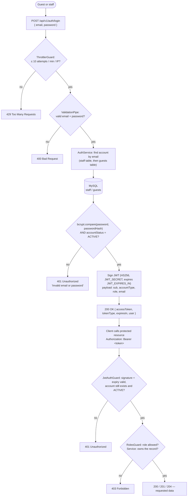

Differences from the Lab 06 diagram: the "Users table" is two tables (`guests`, `staff`) behind one `AuthService`; the account-status check is performed again on **every** request (not only at login), so a deactivated user's existing token stops working immediately.

## 6.2 JWT authentication

| Item | Implementation |
|---|---|
| Library | `@nestjs/jwt` (signing) + `passport-jwt` via `@nestjs/passport` (verification) |
| Algorithm | HS256 only (other algorithms, including `none`, are rejected) |
| Secret | `JWT_SECRET` environment variable, min 32 chars; the app refuses to start without it or with the placeholder — there is **no fallback secret** ([`env.validation.ts`](../../backend/src/config/env.validation.ts)) |
| Expiry | `JWT_EXPIRES_IN` (default `1h`); expired tokens → 401 "Access token has expired" |
| Issuer | `maristay-api` (verified) |
| Payload | `{ sub, accountType: GUEST|STAFF, role, email, iat, exp, iss }` — no password or personal data beyond email |
| Transport | `Authorization: Bearer <token>` header |
| Per-request check | [`JwtStrategy.validate()`](../../backend/src/auth/strategies/jwt.strategy.ts) reloads the account; INACTIVE or deleted → 401; the role is taken from the database, so role changes apply immediately |

## 6.3 Password hashing

* **bcrypt** with cost factor 10 (`BCRYPT_ROUNDS`), salted automatically; hashes look like `$2b$10$…` (verified in MySQL).
* Plaintext passwords are never stored or logged. `passwordHash` columns are `select: false` (not loaded unless explicitly requested) **and** `@Exclude()` (removed from every JSON response by `ClassSerializerInterceptor`).
* Password policy: 8–72 characters, at least one letter and one number (72 = bcrypt's input limit).
* Login uses the same error message for unknown email, wrong password and inactive account, and compares against a dummy bcrypt hash when the email is unknown so response timing does not reveal which emails exist.
* Guests change their own password with `currentPassword` + `newPassword`; managers can reset staff passwords.

## 6.4 Protected routes

`JwtAuthGuard` is registered **globally** (`APP_GUARD`), so every endpoint requires a valid token unless it is explicitly marked `@Public()`. Public endpoints: `POST /auth/login`, `POST /guests`, `GET /rooms`, `GET /rooms/:id`. All other 40 endpoints are protected.

## 6.5 Role-based access control (RBAC)

Roles: `GUEST`, `FRONT_DESK`, `HOUSEKEEPING`, `MANAGER`. Controllers declare who may call each route with `@Roles(...)`; the global [`RolesGuard`](../../backend/src/common/guards/roles.guard.ts) returns **403** when an authenticated user's role is not listed. Public registration can only create `GUEST` accounts (unknown properties such as `role` are rejected with 400); staff accounts are created only by a manager.

## 6.6 Ownership verification

Role checks are not enough — a guest must not see *another guest's* data. Services call [`assertGuestOwnerOrStaff()`](../../backend/src/common/utilities/ownership.util.ts) after loading a record:

| Resource | Rule |
|---|---|
| Guest profile, history | guest only if `guestId === token.sub` |
| Reservation, check-in/out, cancel | guest only if `reservation.guestId === token.sub` |
| Payment, digital key, service order | guest only if the parent reservation belongs to them |
| Housekeeping task | housekeeper only if `task.staffId === token.sub` |
| Lists (`GET /reservations`, `/payments`, …) | guests are automatically filtered to their own records |

Violations return **403 Forbidden**. Housekeeping staff cannot read payments, reservations or guest data at all.

## 6.7 Input validation

* Global `ValidationPipe` with `whitelist: true`, `forbidNonWhitelisted: true`, `transform: true` — every request body and query is validated against a DTO (class-validator), and **unknown properties are rejected** (prevents mass assignment such as sending `accountStatus`, `reservationStatus`, `totalAmount` or `role`).
* Services copy allowed fields explicitly into entities; client input is never spread into an entity.
* Validated: email format; names; phone numbers; password policy; positive integer ids (`ParseIdPipe`); real calendar dates `YYYY-MM-DD` (`@IsDateOnly`, rejects 2026-02-30); date ranges (check-out after check-in, not in the past, ≤ 30 nights); money (`> 0` or `≥ 0`, max 2 decimals); enum values (case-normalised); quantities 1–20; string lengths matching the column sizes.
* Business validation in services: overlapping bookings, payment ≤ outstanding balance, allowed status transitions, room readiness.
* Database CHECK constraints are a final safety net.

## 6.8 Rate limiting

`@nestjs/throttler` registered globally:
* **Login**: 10 attempts per IP per 60 s (`LOGIN_RATE_LIMIT`), then **429 Too Many Requests** — reduces brute-force password guessing (Lab 06).
* **All other routes**: 300 requests per IP per 60 s (`API_RATE_LIMIT`).

## 6.9 Credential and data protection

| Measure | Where |
|---|---|
| No hardcoded secrets | DB credentials, JWT secret and demo password come only from `.env` (git-ignored); `.env.example` has placeholders |
| Environment validation at startup | [`env.validation.ts`](../../backend/src/config/env.validation.ts) |
| Password hashes never returned | `select: false` + `@Exclude()` |
| Digital key credentials | 256-bit random `MSK-…` code; only its SHA-256 hash is stored (unique index); plaintext returned once at issue; never logged; notifications do not contain it |
| SQL injection | All queries go through TypeORM with bound parameters (`:param`); no string-concatenated SQL with user input; ids validated as integers |
| Safe errors | `AllExceptionsFilter` returns generic messages; SQL errors and stack traces stay in the server log |
| Logging | Request bodies, passwords, tokens and key codes are never logged; notification recipients are masked (`0912****789`, `g***@example.com`) |
| Security headers | `helmet()` — verified in responses: `Content-Security-Policy`, `Strict-Transport-Security`, `X-Content-Type-Options: nosniff`, `X-Frame-Options: SAMEORIGIN`; `X-Powered-By` removed. The API serves JSON only, so Helmet's default headers are used in every environment |
| CORS | Restricted to `CORS_ORIGIN` (default `http://localhost:5173`); verified: an allowed origin receives `Access-Control-Allow-Origin`, any other origin receives none (browser blocks it) |
| Inactive accounts | Cannot log in and lose access to protected routes immediately |
| Historical data | FKs are `ON DELETE RESTRICT`; reservations are cancelled, accounts deactivated — never destroyed |
| Postman exports | Environment file contains no passwords or tokens (`demoPassword` is entered locally) |
| Git | `.gitignore` excludes `.env`, `node_modules/`, `dist/`, `coverage/`, logs, and `references/` |

## 6.10 Lab 06 security measures — traceability

| Lab 06 measure | Purpose | Implemented by | Status |
|---|---|---|---|
| Password hashing | Secure passwords | bcrypt (cost 10) | ✔ Implemented and tested |
| HTTPS | Secure communication | Not configured locally — the demo uses HTTP on localhost. Production must terminate TLS at a reverse proxy | ✖ Deployment requirement (documented, not claimed) |
| JWT authentication | Verify users | HS256 JWT, global `JwtAuthGuard` | ✔ |
| RBAC | Restrict access | `@Roles` + `RolesGuard` + ownership checks | ✔ |
| Input validation | Prevent invalid/harmful data | Global `ValidationPipe`, DTOs, custom validators, DB constraints | ✔ |
| Rate limiting | Limit repeated requests / brute force | `@nestjs/throttler` | ✔ (429 verified) |

Threats from Lab 06 Part C and how MariStay addresses them: **SQL injection** → parameterised TypeORM queries; **XSS** → JSON-only API, Helmet CSP headers, no HTML rendering; **brute force** → login rate limit + bcrypt cost; **phishing / session hijacking** → short-lived signed tokens, HTTPS required in deployment, per-request account checks.

**Authentication vs authorization** (Lab 06 Q5): authentication (`JwtAuthGuard`) answers *who are you?* and fails with 401; authorization (`RolesGuard` + ownership) answers *what may you do?* and fails with 403.

## 6.11 Guest self-registration and the optional frontend

* **Public sign-up cannot create staff.** `POST /guests` is public, but it always writes to the `guests` table, and accounts from that table always receive the `GUEST` role at login. Staff roles exist only in the `staff` table, which only a manager can write to (`POST /staff`, `@Roles(MANAGER)`). Because the global `ValidationPipe` uses `forbidNonWhitelisted`, a sign-up request that adds `role`, `accountType`, `accountStatus` or `guestId` is rejected with 400 and creates nothing.
* **Duplicate e-mails** are rejected with 409 across both the guest and staff tables, in any letter case.
* **The React frontend is not a security boundary.** It hides pages a role cannot use, but every request is still checked by `JwtAuthGuard`, `RolesGuard` and the ownership rules. The JWT is kept in `sessionStorage`, and the role is always re-read from the server (`GET /auth/me`). One-time digital key codes are kept only in memory for the current tab.

## 6.12 Final security verification (2026-11-27)

Run on the isolated database (Testing §8.9):

* `npm run verify:registration`: **49/49** checks.
  * 201 without any password field; a bcrypt `$2b$10$` hash in the database; login as GUEST.
  * Duplicate e-mail → 409; invalid input and weak passwords → 400.
  * `role` MANAGER / FRONT_DESK / HOUSEKEEPING → 400 with no account created.
  * The new guest gets 403 on staff routes.
* Security and RBAC matrix: **126/126** checks.
  * 21 endpoints × no token and the four roles: 401/403 enforced.
  * Rejected tokens: tampered, `alg: none`, expired, and signed with another secret.
  * Ownership checks hold.
  * No `passwordHash` or `keyCodeHash` in any response.
  * SQL-injection text is treated as data, and mass assignment is rejected.
  * Helmet headers are present, and CORS allows only the configured origin.

<div class="page-break"></div>

# Chapter 7 — Backend Implementation

## 7.1 Technology and project structure

| Component | Version / package |
|---|---|
| Runtime | Node.js 24, TypeScript 5.8 |
| Framework | NestJS 11.2 (`@nestjs/common`, `core`, `platform-express`) |
| ORM / driver | TypeORM 0.3.31 + `mysql2` 3 (`@nestjs/typeorm` 11) |
| Database | MySQL protocol — XAMPP MariaDB 10.4.32 locally; also verified on Oracle MySQL 8.4.11 LTS |
| Auth | `@nestjs/jwt` 11, `@nestjs/passport` 11, `passport-jwt` 4, `bcrypt` 6 |
| Validation | `class-validator` 0.14, `class-transformer` 0.5 |
| Security | `helmet` 8, `@nestjs/throttler` 6 |
| Tests | Jest 29, Supertest 7, Postman / Newman |

The repository root has five folders: `backend/` (the NestJS application below, with its `package.json`, tests and utility scripts), `database/` (`maristay.sql`), `postman/` (collection and environment), `frontend/` (optional React client) and `docs/`.

```text
backend/src/
├── auth/            login, JWT strategy, JwtAuthGuard, IdentityService, rate-limit config
├── guests/          GuestsModule (controller, service, entity, DTOs)
├── rooms/           RoomsModule
├── reservations/    ReservationsModule + StayService (check-in / check-out)
├── payments/        PaymentsModule + BillingService
├── digital-keys/    DigitalKeysModule (issue/revoke helpers + API service)
├── housekeeping/    HousekeepingModule (+ automatic assignment service)
├── staff/           StaffModule
├── service-orders/  ServiceOrdersModule + server-side service catalog
├── notifications/   simulated SMS / e-mail adapter
├── common/          enums, decorators, RolesGuard, exception filter, pipes, validators, utilities
├── config/          environment validation
├── database/        connection options, migration, seed, CLI data source, db:create
├── app.module.ts    root module (imports + global guards)
├── app.setup.ts     global HTTP pipeline (prefix, Helmet, CORS, validation, serializer, filter)
└── main.ts          bootstrap
backend/test/        e2e tests (Supertest) + isolated test-database setup
backend/scripts/     Postman instance, registration check, documentation and slide builders
```

## 7.2 NestJS modules

Each functional module follows the same pattern — **module** (wiring), **controller** (HTTP), **service** (business logic), **entity** (table), **DTOs** (input contracts):

| Module | Controller routes | Service highlights |
|---|---|---|
| AuthModule | `/auth/login`, `/auth/me` | bcrypt compare, JWT signing, per-request account reload |
| GuestsModule | `/guests` (6 routes) | registration, cross-table email check, deactivation guard |
| RoomsModule | `/rooms` (6 routes) | availability query (`NOT EXISTS` overlap), history-safe delete |
| ReservationsModule | `/reservations` (8 routes) | locked booking transaction, confirm, cancel, StayService check-in/out |
| PaymentsModule | `/payments` (4 routes) | balance validation, status transitions, auto-confirmation |
| DigitalKeysModule | `/digital-keys` (5 routes) | random key + SHA-256 hash, validation rules, revoke |
| HousekeepingModule | `/housekeeping` (4 routes) | least-loaded assignment, strict transitions, room release |
| StaffModule | `/staff` (5 routes) | manager-only CRUD, self-lockout and open-task guards |
| ServiceOrdersModule | `/service-orders` (4 routes) | catalog pricing, status workflow, guest cancellation |

## 7.3 Controller layer

Controllers only translate HTTP into a service call. Example — the room endpoints used in the video demo ([`rooms.controller.ts`](../../backend/src/rooms/rooms.controller.ts)):

```typescript
@Controller('rooms')
export class RoomsController {
  constructor(private readonly roomsService: RoomsService) {}   // dependency injection

  @Public()                                   // no token needed (Lab 05: public)
  @Get()
  findAll(@Query() query: RoomQueryDto) {     // query string validated by RoomQueryDto
    return this.roomsService.findAll(query);
  }

  @Roles(Role.MANAGER)                        // RolesGuard → 403 for other roles
  @Patch(':id')
  update(@Param('id', ParseIdPipe) id: number, @Body() dto: UpdateRoomDto) {
    return this.roomsService.update(id, dto); // returns the updated Room → 200 + JSON
  }

  @Roles(Role.MANAGER)
  @Delete(':id')
  @HttpCode(HttpStatus.NO_CONTENT)            // 204
  async remove(@Param('id', ParseIdPipe) id: number) {
    await this.roomsService.remove(id);
  }
}
```

## 7.4 Service layer

Services hold the rules. Example ([`rooms.service.ts`](../../backend/src/rooms/rooms.service.ts)):

```typescript
async update(roomId: number, dto: UpdateRoomDto): Promise<Room> {
  const room = await this.findOne(roomId);               // 404 if missing
  return this.applyChanges(room, dto);
}

private async applyChanges(room: Room, dto: UpdateRoomDto): Promise<Room> {
  if (dto.roomNo !== undefined && dto.roomNo !== room.roomNo) {
    await this.assertRoomNoAvailable(dto.roomNo);         // 409 duplicate room number
    room.roomNo = dto.roomNo;
  }
  if (dto.roomStatus !== undefined && dto.roomStatus !== room.roomStatus) {
    if (room.roomStatus === RoomStatus.OCCUPIED) {
      throw new ConflictException('Room is occupied by a checked-in guest; its status changes at check-out');
    }
    room.roomStatus = dto.roomStatus;
  }
  if (dto.roomType !== undefined) room.roomType = dto.roomType;
  if (dto.pricePerNight !== undefined) room.pricePerNight = dto.pricePerNight;
  return this.rooms.save(room);                           // Repository → UPDATE rooms …
}
```

## 7.5 TypeORM repository layer

Services receive repositories through dependency injection (`@InjectRepository(Room) private readonly rooms: Repository<Room>`). Simple reads use `findOneBy`/`findAndCount`; filters use the QueryBuilder with **bound parameters**:

```typescript
qb.andWhere('room.roomStatus <> :maintenance', { maintenance: RoomStatus.MAINTENANCE }).andWhere(
  `NOT EXISTS (
     SELECT 1 FROM reservations r
     WHERE r.roomId = room.roomId
       AND r.reservationStatus IN (:...active)
       AND r.checkInDate < :checkOutDate
       AND r.checkOutDate > :checkInDate)`,
  { active: ACTIVE_RESERVATION_STATUSES, checkInDate: query.checkInDate, checkOutDate: query.checkOutDate },
);
```

Inside workflows the service uses the transaction's `EntityManager` (`em`) so that every write belongs to the same transaction.

## 7.6 Entity implementation

Entities map classes to tables. Example — `Reservation` with both sides of its relationships ([`reservation.entity.ts`](../../backend/src/reservations/entities/reservation.entity.ts)):

```typescript
@Entity({ name: 'reservations' })
@Index('IDX_reservations_room_dates', ['roomId', 'checkInDate', 'checkOutDate'])
export class Reservation {
  @PrimaryGeneratedColumn({ name: 'reservationId', type: 'int' })
  reservationId!: number;

  @Column({ type: 'int' }) guestId!: number;
  @Column({ type: 'int' }) roomId!: number;
  @Column({ type: 'date' }) checkInDate!: string;
  @Column({ type: 'date' }) checkOutDate!: string;
  @Column({ type: 'varchar', length: 20, default: ReservationStatus.PENDING })
  reservationStatus!: ReservationStatus;
  @Column({ type: 'decimal', precision: 10, scale: 2, transformer: decimalTransformer })
  totalAmount!: number;
  // …ratePerNight, createdAt, updatedAt

  @ManyToOne(() => Guest, (guest) => guest.reservations, { onDelete: 'RESTRICT', onUpdate: 'CASCADE' })
  @JoinColumn({ name: 'guestId', foreignKeyConstraintName: 'FK_reservations_guest' })
  guest?: Guest;

  @ManyToOne(() => Room, (room) => room.reservations, { onDelete: 'RESTRICT', onUpdate: 'CASCADE' })
  @JoinColumn({ name: 'roomId', foreignKeyConstraintName: 'FK_reservations_room' })
  room?: Room;

  @OneToMany(() => Payment, (payment) => payment.reservation) payments?: Payment[];
  @OneToMany(() => DigitalKey, (key) => key.reservation) digitalKeys?: DigitalKey[];
  @OneToMany(() => ServiceOrder, (order) => order.reservation) serviceOrders?: ServiceOrder[];
}
```

Sensitive columns are protected in the entity itself:

```typescript
@Exclude()                                                    // never serialized to JSON
@Column({ type: 'varchar', length: 255, select: false })      // never loaded unless asked
passwordHash!: string;
```

## 7.7 Database connection

One function builds the connection options from environment variables and is shared by the app, the TypeORM CLI, the seed script and the tests ([`database.config.ts`](../../backend/src/database/database.config.ts)):

```typescript
export function buildDataSourceOptions(env = process.env, databaseOverride?: string): DataSourceOptions {
  return {
    type: 'mysql',                       // mysql2 driver
    host: required(env, 'DB_HOST'),
    port: Number(env.DB_PORT ?? 3306),
    username: required(env, 'DB_USERNAME'),
    password: env.DB_PASSWORD ?? '',
    database: databaseOverride ?? required(env, 'DB_DATABASE'),
    entities: ENTITIES,                  // the 8 entity classes
    migrations: MIGRATIONS,
    synchronize: false,                  // schema changes only via migrations
    timezone: 'local',
    dateStrings: ['DATE'],
  };
}
```

`AppModule` registers it with `TypeOrmModule.forRootAsync(...)`, and the app refuses to start if any required variable is missing or the JWT secret is weak.

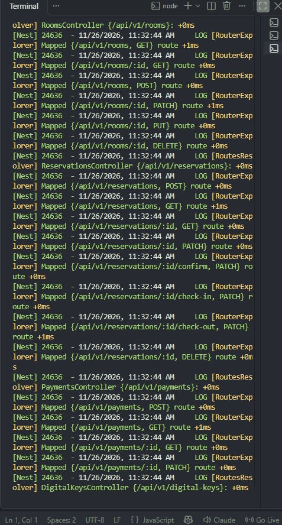**Figure 7.1.** Part of the `npm run start:dev` log on 2026-11-26 (process 24636, 11:32:44 AM). NestJS's `RoutesResolver` and `RouterExplorer` map the *Rooms*, *Reservations* and *Payments* routes under `/api/v1`, including PATCH/PUT/DELETE `/rooms/:id` and the reservation `confirm`, `check-in` and `check-out` actions. The routes are mapped only after the database connection succeeds. The whole log maps 44 routes; the 0-error compile is recorded in §8.3.

## 7.8 Important business logic

### Preventing double bookings ([`reservations.service.ts`](../../backend/src/reservations/reservations.service.ts))

```typescript
const reservationId = await this.dataSource.transaction('READ COMMITTED', async (em) => {
  const guest = await em.findOneBy(Guest, { guestId });
  // …404 / inactive checks
  const room = await em.findOne(Room, { where: { roomId: dto.roomId }, lock: { mode: 'pessimistic_write' } });
  //            ^ SELECT … FOR UPDATE: a second booking for this room waits here
  if (room.roomStatus === RoomStatus.MAINTENANCE) throw new ConflictException('Room is under maintenance …');
  await this.assertNoOverlap(em, room.roomId, dto.checkInDate, dto.checkOutDate);  // 409 if overlap
  const nights = nightsBetween(dto.checkInDate, dto.checkOutDate);
  const reservation = em.create(Reservation, {
    guestId, roomId: room.roomId, checkInDate: dto.checkInDate, checkOutDate: dto.checkOutDate,
    reservationStatus: ReservationStatus.PENDING,
    ratePerNight: room.pricePerNight,                                   // price snapshot
    totalAmount: fromCents(toCents(room.pricePerNight) * nights),
  });
  return (await em.save(reservation)).reservationId;
});
```
Why it works: both competing requests try to lock the same room row; the second waits until the first commits, then (because of `READ COMMITTED`) its overlap query sees the new reservation and returns 409. Verified with 6 simultaneous requests: one 201, five 409.

### Digital check-in ([`stay.service.ts`](../../backend/src/reservations/stay.service.ts))

```typescript
const issued = await this.dataSource.transaction(BOOKING_ISOLATION, async (em) => {
  const reservation = await this.lockReservation(em, reservationId);
  assertGuestOwnerOrStaff(user, reservation.guestId);                 // 403 for other guests
  // status must be CONFIRMED; today within [checkInDate, checkOutDate)   → 409 otherwise
  const summary = await this.billing.summarize(em, reservation);
  if (toCents(summary.paidTotal) < toCents(summary.roomTotal)) throw new ConflictException('Payment required …');
  const room = await em.findOne(Room, { where: { roomId: reservation.roomId }, lock: { mode: 'pessimistic_write' } });
  if (room.roomStatus !== RoomStatus.AVAILABLE) throw new ConflictException(`Room ${room.roomNo} is not ready …`);

  await em.update(Reservation, { reservationId }, { reservationStatus: ReservationStatus.CHECKED_IN });
  await em.update(Room, { roomId: room.roomId }, { roomStatus: RoomStatus.OCCUPIED });
  return this.digitalKeys.issueKey(em, reservation);                   // stores only the hash
});
// after commit: simulated SMS + e-mail, response includes the key code once
```

### Digital check-out
In one transaction: cancel open service orders → compute balance (409 if anything is due) → reservation CHECKED_OUT → revoke active keys → room CLEANING → `HousekeepingAssignmentService.assignCleaning()` picks the active housekeeper with the fewest open tasks. If any step throws, **everything** rolls back.

### Digital keys
```typescript
export function generateDigitalKeyCode(): string {
  return `MSK-${randomBytes(32).toString('base64url')}`;       // 256 bits of randomness
}
export function hashDigitalKeyCode(code: string): string {
  return createHash('sha256').update(code, 'utf8').digest('hex'); // what is stored in MySQL
}
```
Validation hashes the submitted code, looks it up, and checks status, expiry, reservation status, room and ownership.

### Money
DECIMAL values are converted to numbers by a column transformer, and all arithmetic is done in integer centavos (`toCents`/`fromCents`) so `0.1 + 0.2` problems cannot affect balances.

## 7.9 Cross-cutting implementation

| Concern | Implementation |
|---|---|
| Global guards | `APP_GUARD` providers in `AppModule`: ThrottlerGuard → JwtAuthGuard → RolesGuard |
| Decorators | `@Public()`, `@Roles(...)`, `@CurrentUser()` in `common/decorators` |
| Validation | Global `ValidationPipe` (whitelist + forbidNonWhitelisted + transform), DTO classes, `ParseIdPipe`, `@IsDateOnly()` |
| Serialization | `ClassSerializerInterceptor` honours `@Exclude()` |
| Errors | `AllExceptionsFilter` — consistent JSON, DB error translation |
| Configuration | `ConfigModule` + `validateEnv()` |
| Documentation | Endpoint reference in Chapter 5; each controller method has a one-line summary comment |
| Migrations / seed | `backend/src/database/migrations`, `backend/src/database/seeds` (idempotent) |

<div class="page-break"></div>

# Chapter 8 — API Testing and Validation

**Test dates:** 2026-11-25 (development and full suite); 2026-11-26 (Newman runs; unit + e2e regression after rotating the JWT secret; Postman desktop Runner 177/177; screenshot evidence in §8.7); 2026-11-27 (final regression on MariaDB and Oracle MySQL 8.4.11 LTS, §8.9) · **Environment:** Windows 11, Node.js 24.21.0, NestJS 11.2, TypeORM 0.3.31, XAMPP MariaDB 10.4.32 (MySQL-compatible) on localhost:3306.

All results in this report were produced by actually running the tests on the development machine. Nothing is estimated. The screenshots in §8.7 were captured by the student on the same machine; only redaction and cropping were applied.

## 8.1 Testing approach

| Level | Tool | Database | What it proves |
|---|---|---|---|
| Unit tests | Jest + ts-jest (`npm run test`) | none (mocks) | Pure logic: dates, money, id validation, ownership, RolesGuard, login rules, env validation |
| End-to-end (integration) tests | Jest + Supertest (`npm run test:e2e`) | real MySQL, isolated `maristay_test_db` — dropped, migrated and seeded at the start of every run | The whole stack (guards → pipes → controllers → services → TypeORM → MySQL) and the integrated workflow |
| Collection testing | Postman collection (`postman/MariStay.postman_collection.json`), run with Newman (`npm run postman:newman`) or the Postman Runner | isolated `maristay_postman_db` on port 3001, reset before every run | All 122 requests in order, with 177 assertions: the integrated workflow, security and negative cases |
| Manual API testing / live demo | Individual Postman requests | local `maristay_db` on port 3000 | Live demonstration (Login and room CRUD only, not the full collection); request/response inspection |
| Manual smoke scripts | Node `fetch` scripts during development | `maristay_test_db` | Every endpoint, positive and negative cases, while building each module |
| Database checks | `mysql` CLI | both | CHECK / FK constraints reject bad data; SQL export re-imports cleanly |

The e2e database name must end with `_test` (or `_test_db`); the test refuses to reset any other database, so demo data in `maristay_db` is never touched.

## 8.2 Automated test results

### Unit tests — `npm run test` → **33 passed, 0 failed** (4 / 4 suites; latest run 37.441 s, Figure 8.17)

| Suite | Tests |
|---|---|
| `config/env.validation.spec.ts` | accepts a complete configuration · refuses to start without a JWT secret (no insecure fallback) · refuses the placeholder or a short secret · rejects an unsafe database name |
| `common/utilities/utilities.spec.ts` | nights in a half-open range · only real YYYY-MM-DD dates · key expiry 12:00 local on check-out date · centavo arithmetic avoids float errors · ParseIdPipe accepts positive integers and rejects `0`, `-1`, `abc`, `1.5`, `1 OR 1=1`, empty (400) · guest can access own record · guest blocked from another guest's record (403) · operations staff allowed · disallowed staff roles blocked · custom role list honoured · unique high-entropy key codes · deterministic SHA-256 key hashing · password policy |
| `common/guards/roles.guard.spec.ts` | routes without @Roles allowed · public routes allowed · listed role allowed · wrong role → 403 (not 401) |
| `auth/auth.service.spec.ts` | valid guest gets JWT with id/accountType/role and no hash · staff login carries staff role · wrong password → 401 · unknown email → same 401 message · INACTIVE account → 401 · deactivated account's token resolves to no user |

### End-to-end tests — `npm run test:e2e` → **46 passed, 0 failed** (latest run 13.62 s, Figure 8.18)

| # | Scenario (test name) | Expected | Actual |
|---|---|---|---|
| 1 | registers a guest without exposing the password hash | 201 | ✔ 201 |
| 2 | rejects a duplicate email, also across staff accounts | 409 | ✔ 409 |
| 3 | rejects invalid registration data and unknown properties | 400 | ✔ 400 |
| 4 | logs in with valid credentials and returns a JWT | 200 | ✔ 200 |
| 5 | rejects invalid credentials | 401 | ✔ 401 |
| 6 | protected route without a token | 401 | ✔ 401 |
| 7 | protected route with invalid / tampered token | 401 | ✔ 401 |
| 8 | current profile with a valid token | 200 | ✔ 200 |
| 9 | guest calls a manager-only route | 403 | ✔ 403 |
| 10 | guest reads another guest's profile | 403 | ✔ 403 |
| 11 | non-numeric id | 400 | ✔ 400 |
| 12 | deactivated account blocked immediately, even with an unexpired token | 204 then 401 | ✔ |
| 13 | public room list with `?roomStatus=Available` | 200, all AVAILABLE | ✔ |
| 14 | invalid status filter | 400 | ✔ 400 |
| 15 | create room | 201 | ✔ 201 |
| 16 | invalid room data / duplicate room number | 400 / 409 | ✔ |
| 17 | retrieve room | 200 | ✔ 200 |
| 18 | update room with PATCH | 200 | ✔ 200 |
| 19 | replace room with PUT (missing field → 400) | 400 / 200 | ✔ |
| 20 | delete test room, then GET | 204 / 404 | ✔ |
| 21 | delete room with reservation history | 409 | ✔ 409 |
| 22 | invalid reservation dates (reversed, past, 2026-02-30) | 400 | ✔ 400 |
| 23 | book a room → PENDING, total = 3 × 1800 | 201 | ✔ 201 |
| 24 | overlapping reservation rejected; same-day turnover allowed | 409 / 201 | ✔ |
| 25 | **6 concurrent conflicting bookings** | exactly one 201, five 409 | ✔ `[201, 409, 409, 409, 409, 409]` |
| 26 | guest views another guest's reservation; guest lists only own | 403 | ✔ |
| 27 | housekeeping lists reservations | 403 | ✔ 403 |
| 28 | client-controlled status / booking for someone else | 400 / 403 | ✔ |
| 29 | workflow step 4: guest books a room for today | 201 | ✔ |
| 30 | check-in without sufficient payment (pending, then confirmed-but-unpaid) | 409 | ✔ 409 "Payment required…" |
| 31 | invalid payment information; guest tries to record payment | 400 / 403 | ✔ |
| 32 | step 5: FAILED payment not counted; PAID payment auto-confirms | 201, CONFIRMED | ✔ |
| 33 | check-in when room is not ready (CLEANING) | 409 | ✔ 409 "not ready" |
| 34 | step 6: digital check-in → CHECKED_IN, room OCCUPIED, key issued, notifications simulated | 200 | ✔ |
| 35 | only a SHA-256 hash of the key is stored in MySQL | hash ≠ code | ✔ |
| 36 | step 7: valid key → access granted; invalid key → denied | 200 / 403 | ✔ |
| 37 | expired key and revoked key rejected | 403 / 403 | ✔ |
| 38 | step 8: service order priced by server (2 × 450 = 900); client price rejected | 201 / 400 | ✔ |
| 39 | unauthorized service order (other guest / not checked in) | 403 / 409 | ✔ |
| 40 | step 9: check-out blocked by unpaid 900.00, then succeeds; key no longer works | 409 / 200 / 403 | ✔ |
| 41 | step 10: housekeeper cannot touch another housekeeper's task or payments | 403 | ✔ |
| 42 | step 10: invalid transition 409; IN_PROGRESS → COMPLETED; room becomes AVAILABLE | 409 / 200 | ✔ |
| 43 | manager assigns housekeeping task; duplicate open task | 201 / 409 | ✔ |
| 44 | staff create / read / update / deactivate; deactivated staff cannot log in | 201/200/200/204/401 | ✔ |
| 45 | staff endpoints are manager-only | 403 | ✔ 403 |
| 46 | login rate limit | 429 | ✔ 429 |

Raw output (last run):
```
Test Suites: 1 passed, 1 total
Tests:       46 passed, 46 total
```

### Coverage of the required test scenarios

| Required scenario | Covered by |
|---|---|
| Successful guest registration / duplicate email | e2e 1, 2 · Postman 2, 11 |
| Valid login / invalid credentials | e2e 4, 5 · Postman 1, 11 |
| Protected route without token / invalid token | e2e 6, 7 · Postman 11 |
| Guest attempting manager-only operations | e2e 9 · Postman 11 |
| Guest accessing another guest's reservation | e2e 26 · Postman 11 |
| Valid / invalid room creation, retrieval, update, deletion | e2e 15–21 · Postman 3, 11 |
| Invalid reservation dates / successful reservation / overlap | e2e 22–24 · Postman 4, 11 |
| Concurrent conflicting reservation attempts | e2e 25 · Postman 11 (4 parallel `pm.sendRequest`) |
| Successful payment / invalid payment information | e2e 31–32 · Postman 5 |
| Check-in without sufficient payment / room not ready | e2e 30, 33 · Postman 10, 11 |
| Successful digital check-in / digital key generation | e2e 34–35 · Postman 6 |
| Invalid / expired / revoked digital key | e2e 36–37 · Postman 6 |
| Successful / unauthorized service order | e2e 38–39 · Postman 9 |
| Successful check-out | e2e 40 · Postman 9, 10 |
| Housekeeping assignment / status update / room availability restoration | e2e 41–43 · Postman 7, 9, 10 |

## 8.3 Manual verification performed during development

| Check | Result |
|---|---|
| `npm run build` | ✔ 0 TypeScript errors |
| `npm run start:dev` against `maristay_db` | ✔ "Found 0 errors", 44 routes mapped, API + Swagger URLs logged (Swagger UI was removed on 2026-11-27; see Testing §8.11.) |
| Video flow on `maristay_db`: manager login → create room → GET → PATCH → DELETE → POST without token | ✔ 200 → 201 → 200 → 200 → 204 → 401 |
| Swagger `/api/docs-json` | ✔ 200, 44 operations, 18 schemas; UI assets load under CSP (Swagger UI was removed on 2026-11-27; see Testing §8.11.) |
| Security headers / CORS | ✔ CSP, HSTS, nosniff, SAMEORIGIN present; `X-Powered-By` absent; only the configured origin receives `Access-Control-Allow-Origin` |
| CHECK constraints (MariaDB) | ✔ negative price → `CONSTRAINT CHK_rooms_pricePerNight failed`; checkOut = checkIn → `CHK_reservations_dates failed` |
| FK RESTRICT | ✔ deleting a room with history → error 1451 |
| Seed idempotency | ✔ second run creates 0 records |
| SQL export | ✔ `database/maristay.sql` re-imported into a scratch database: 8 tables + migrations, 7 FKs, all rows |
| Secret scan of every file to be committed | ✔ JWT secret and demo password found in 0 files; `.env` and `references/` ignored |

## 8.4 Error handling verification

Every error returns the same JSON shape with a correct status code (never 200 on failure):
```json
{ "statusCode": 409, "error": "CONFLICT", "message": "Room already booked for the selected dates", "path": "/api/v1/reservations", "timestamp": "…" }
```
Database exceptions are mapped (duplicate → 409, FK → 400/409, CHECK → 400, other → 500 generic) without exposing SQL text.

## 8.5 Bugs found by testing and fixed

| # | Found by | Problem | Fix |
|---|---|---|---|
| B1 | Smoke test (500 on every booking) | TypeORM's `pessimistic_read` lock emits MySQL 8 `FOR SHARE`, a syntax error on MariaDB 10.4 | Booking transactions use `READ COMMITTED` + `SELECT … FOR UPDATE` on the room row (portable); concurrency re-verified |
| B2 | Captured API samples | `createdAt` (DB default, local time) and app-written datetimes (UTC) differed by 8 h | Use the `local` time zone for both; corrected seeded rows; re-exported SQL |
| B3 | Postman design review | Login limit of 5/min was below the 6 role logins in folder 1 | Default raised to 10/min (still blocks brute force; 429 test updated) |
| B4 | e2e test | Test tried to set `expiresAt` before `issuedAt`; the CHECK constraint correctly refused | Test fixed (constraint confirmed working) |
| B5 | Header review | Helmet CSP `upgrade-insecure-requests` could break Swagger UI over plain HTTP | Directive sent only in production. Since Swagger was removed (2026-11-27), Helmet defaults apply everywhere |
| B6 | First full Postman run | 32 request bodies sent numeric ids and amounts as quoted placeholders (`"roomId": "{{stayRoomId}}"`), so the API correctly answered 400 (`roomId must be an integer number`), and payments, same-day bookings, check-in and the workflow cascaded into failures | Placeholders unquoted (`"roomId": {{stayRoomId}}`) in the collection; API validation unchanged |
| B7 | Second Postman desktop run (port 3001): 38 passed, 138 failed, 10 script errors, every protected request 401 | Not a code bug: all six logins failed, so no tokens were saved. Newman reproduced the same signature only when `demoPassword` was empty (400 on every login) or wrong (401), each giving 36 passed / 140 failed. Spending the login rate limit beforehand produced different counts. | Login - Manager now has a pre-request guard that stops with a clear message when `demoPassword` is empty. No assertion, validation or authentication was changed. |

## 8.6 Postman collection

* **Files:** `postman/MariStay.postman_collection.json` (Postman v2.1, the submitted collection) and `postman/MariStay.postman_environment.json` (no passwords or tokens; `demoPassword` is left empty).
* **Content:** 11 folders and **122 requests**. Each request has test assertions (status codes and business rules). Scripts save tokens and ids into environment variables. Every `{{variable}}` used is defined in the environment or set by an earlier request.
* **Isolated run target:** the full collection creates guests, staff, rooms, reservations and payments, so it runs against a separate database, `maristay_postman_db`, served by a second instance on port 3001 (`baseUrl` = `http://localhost:3001/api/v1`). `maristay_db` is never touched.
  * `npm run postman:setup` creates and seeds the database.
  * `npm run postman:reset` rebuilds only that database.
  * `npm run postman:start` serves it.
  * `npm run postman:env` writes a matching Postman environment to the git-ignored `postman/tmp/`.
* **Preconditions:** a freshly seeded database (room ids 1, 2, 3 and 5 = rooms 101, 102, 103 and 201; room 302 is the only available Family room). A freshly started server, because the login limit of 10/min is kept in memory: the run makes 8 logins before the final rate-limit request sends 12.
* **Collection fixes found by running it** (see 8.5 B6 and B7):
  * 32 numeric placeholders were unquoted.
  * *Login - Manager* now stops with a clear message if `demoPassword` is empty.
  * The deliberately invalid token in *Protected Route With Invalid Token → 401* is built at run time, so Postman's secret scanner no longer rewrites it. It still sends `Bearer invalid.token.value` and expects 401.

  No assertion, validation rule or security control was weakened.
* **Newman command:** `npm install --no-save newman` once, then `npm run postman:newman` while the port-3001 server runs. It runs `postman/MariStay.postman_collection.json` and passes the demo password from `.env` in memory, so it never appears on a command line, in a file or in the report. It writes a token-free summary to `postman/tmp/newman-summary.json`.

**Newman results.** Actual runs on 2026-11-26 with Newman 6.2.3 on port 3001. Before each run, `maristay_postman_db` was reset and the server restarted:

| Run | Collection source | Requests (collection / HTTP) | Assertions passed | Failed | Script errors | Duration |
|---|---|---|---|---|---|---|
| 1 | Collection (converted from the Postman YAML copy) | 122 / 137 | 177 / 177 | 0 | 0 | 16.9 s |
| 2 | Same, repeated | 122 / 137 | 177 / 177 | 0 | 0 | 16.2 s |
| 3 | `postman/MariStay.postman_collection.json`, after rotating the JWT secret | 122 / 137 | 177 / 177 | 0 | 0 | 14.8 s |

The 137 HTTP requests include 15 sent by `pm.sendRequest`: 4 concurrent bookings and 11 rate-limit logins. HTTP status mix in each run: 200 ×64, 201 ×24, 204 ×3, 400 ×7, 401 ×5, 403 ×10, 404 ×1, 409 ×13, 429 ×10. Every 4xx response is the expected result of a negative test. The Newman output contained no tokens or passwords.

* **Postman desktop app:** ✔ **passed** on 2026-11-26 (Runner started 12:12:44 PM). The run used the *MariStay Postman 3001* environment against a freshly reset `maristay_postman_db` on port 3001.
  * Totals reported by the Runner: 1 iteration, **177 tests, 177 passed, 0 failed, 0 skipped, 0 errors**.
  * Duration **17 s 347 ms**; average response time **13 ms**.
  * Evidence: Figures 8.12 to 8.15.

  Two earlier desktop runs had failed for reasons outside the API (B6 and B7). Newman counts 177 assertions only when every request succeeds; failing runs count fewer, because a failed test stops before its later assertions. A total of 177 passed therefore means all 122 requests ran successfully. To repeat the run:
  1. Stop the port-3001 server, then run `npm run postman:reset` and `npm run postman:start`.
  2. Select the *MariStay Postman 3001* environment. Set `demoPassword` and **save** the environment.
  3. Run all 122 requests in their default order, sequentially.

## 8.7 Evidence and representative screenshots

All screenshots were captured by the student on 2026-11-26 on the development machine. They were then prepared for publication as follows:

* **Redacted:**
  * the JWT payload and signature in the two login responses (Figures 8.1 and 8.2);
  * the plain digital key code in the check-in response (Figure 8.14).
* **Cropped:** each image is cropped to the relevant part of the screen. This removed the Postman AI side panel and collection sidebar, and the phpMyAdmin database list, which showed database names unrelated to this project.

Nothing else was edited. The server start-up is Figure 7.1 (Chapter 7). The Swagger UI screenshot (formerly Figure 5.1) was removed together with Swagger on 2026-11-27.

**Environments used.** Two groups of screenshots use two different databases:

* **Manual requests (Figures 8.1–8.11):** sent one at a time with the *MariStay Local* environment to the demonstration instance on port 3000 (`maristay_db`). Only login, room CRUD and the 401/403 checks were run there.
* **Collection Runner (Figures 8.12–8.15):** the full collection, run on the isolated instance on port 3001 (`maristay_postman_db`). This keeps the demonstration data clean, as described in §8.6.

### Summary of verified results

| # | Evidence | Result | Figure |
|---|---|---|---|
| 1 | Server start-up, routes mapped | ✔ | 7.1 |
| 2 | Manager login | ✔ 200 OK, JWT issued | 8.1 |
| 3 | Guest login | ✔ 200 OK, JWT issued | 8.2 |
| 4 | Create room | ✔ 201 Created (Room ID 13, 2500.00) | 8.3 |
| 5 | Retrieve room | ✔ 200 OK (Room ID 13) | 8.4 |
| 6 | Update room with PATCH | ✔ 200 OK, price 2500 → 2800 (Room ID 13) | 8.5, 8.6 |
| 7 | Retrieve a deleted room | ✔ 404 Not Found (Room ID 13) | 8.7, 8.8 |
| 8 | Delete room | ✔ 204 No Content (temporary Room ID 14, see note below) | 8.9 |
| 9 | Protected route without a token | ✔ 401 Unauthorized | 8.10 |
| 10 | Guest calls a manager-only route | ✔ 403 Forbidden | 8.11 |
| 11 | Full collection in the Postman desktop Runner | ✔ 177 / 177 assertions, 0 failed, 0 errors, 17.347 s, avg 13 ms | 8.12 |
| 12 | Digital check-in issues a key; simulated smart lock grants access | ✔ 200 OK, "Key issued", "Access granted" | 8.13, 8.14 |
| 13 | Overlapping reservation | ✔ 409 Conflict | 8.15 |
| 14 | `reservations` table unchanged by the manual requests | ✔ | 8.16 |
| 15 | Unit tests | ✔ 33 / 33 passed, 4 / 4 suites, 37.441 s | 8.17 |
| 16 | End-to-end tests | ✔ 46 / 46 passed, 1 / 1 suite, 13.62 s | 8.18 |
| 17 | Newman (command-line runner) | ✔ 177 / 177 in three runs (table in §8.6) | text only |

**Protected route with an invalid token → 401.** This case has no separate screenshot. It is covered by the passing Runner assertion *Protected Route With Invalid Token → 401* (inside the 177 in Figure 8.12), by e2e test 7 (Figure 8.18), and by all three Newman runs.

### 8.7.1 Authentication

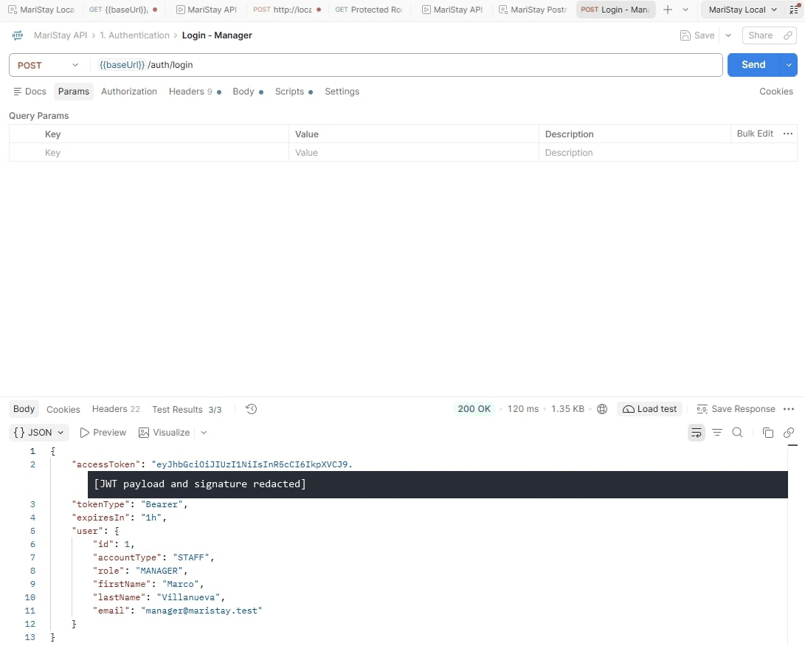\
**Figure 8.1.** *Login - Manager* (`POST /auth/login`) on port 3000 returns **200 OK** with an access token (JWT payload and signature redacted).

The response gives `tokenType: "Bearer"` and `expiresIn: "1h"`, and the user's role is `MANAGER`. The password hash is not part of the response. All three test assertions passed (Test Results 3/3).

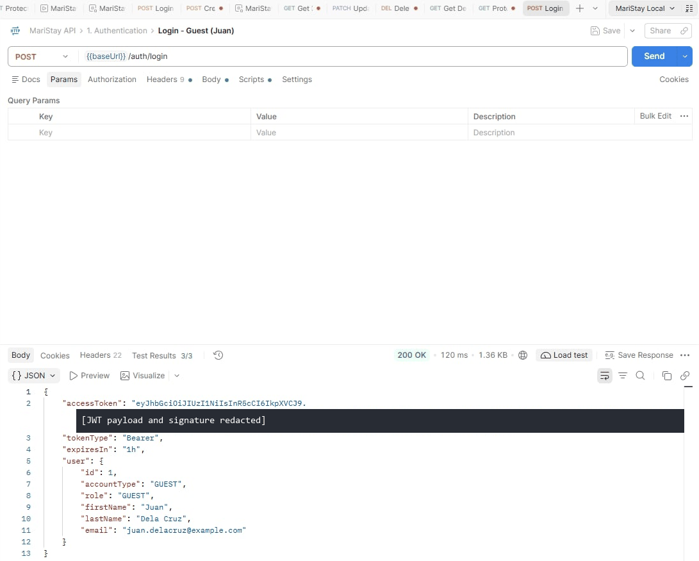\
**Figure 8.2.** *Login - Guest (Juan)* returns **200 OK** with an access token for the fictional demo guest, whose role is `GUEST` (token redacted).

This token is used for the 403 check in Figure 8.11.

### 8.7.2 Room management: full CRUD

Figures 8.3 to 8.8 follow one test room, **Room ID 13** (room number `T91562`, generated by the collection). It was created, read, updated, and is shown to be gone. The **204 response in Figure 8.9 belongs to a second, temporary room, Room ID 14**. That room was created the same way, only to capture a clean DELETE screenshot, because the DELETE response for Room 13 was not captured. Neither room still exists. A read-only query of `maristay_db` on 2026-11-26 found no room with an ID of 10 or higher and `AUTO_INCREMENT = 15`, which confirms that rooms 13 and 14 were both created and then deleted.

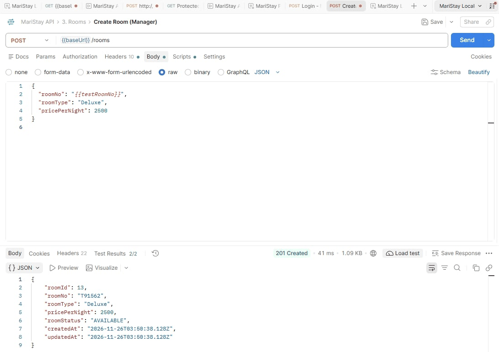\
**Figure 8.3.** *Create Room (Manager)* returns **201 Created**. The new room has `roomId: 13`, type Deluxe, `pricePerNight: 2500` and `roomStatus: "AVAILABLE"`.

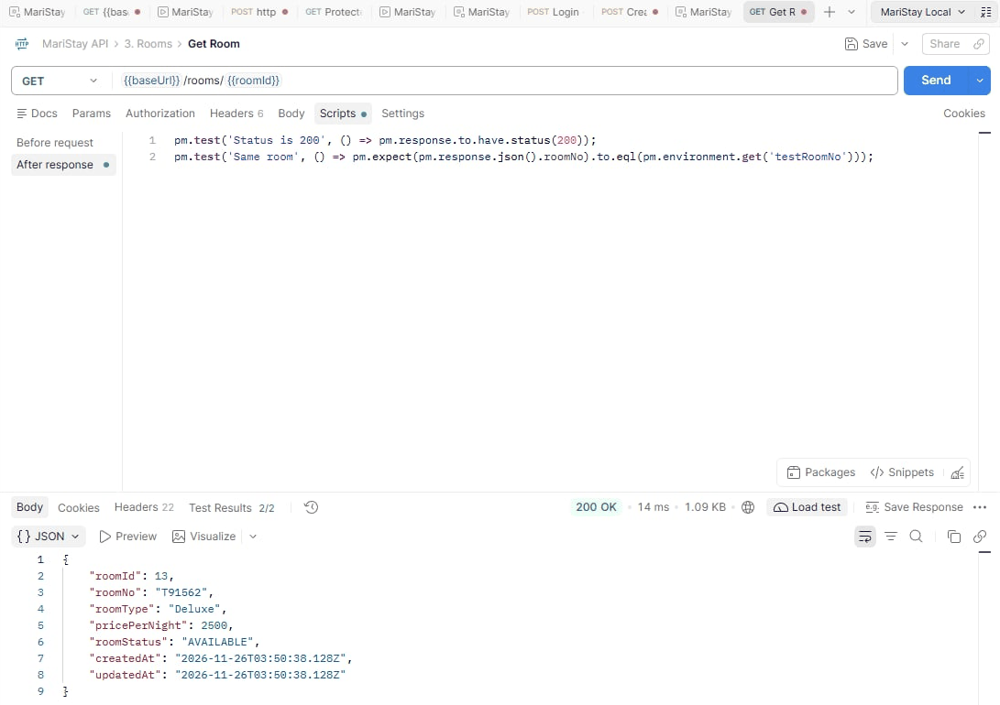\
**Figure 8.4.** *Get Room* (`GET /rooms/{{roomId}}`) returns **200 OK** with the same record, Room ID 13. The test script shown checks both the status and the room number.

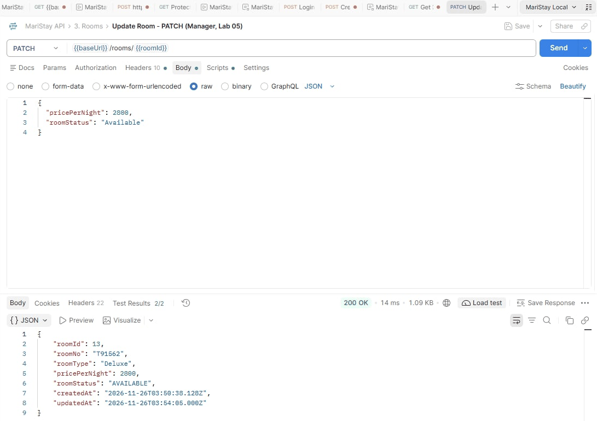\
**Figure 8.5.** *Update Room - PATCH* returns **200 OK**. `pricePerNight` changes from **2500 to 2800**, and `updatedAt` advances while `createdAt` stays the same.

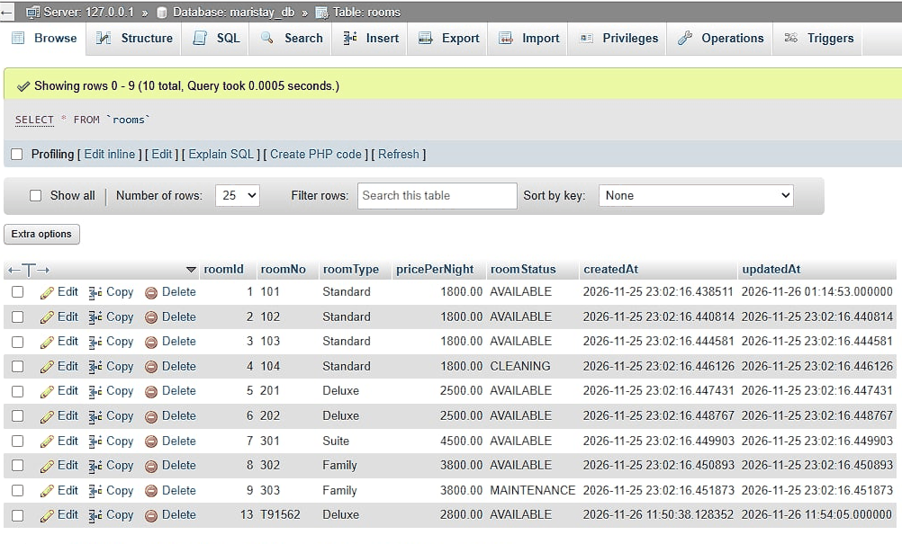\
**Figure 8.6.** phpMyAdmin, `maristay_db.rooms`, after the PATCH. Room 13 (`T91562`) is stored with **2800.00**, and the nine other rooms are not affected by these requests.

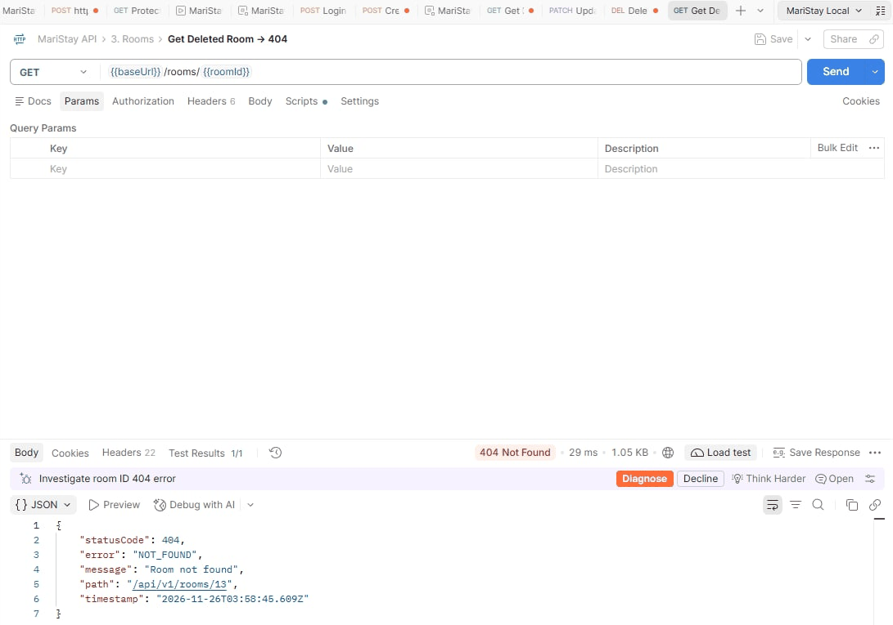\
**Figure 8.7.** *Get Deleted Room → 404* returns **404 Not Found** for `/api/v1/rooms/13`, with the standard error body ("Room not found"). The purple bar is Postman's built-in AI suggestion and is not part of the API response.

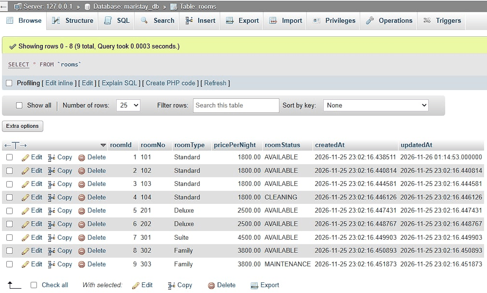\
**Figure 8.8.** phpMyAdmin, `maristay_db.rooms`, after Room 13 was deleted. Nine rows remain: the seeded rooms 101–303, none affected by these requests.

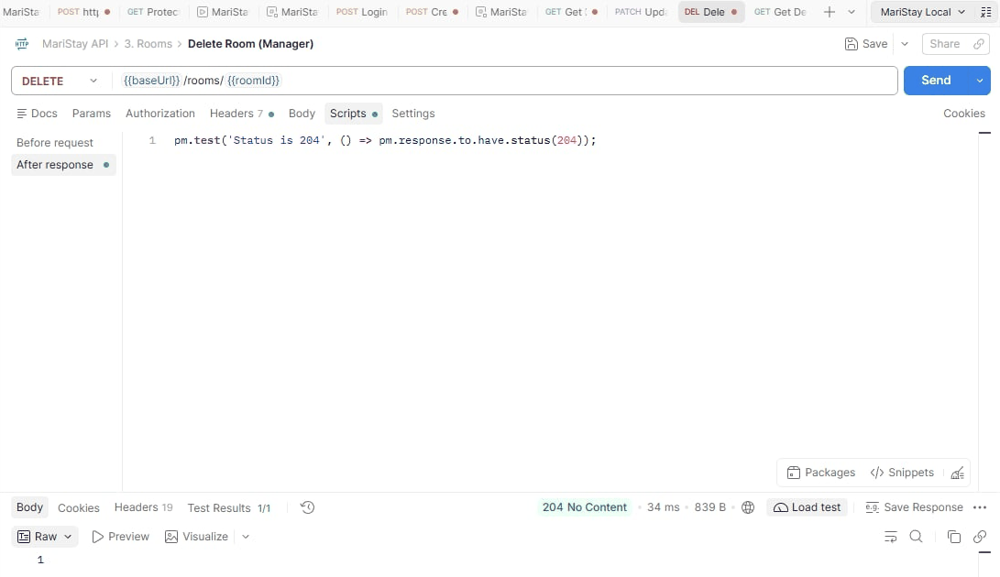\
**Figure 8.9.** *Delete Room (Manager)* returns **204 No Content**, and the test "Status is 204" passed (1/1). This request deleted the **temporary Room ID 14**, not Room 13 (see the note above).

### 8.7.3 Authorization: 401 and 403

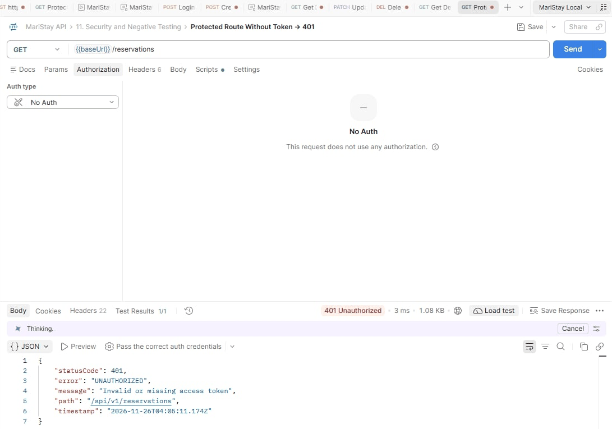\
**Figure 8.10.** *Protected Route Without Token → 401*: `GET /reservations` with Auth type **No Auth** returns **401 Unauthorized** ("Invalid or missing access token"). The global `JwtAuthGuard` rejects the request before any controller runs.

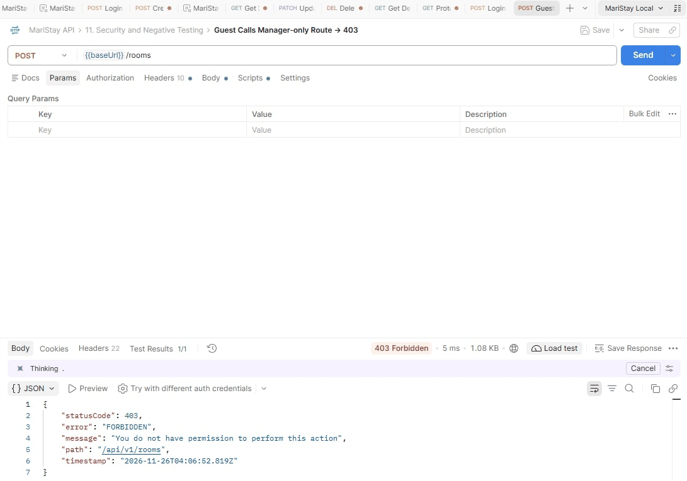\
**Figure 8.11.** *Guest Calls Manager-only Route → 403*: the guest's valid token on `POST /rooms` returns **403 Forbidden** ("You do not have permission to perform this action"). Authentication succeeded, but `RolesGuard` refused the role. No room was created.

### 8.7.4 Postman desktop Collection Runner (port 3001)

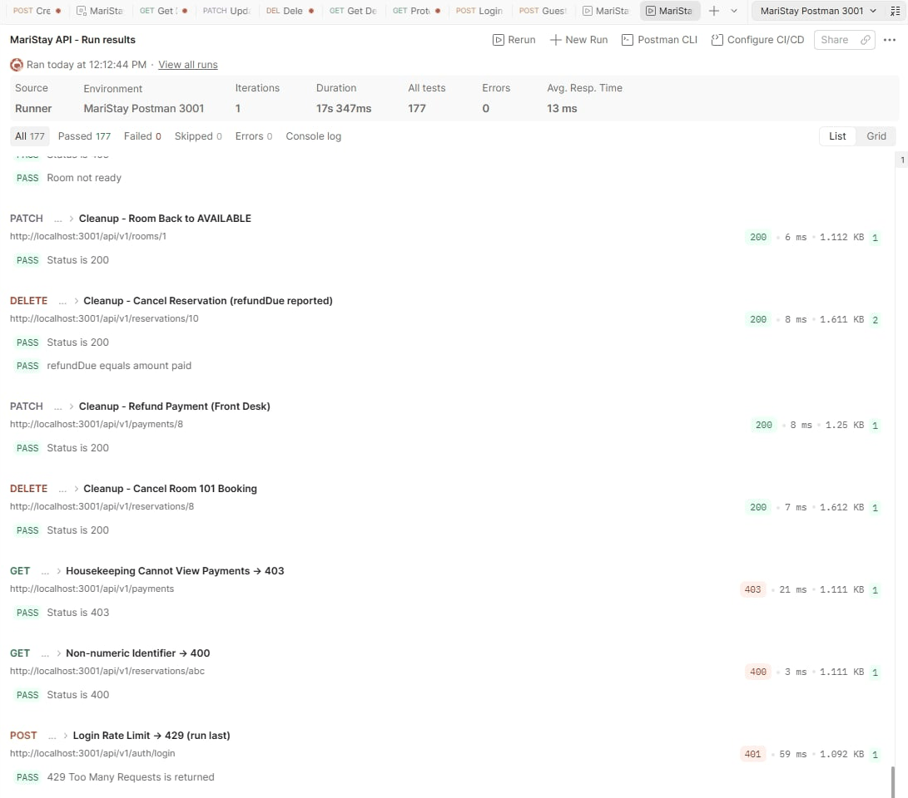\
**Figure 8.12.** Run summary of the Collection Runner, environment *MariStay Postman 3001*: **177 tests, 177 passed, 0 failed, 0 skipped, 0 errors**; duration 17 s 347 ms; average response 13 ms. The list shows the final security tests.

The last request, *Login Rate Limit → 429*, displays its own response, a 401 caused by a deliberately wrong password. Its test script then sends 11 more logins and asserts that a **429 Too Many Requests** is returned, and that assertion passed.

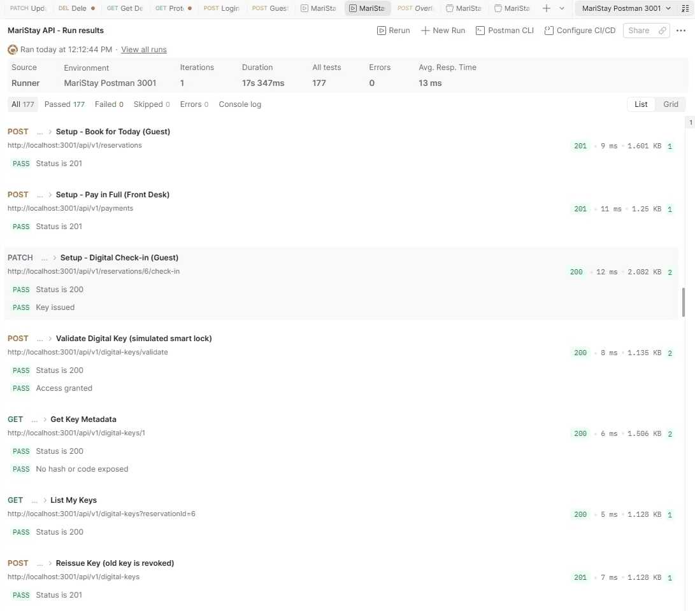\
**Figure 8.13.** The *6. Digital Keys* results from the same run:

* *Setup - Digital Check-in (Guest)* → **200**, "Key issued".
* *Validate Digital Key (simulated smart lock)* → **200**, "Access granted".
* *Get Key Metadata* → "No hash or code exposed".
* *Reissue Key* → **201**.

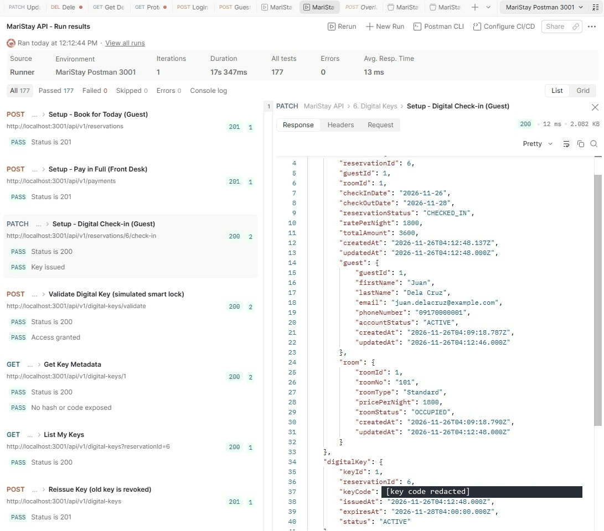\
**Figure 8.14.** The digital check-in response, opened from the Runner. Reservation 6 is `CHECKED_IN`, room 101 is `OCCUPIED`, and a `digitalKey` with `status: "ACTIVE"` expires at 12:00 on the check-out date. The plain key code, returned once at issue, is redacted here. The database stores only its SHA-256 hash.

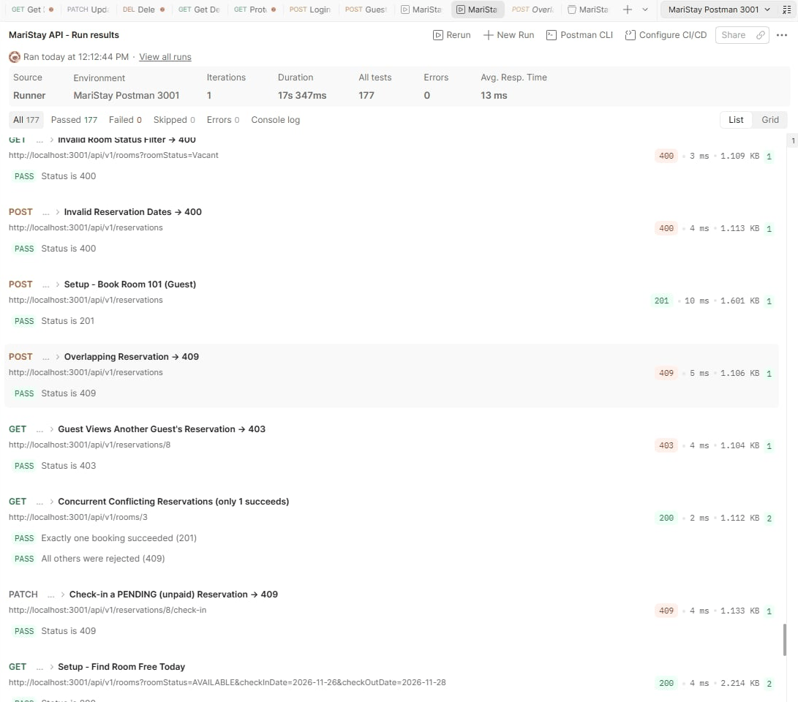\
**Figure 8.15.** *11. Security and Negative Testing* results from the same run:

* *Overlapping Reservation* → **409 Conflict**.
* *Concurrent Conflicting Reservations*: exactly one of the concurrent bookings succeeded (201) and all the others were rejected (409).
* Invalid reservation dates → 400.
* Another guest's reservation → 403.

### 8.7.5 Database state of the demonstration database

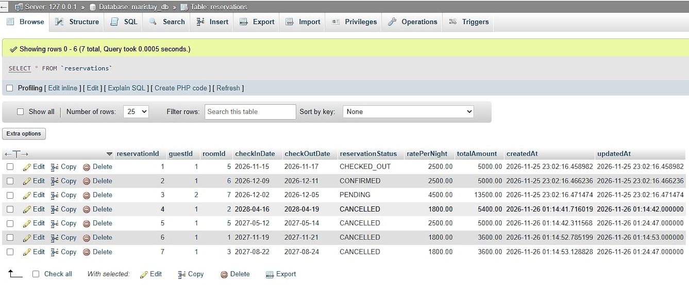\
**Figure 8.16.** phpMyAdmin, `maristay_db.reservations`. It holds the same seven rows as after the approved clean-up at 01:24:47. Rows 4–7 are cancelled test bookings from that clean-up, and no row was added afterwards. This confirms that the manual port-3000 requests in Figures 8.1–8.11 created no reservations. The overlapping-reservation test ran only on the isolated port-3001 database.

### 8.7.6 Automated test runs

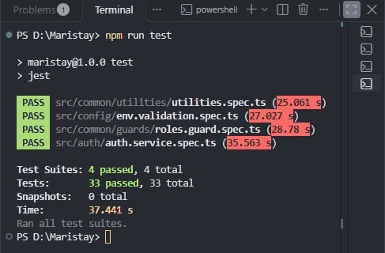\
**Figure 8.17.** `npm run test`: **4 of 4 suites, 33 of 33 tests passed** in 37.441 s.

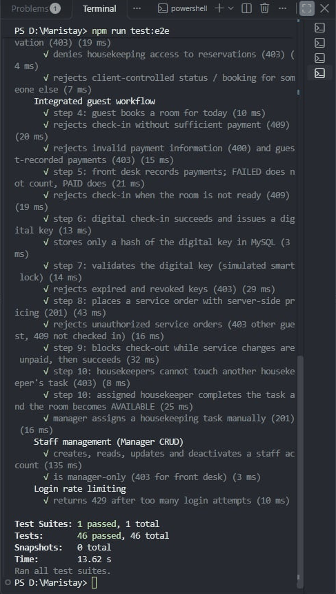\
**Figure 8.18.** `npm run test:e2e`: **46 of 46 tests passed** in 13.62 s against the isolated `maristay_test_db`. The visible part shows the integrated guest workflow, staff management and login rate-limiting tests.

**Not captured as screenshots:**

* Newman: its results are given as text in §8.6.
* The `Found 0 errors` line of `npm run start:dev`: Figure 7.1 shows the route-mapping part of the start-up log; the 0-error compile is recorded in §8.3.
* The video demonstration: pending.

## 8.8 How to reproduce

Run these in `backend/`:

```bash
npm run test            # unit tests (no database needed)
npm run test:e2e        # real MySQL-compatible test database (TEST_DB_DATABASE, default maristay_test_db)

# Full Postman collection with Newman, isolated database on port 3001
npm run postman:reset   # rebuild maristay_postman_db only
npm run postman:start   # terminal 1: API on http://localhost:3001/api/v1
npm install --no-save newman
npm run postman:newman  # terminal 2
npm run security:check  # terminal 2: 126 security and role-access checks
```

## 8.9 Final regression and Oracle MySQL verification (2026-11-27)

Run after the functional scope was frozen. Every run used an isolated database; `maristay_db` was only read (schema comparison), never written. No code was changed by this verification.

### Final regression (MariaDB 10.4.32)

| Check | Command / database | Result |
|---|---|---|
| Backend production build | `nest build -p tsconfig.postman.json` (same compiler options as `npm run build`, output `dist-postman/`) | ✔ 0 errors |
| Frontend production build | `cd frontend && npm run build` (tsc + Vite) | ✔ |
| Unit tests | `npm run test` | ✔ **33/33**, 4/4 suites, 10.1 s |
| End-to-end tests | `npm run test:e2e` → `maristay_test_db` | ✔ **46/46**, 9.1 s |
| Postman collection | `npm run postman:reset`, `postman:start`, `postman:newman` → `maristay_postman_db`, port 3001 | ✔ **177/177** assertions, 137 requests, 0 failures, 12 s, avg 10 ms |
| Browser integration test | `frontend/tests/ui-e2e.mjs` (Microsoft Edge) → fresh `maristay_postman_db` | ✔ **37/37** |
| Guest registration API + database | `npm run verify:registration` | ✔ **49/49** |
| Security and RBAC matrix | one-off script, isolated API | ✔ **126/126** (below) |
| Integrated hotel workflow | Newman folder 10, e2e steps 1–10, browser test | ✔ booking → payment → automatic confirmation → check-in with key → smart lock → service order → check-out blocked by balance → payment → check-out (keys revoked, cleaning task) → housekeeping completes → room available |

**Security and RBAC matrix (126 checks).**
* Each role's login returns a JWT carrying that role.
* 21 representative endpoints × {no token, GUEST, FRONT_DESK, HOUSEKEEPING, MANAGER}: 401 without a token, 403 for roles that are not allowed, and the guard passes for allowed roles. Allowed write calls used invalid bodies (400) or nonexistent ids (404), so no data changed.
* Tokens rejected with 401: a guest token with its role edited to MANAGER (bad signature), `alg: none`, a garbage token, a correctly signed but expired token, and a token signed with another secret.
* Ownership: a guest cannot read another guest's profile (403), and a guest's reservation list contains only their own reservations.
* No `passwordHash` or `keyCodeHash` in the staff, guest, key or `/auth/me` responses.
* `' OR 1=1 -- ` in a search is treated as text (0 rows).
* An extra `reservationStatus` field in a booking is rejected (400).
* Helmet headers: `nosniff`, CSP, no `X-Powered-By`.
* CORS allows only the configured origin.
* Error bodies contain no stack trace.

### Oracle MySQL 8.4.11 LTS

A temporary, portable MySQL Community Server 8.4.11 LTS ran on `127.0.0.1:3307`, with its own data folder in a temporary directory. The binaries were verified as signed by Oracle America, Inc. It was stopped and removed afterwards. Only environment variables pointed MariStay at it.

| Check | Result |
|---|---|
| `npm run db:setup` (create, migrate, seed) → `maristay_mysql8_db` | ✔ |
| `npm run schema:check` | ✔ schema up to date |
| Schema vs MariaDB `maristay_db` (`information_schema`) | ✔ identical: 9 tables, 67 columns (64 application), 7 FKs, 17 CHECKs, 13 unique indexes |
| `npm run test:e2e` → `maristay_mysql8_test` | ✔ **46/46**, 19.8 s |
| Newman, API on port 3001 backed by MySQL → `maristay_mysql8_postman` | ✔ **177/177** assertions, 137 requests, 19.7 s, avg 47 ms |
| `database/maristay.sql` import (copy without `CREATE DATABASE`/`USE`) → `maristay_mysql8_import` | ✔ imported; deprecation warnings only |
| Constraints on imported data | ✔ FK 1451/1452, CHECK 3819, UNIQUE 1062 enforced |

The only difference is cosmetic: foreign keys imported from the MariaDB dump show `ON DELETE NO ACTION` instead of `RESTRICT`, which InnoDB treats identically (Compliance Checklist §6).

### Documentation checks

* **ERD:** the Mermaid ERD in `DATABASE_DESIGN.md` was parsed and compared with `information_schema`. All 8 tables, 64 columns, data types, PK/FK/UK markers and 7 relationships match.
* **API documentation:** the endpoint table covers all 44 operations reported by Swagger (`/api/docs-json`, 9 tags), checked before Swagger was removed. After the removal, the start-up log maps the same 44 routes (§8.11).

### Frontend screenshots

37 screenshots of all four roles were captured on the isolated database into `docs/screenshots/frontend/`, with key codes masked (`docs/FRONTEND.md` §9).

### Reproduce the additional checks

```bash
cd backend && npm run verify:registration           # isolated API on port 3001 (postman:start)
cd ../frontend && node --env-file=../backend/.env tests/ui-e2e.mjs
```

## 8.10 Frontend verification after the UI redesign (2026-11-27)

The React frontend was restyled (Modern Luxury Minimalist) after the functional scope was frozen. No backend file, route, API call or test assertion changed. Results on a freshly reset `maristay_postman_db` with the final UI:

| Check | Result |
|---|---|
| Frontend production build (`npm run build`) | ✔ |
| Browser integration test (`frontend/tests/ui-e2e.mjs`) | ✔ **37/37**. A first run had 32/37: a required-field asterisk had been placed inside the sign-up labels, which changed their text. The asterisk was moved outside the labels; the test was not changed |
| `npm run verify:registration` | ✔ **49/49** |
| Responsive and accessibility audit (Microsoft Edge, 1440 / 1280 / 768 / 390 px, every screen of all four roles, plus the Add room dialog) | ✔ **331** checks, 0 findings, 0 console errors |
| Main configuration (read-only) | ✔ the main frontend calls the API on port 3000, which is connected to `maristay_db` (confirmed by comparing record timestamps); manager login shows live data |

### Result history

| Suite | Earlier | Latest (2026-11-27) |
|---|---|---|
| Unit tests | 33/33 (2026-11-25/26) | 33/33 (final regression, §8.9) |
| E2E tests, MariaDB | 46/46 (2026-11-25/26) | 46/46 (§8.9) |
| E2E tests, Oracle MySQL 8.4.11 | — | 46/46 (§8.9) |
| Postman / Newman | 177/177 × 3 Newman + 1 desktop Runner (2026-11-26) | 177/177 on MariaDB and 177/177 on MySQL 8.4 (§8.9) |
| Browser UI test | 30/30 (before sign-up) | 37/37 (after the UI redesign, §8.10) |
| Registration checks | 49/49 (when sign-up was added) | 49/49 (after the UI redesign) |
| Security / RBAC matrix | — | 126/126 (§8.9) |

## 8.11 Swagger UI removal and regression (2026-11-27)

The ITEC 116 guidelines name Postman as the required API testing tool, so Swagger UI was removed. Only documentation tooling changed:
* `@nestjs/swagger`, its Nest CLI plugin, the `/api/docs` setup, the start-up log line and 193 `@Api…` decorators were removed. Each endpoint's summary is kept as a one-line code comment.
* The update DTOs now import `PartialType`/`OmitType` from `@nestjs/mapped-types`, the official package Swagger re-exported. It copies the same class-validator rules.
* Helmet now uses its defaults in every environment. The development-only CSP exception existed only for Swagger's HTML page.

No endpoint, DTO rule, guard, role, business rule, database object or frontend file changed. Results, on isolated databases only:

| Check | Result |
|---|---|
| TypeScript (`src` + `test`) and `nest build` | ✔ 0 errors |
| `npm run start:dev` (isolated database, port 3101) | ✔ "Found 0 errors", **44 routes mapped**, application started; no Swagger log line; `/api/docs` and `/api/docs-json` return 404 |
| Unit tests | ✔ **33/33** |
| End-to-end tests (`maristay_test_db`) | ✔ **46/46** |
| Postman collection with Newman (fresh `maristay_postman_db`, port 3001) | ✔ **177/177** assertions, 137 requests, 0 failures |
| Browser integration test (fresh database) | ✔ **37/37** |
| `npm run verify:registration` | ✔ **49/49** |
| Security and RBAC matrix | ✔ **126/126** (Helmet CSP, `nosniff`, no `X-Powered-By`, CORS) |


## 8.12 Repository restructure and regression (2026-11-28)

The repository was reorganized into `backend/` (NestJS source, tests, scripts and configuration), `database/` (`maristay.sql`), `postman/` (collection and environment), `frontend/` and `docs/`. Files were moved with `git mv`; every file in `backend/src/` and `backend/test/` is a pure rename with unchanged content, and the SQL export and Postman files are byte-identical. Only paths in scripts, documentation and the README changed. No endpoint, DTO rule, guard, role, business rule or frontend behaviour changed, and `maristay_db` was not written (table checksums identical before and after).

| Check | Result |
|---|---|
| `npm run build` (in `backend/`) | ✔ 0 errors |
| `npm run start:dev` | ✔ "Found 0 errors", **44 routes mapped**; `/api/docs` and `/api/docs-json` return 404 |
| Unit tests | ✔ **33/33** |
| End-to-end tests (`maristay_test_db`) | ✔ **46/46** |
| Postman collection with Newman (fresh `maristay_postman_db`, port 3001) | ✔ **177/177** assertions, 137 requests, 0 failures; all 44 mapped routes are called |
| Frontend production build | ✔ |
| Browser integration test (fresh database) | ✔ **37/37** |
| `npm run verify:registration` (fresh database) | ✔ **49/49** |
| Security and RBAC matrix (`npm run security:check`) | ✔ **126/126** |
| Fresh clone following the README (new `.env` from `.env.example`, new scratch database) | ✔ `npm ci`, `db:setup`, build, start-up with 44 routes, unit 33/33, e2e 46/46, frontend `npm ci` and build |
| Git ignore and credentials | ✔ `backend/.env`, `postman/tmp/` and Postman workspace files ignored; no `.env` value, JWT or key code in the 240 tracked files |

Total: **468/468** checks passed, the same as the previous baseline.

<div class="page-break"></div>

# Chapter 9 — Conclusion

## 9.1 Project accomplishments

* A working NestJS + TypeORM + MySQL backend that turns the Lab 03–06 designs into running software.
* All **8 Lab 04 entities** implemented as TypeORM entities with primary keys, 7 foreign keys (RESTRICT), unique indexes and CHECK constraints, created by a migration and exported to `maristay.sql`.
* **44 REST endpoints** (target was ≥ 20) using GET, POST, PUT, PATCH and DELETE, including all 7 Lab 05 endpoints with their original access levels; full CRUD for Rooms and Staff (Guests and Reservations also support all four operations).
* **Security** from Lab 06: bcrypt hashing, JWT with expiry, global authentication guard, RBAC with four roles, ownership checks, strict input validation, login rate limiting, Helmet headers, restricted CORS, no hardcoded secrets.
* **Real integration**: payment status drives reservation confirmation; check-in coordinates payments, rooms and digital keys; check-out coordinates service orders, billing, keys, rooms and housekeeping — each in a single database transaction.
* **Testing**: 33 unit tests and 46 end-to-end tests against a real MySQL-compatible test database, all passing. The 122-request Postman collection ran against an isolated database three times with Newman and once in the Postman desktop Collection Runner, with 177/177 assertions passing each time. Annotated screenshots of the manual and Runner tests are in §8.7. The final regression on 2026-11-27 passed again on MariaDB, and the e2e suite and the Postman collection also passed on Oracle MySQL 8.4.11 LTS (§8.9).
* **Optional React frontend (bonus)** for all four roles, with guest self-registration that always creates a Guest account (Appendix G).

## 9.2 Challenges encountered

1. **MySQL vs MariaDB differences.** XAMPP's "MySQL" is MariaDB 10.4. TypeORM generated MySQL 8 lock syntax (`FOR SHARE`) that MariaDB rejects. The booking logic was redesigned to use a row lock (`FOR UPDATE`, supported by both) with `READ COMMITTED` isolation, and concurrency was re-tested.
2. **Preventing double bookings.** Checking "is the room free?" and then inserting is not safe when two requests arrive at the same time. Locking the room row inside a transaction solved it.
3. **Time zones.** Timestamps written by the application and those generated by MySQL defaults disagreed by eight hours until both were configured to use the same time zone.
4. **Testing the Postman collection for real.** On paper, the collection looked complete. Running it showed that 32 request bodies sent numeric ids as quoted text. The API correctly rejected them, and the first failure cascaded into many more. A later desktop run failed because the environment's password was not saved. Both problems were fixed in the collection, not by relaxing validation. The final desktop run passed all 177 assertions. The full collection now runs against its own database, so test data never mixes with the demonstration data.
5. **Keeping documentation consistent with code.** Lab 05 used names like `roomNumber` and client-supplied totals; the implementation standardised on the Lab 04 names and server-side pricing, and every change is listed as a documented deviation.

## 9.3 Lessons learned

* Designing the database, API and security first (Labs 04–06) made implementation faster — most decisions were already made.
* Business rules belong in the service layer and, where possible, also in the database (constraints) as a second line of defence.
* Transactions are what make "integration" safe: several modules can change data together without leaving half-finished states.
* Authentication (401) and authorization (403) are different problems; ownership checks are needed in addition to roles.
* Automated tests against a real database find problems that mocks hide (the lock syntax and time-zone bugs were both found by running real requests).

## 9.4 Current limitations

* Payment gateway, SMS/e-mail and smart lock are simulated.
* The React frontend is a basic web client; there is no mobile app.
* HTTP only on localhost; HTTPS is a deployment task.
* No refresh tokens, password-reset e-mails, invoices, taxes, discounts or multi-property support.
* Service catalog prices live in code.
* Sign-up has no e-mail verification or CAPTCHA.

## 9.5 Recommendations and future improvements

**Recommendations for deployment or continued development**

* Use the same server family in production that the tests ran on. MariStay passed on both MariaDB 10.4.32 and Oracle MySQL 8.4.11 LTS (Requirements Compliance Checklist §6).
* Give the database a dedicated account with a strong password instead of XAMPP's password-less `root`, and keep all secrets in environment variables.
* Serve the API only over HTTPS behind a reverse proxy, and set `CORS_ORIGIN` to the real front-end origin.
* Keep running the automated suites (`npm run test`, `npm run test:e2e`, `npm run postman:newman`) before every release.

**Future improvements**


1. A mobile app and e-mail verification for guest sign-up, on top of the existing React web frontend.
2. Real integrations behind the existing adapters: a payment gateway (e.g. card/e-wallet provider), SMS/e-mail provider, and a smart-lock vendor API.
3. Deployment with HTTPS (reverse proxy), Docker, and a managed MySQL database.
4. Refresh tokens and token revocation on logout; password reset by e-mail.
5. Service catalog and room types stored in database tables managed by the manager.
6. Reports and dashboards (occupancy, revenue, housekeeping performance).
7. Scheduled jobs: expire keys and auto-cancel unpaid reservations at a cut-off time.

<div class="page-break"></div>

# References

Project sources:
1. Dallego, J. V. A. *ITEC 116 — Final Project: Systems Integration Backend Prototype* (student copy).
2. Reyes, G. A. E. *Laboratory Activity 03 — System Description, Components, Architecture Diagram and Information Flow (MariStay)*.
3. Reyes, G. A. E. *Laboratory Activity 04 — Database Design: Entities, ERD and Data Dictionary (MariStay)*.
4. Reyes, G. A. E. *Laboratory Activity 05 — REST API Design (MariStay)*.
5. Reyes, G. A. E. *Laboratory Activity 06 — Authentication and Security Design (MariStay)*.

Technical documentation of the tools used:
6. NestJS documentation — https://docs.nestjs.com (modules, controllers, providers, guards, pipes, authentication, OpenAPI).
7. TypeORM documentation — https://typeorm.io (entities, relations, migrations, transactions, locking).
8. MySQL 8.0 Reference Manual — https://dev.mysql.com/doc/refman/8.0/en/ (InnoDB locking, isolation levels, CHECK constraints, mysqldump).
9. MariaDB Knowledge Base — https://mariadb.com/kb/ (CHECK constraints, `SELECT … FOR UPDATE`, transaction isolation).
10. node-bcrypt (`bcrypt` npm package) — https://github.com/kelektiv/node.bcrypt.js
11. RFC 7519 — JSON Web Token (JWT). IETF, 2015. https://www.rfc-editor.org/rfc/rfc7519
12. RFC 9110 — HTTP Semantics (status codes and methods). IETF, 2022. https://www.rfc-editor.org/rfc/rfc9110
13. class-validator — https://github.com/typestack/class-validator
14. Helmet — https://helmetjs.github.io
15. Postman Learning Center — https://learning.postman.com
16. Newman, the Postman command-line collection runner — https://github.com/postmanlabs/newman
17. OWASP Cheat Sheet Series — Password Storage; Authentication; REST Security. https://cheatsheetseries.owasp.org

<div class="page-break"></div>

# Appendix

## A. Installation and configuration

**Prerequisites:** Node.js 20 or newer with npm, Git, Postman, and a MySQL-compatible server. Development used XAMPP: start **MySQL** (and Apache for phpMyAdmin) in the XAMPP Control Panel. On Windows the `mysql` client is in `C:\xampp\mysql\bin`, which is not on PATH.

1. **Get the code and install dependencies**
   ```bash
   git clone <repository-url> maristay && cd maristay/backend
   npm install
   ```
2. **Configure the environment** in `backend/`. Copy the template, then edit the copy. Never commit `.env`. All `npm run` commands below are run in `backend/`.
   ```bash
   cp .env.example .env        # PowerShell: Copy-Item .env.example .env
   node -e "console.log(require('crypto').randomBytes(48).toString('hex'))"   # paste the output as JWT_SECRET
   ```
   Set `DB_USERNAME` and `DB_PASSWORD`; XAMPP's `root` has an empty password by default. Choose a `SEED_DEMO_PASSWORD` of 8+ characters with letters and numbers. The API refuses to start if a required value is missing or the JWT secret is weak (Appendix C).
3. **Create the database**, using either option:
   * **Option A (recommended):** `npm run db:setup` creates `maristay_db`, runs the migration and seeds the demo data.
   * **Option B:** import `database/maristay.sql` in phpMyAdmin (Import tab → choose the file → Go) or with `mysql -u root -p < ../database/maristay.sql`. The script creates and uses `maristay_db`. Import it only on a server that does not already have `maristay_db`; otherwise it stops at the first table and changes nothing. With Option B, the demo accounts keep the password used when the export was made, so use Option A to choose your own.
4. **Run the API:** `npm run start:dev`. The API is at `http://localhost:3000/api/v1`; test it with the Postman collection (step 6).
5. **Run the automated tests:** `npm run test` (unit tests, no database needed) and `npm run test:e2e`. The e2e tests drop and recreate only `TEST_DB_DATABASE`, default `maristay_test_db`; the name must end in `_test`.
6. **Postman:**
   * **Demonstration:** import `postman/MariStay.postman_collection.json` and `postman/MariStay.postman_environment.json` from the repository (*MariStay Local*, port 3000, `maristay_db`). Set and **save** `demoPassword`. Use single requests from folders 1 and 3 for the live demonstration.
   * **Full collection (all 122 requests):** never run it against `maristay_db`, because it creates test records. Instead:
     1. `npm run postman:reset`, then `npm run postman:start`. This serves an isolated `maristay_postman_db` on port 3001.
     2. `npm run postman:env`, then import `postman/tmp/MariStay Postman 3001.postman_environment.json`, set and save `demoPassword`.
     3. Run the whole collection in the Runner, in order and sequentially.
     4. Alternatively, run `npm install --no-save newman` and then `npm run postman:newman`.
     5. Reset and restart before every re-run.
7. **Re-export the database (optional):** `mysqldump -u root -p --databases maristay_db --single-transaction --skip-add-drop-table > ../database/maristay.sql` (from `backend/`).

## B. Demo accounts (fictional)

| Role | Email |
|---|---|
| MANAGER | manager@maristay.test |
| FRONT_DESK | frontdesk@maristay.test |
| HOUSEKEEPING | housekeeping1@maristay.test, housekeeping2@maristay.test |
| GUEST | juan.delacruz@example.com, ana.mendoza@example.com |

The password for all demo accounts is the `SEED_DEMO_PASSWORD` value chosen in the local `.env`; it is not stored in the repository.

## C. Environment variables

| Variable | Purpose | Example / default |
|---|---|---|
| NODE_ENV | development / production / test | development |
| PORT | HTTP port | 3000 |
| DB_HOST, DB_PORT | MySQL server | localhost, 3306 |
| DB_USERNAME, DB_PASSWORD | MySQL account | root, *(your password)* |
| DB_DATABASE | Database name | maristay_db |
| JWT_SECRET | Token signing secret (≥ 32 chars, required) | *(random)* |
| JWT_EXPIRES_IN | Token lifetime | 1h |
| CORS_ORIGIN | Allowed browser origin(s) | http://localhost:5173 |
| SEED_DEMO_PASSWORD | Password for seeded demo accounts | *(your choice)* |
| TEST_DB_DATABASE | Database recreated by e2e tests (must end in `_test`) | maristay_test_db |
| LOGIN_RATE_LIMIT, API_RATE_LIMIT | Optional rate-limit overrides | 10, 300 |

## D. Status values

| Entity | Values |
|---|---|
| Room | AVAILABLE, OCCUPIED, CLEANING, MAINTENANCE |
| Reservation | PENDING, CONFIRMED, CHECKED_IN, CHECKED_OUT, CANCELLED |
| Payment | PENDING, PAID, FAILED, REFUNDED (methods: CASH, CARD, E_WALLET) |
| Digital key | ACTIVE, EXPIRED, REVOKED |
| Housekeeping | PENDING, IN_PROGRESS, COMPLETED |
| Service order | PENDING, PREPARING, DELIVERED, CANCELLED |
| Account | ACTIVE, INACTIVE |

## E. Git commit history

See `docs/DEVELOPMENT_PROGRESS.md` for the full list of incremental commits.

## F. Deviations from the laboratory designs

See `docs/PROJECT_REQUIREMENTS.md` §8 (D1–D15) — e.g. `roomNo` instead of `roomNumber`, required password at registration, server-controlled statuses and prices, staff password columns, reservation price snapshot, simulated external services, HTTPS as a deployment requirement.

## G. Optional React frontend (bonus)

A React 19 + Vite + TypeScript web client in `frontend/` uses the same REST API: 15 screens, all four roles, and 36 of the 44 endpoints. Its design, endpoint mapping and tests are described in `docs/FRONTEND.md`. The screenshots were captured automatically on the isolated test database (`maristay_postman_db`) on 2026-11-27. Digital key codes are masked. The full set of 37 images is in `docs/screenshots/frontend/`.

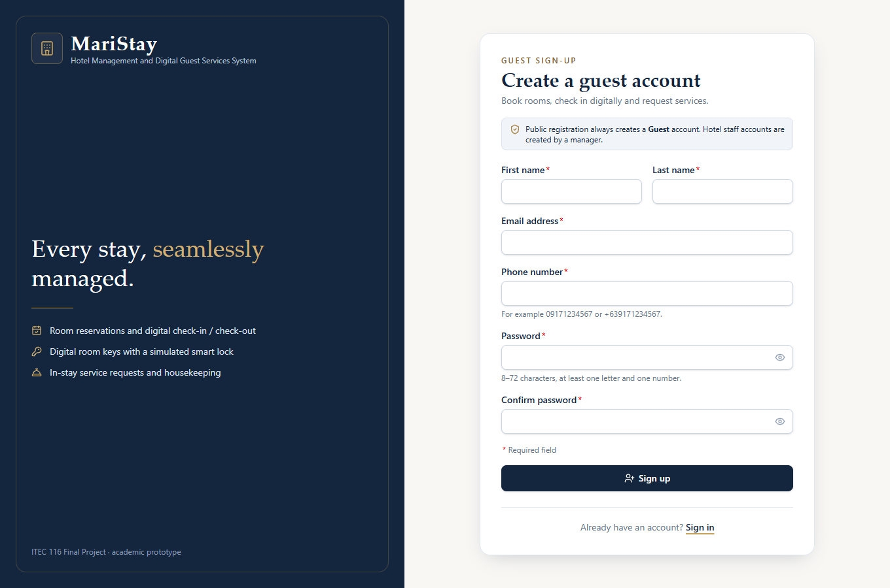\
**Figure G.1.** Guest self-registration. There is no role field: every public sign-up becomes a Guest account, enforced by the API.

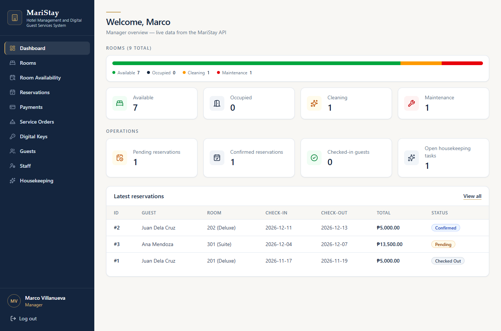\
**Figure G.2.** Manager dashboard with live counts from the API.

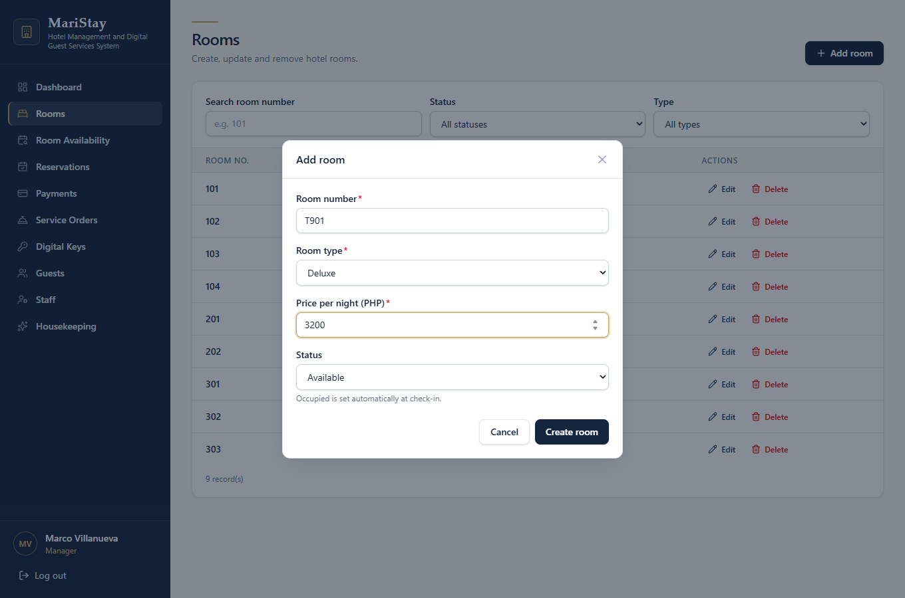\
**Figure G.3.** Room CRUD: the manager's Add room dialog.

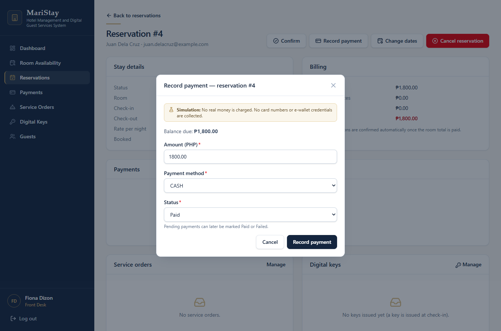\
**Figure G.4.** Front desk records a simulated payment. Full payment confirms the reservation automatically.

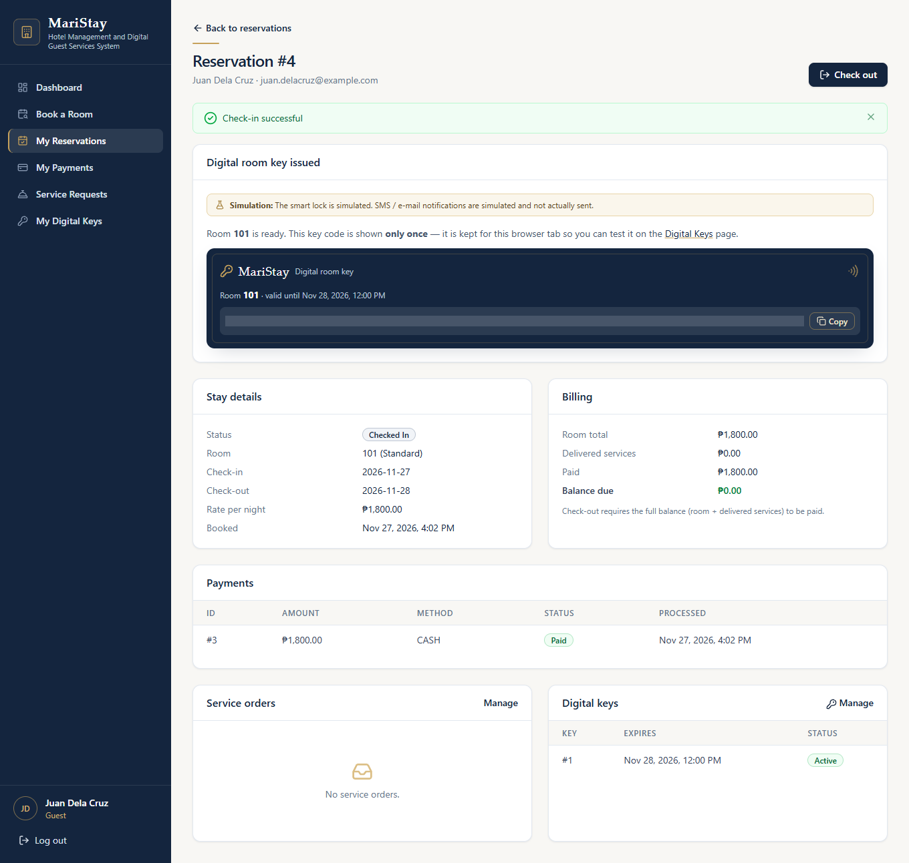\
**Figure G.5.** Digital check-in: the room becomes occupied and a one-time digital key is issued (key code masked).

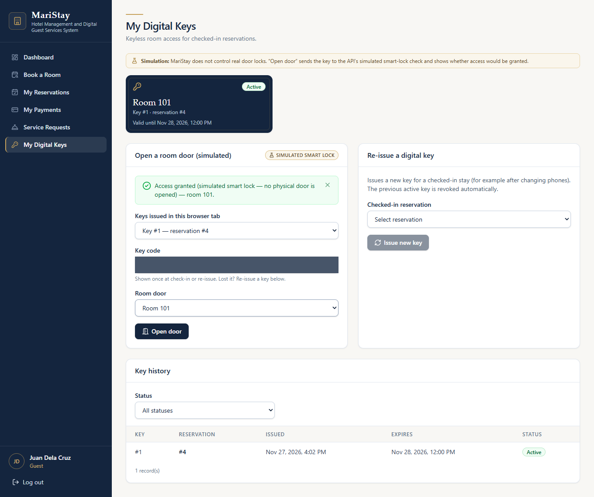\
**Figure G.6.** Simulated smart lock: access granted for the booked room.

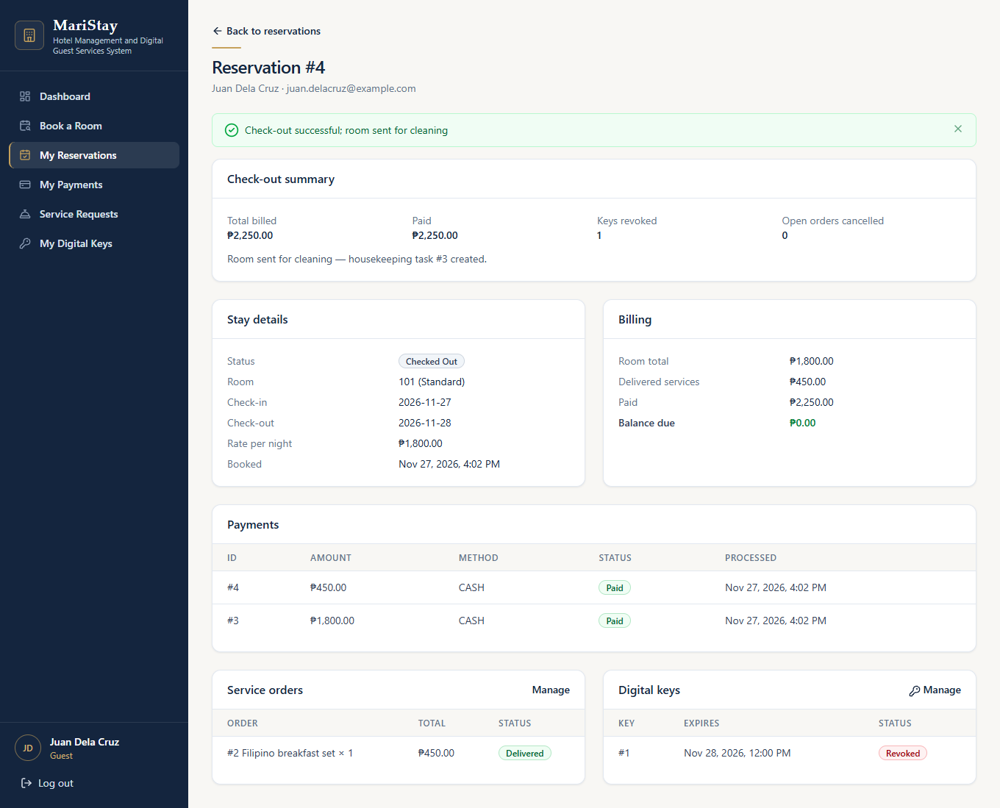\
**Figure G.7.** Digital check-out: balance settled, keys revoked, room sent to housekeeping.

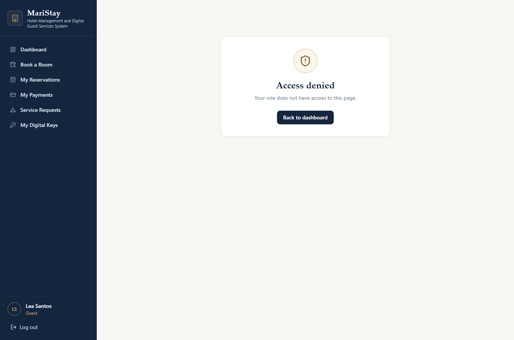\
**Figure G.8.** Access control: a guest opening a manager-only page. The API also rejects the request with 403.

<div class="page-break"></div>

# Requirements Compliance Checklist

Audit of every mandatory requirement in the ITEC 116 Final Project guidelines (§3 Requirements, §4 Deliverables, §7 Submission Checklist), checked against the implemented system on 2026-11-26. Final regression and Oracle MySQL 8.4 verification on 2026-11-27 (Testing §8.9). Repository restructure regression on 2026-11-28 (Testing §8.12).

Status key:
- **Complete:** implemented and verified by the evidence listed.
- **Student action:** needs the student's own account, recording or screenshots. It cannot be done or claimed on the student's behalf.
- **Note:** complete, with a qualification that is stated in the row.

## 1. Backend application

| # | Requirement | Implementation | Evidence | Status |
|---|---|---|---|---|
| 1 | Complete NestJS project that builds and runs | NestJS 11 modular monolith, 9 feature modules | `npm run build`: 0 errors. `npm run start:dev`: "Found 0 errors", 44 routes mapped | Complete |
| 2 | Authentication module: login, JWT, protected routes, password hashing, input validation | `backend/src/auth/` (AuthService, JwtStrategy, global JwtAuthGuard, RolesGuard), bcrypt cost 10, global `ValidationPipe` (whitelist, forbid unknown fields) | e2e tests 1–12; Newman folders 1 and 11 | Complete |
| 3 | At least 2 additional CRUD modules | **Rooms** (POST, GET, PATCH, PUT, DELETE) and **Staff** (POST, GET, PATCH, DELETE = deactivate). Guests and Reservations also cover all four operations | e2e 15–21 and 44; Newman folders 3 and 8 | Complete |
| 4 | At least 20 REST endpoints | **44 endpoints** in 9 resources | Start-up log maps 44 routes (`npm run start:dev`, 2026-11-27); [API documentation](../API_DOCUMENTATION.md) §5.3 | Complete |
| 5 | GET, POST, PUT or PATCH, DELETE | GET 18 · POST 10 · PATCH 11 · PUT 1 · DELETE 4 | §5.3 endpoint table | Complete |
| 6 | Correct HTTP status codes | 200, 201, 204, 400, 401, 403, 404, 409, 429, 500 with one error format | §5.5; Newman status mix (8.6) | Complete |
| 7 | Database connection works | TypeORM + `mysql2`, settings only from `.env` | Server start log; e2e suite against a real database | Complete |

## 2. Database

| # | Requirement | Implementation | Evidence | Status |
|---|---|---|---|---|
| 8 | MySQL database created and working | `maristay_db` on the XAMPP "MySQL" server, which is **MariaDB 10.4.32**; also verified on **Oracle MySQL 8.4.11 LTS** (see §6 below) | MariaDB: migration, seed, 46 e2e, Newman 177/177. Oracle MySQL 8.4.11: migration, seed, `schema:check` up to date, 46/46 e2e, Newman 177/177, SQL export imported (2026-11-27) | Complete |
| 9 | TypeORM entities for every table | 8 entities: Guest, Room, Reservation, Payment, DigitalKey, Housekeeping, Staff, ServiceOrder | `backend/src/*/entities/*.entity.ts` | Complete |
| 10 | Entity relationships configured | `@ManyToOne` / `@OneToMany` for all 7 relationships | Database Design §4.5 | Complete |
| 11 | Primary keys, foreign keys, normalization | 8 auto-increment PKs, 7 FKs (`ON DELETE RESTRICT`), 3NF, 17 CHECK constraints, unique indexes | §4.4–4.7; constraint tests (Testing §8.3) | Complete |
| 12 | SQL export (`.sql`) | `database/maristay.sql`, produced by `mysqldump` from the live database | Re-imported into a scratch database on 2026-11-26: 8 tables + `migrations`, 7 FKs, 17 CHECKs, 23 indexes. 2026-11-27: also imported into Oracle MySQL 8.4.11 (8 tables, 64 columns, 7 FKs, 17 CHECKs enforced) | Complete |

## 3. Authentication and security

| # | Requirement | Implementation | Evidence | Status |
|---|---|---|---|---|
| 13 | JWT authentication | HS256, 1 h expiry, issuer check, account re-validated on every request | e2e 4, 7, 8, 12 | Complete |
| 14 | Protected routes | Global `JwtAuthGuard`; only routes marked `@Public()` are open | e2e 6; Newman "Protected Route Without Token → 401" | Complete |
| 15 | Password hashing | bcrypt (cost 10); hash column never selected or serialized | e2e 1; database shows only `$2b$10$…` | Complete |
| 16 | Input validation | DTOs with class-validator; unknown properties rejected | e2e 3, 11, 14, 22; Newman 400 cases | Complete |
| 17 | No passwords, API keys or credentials in the repository | Secrets only in git-ignored `.env`; `.env.example` holds placeholders | Full Git history scan (9 commits, 158 file versions): no secret values or tokens | Complete |

## 4. API testing

| # | Requirement | Implementation | Evidence | Status |
|---|---|---|---|---|
| 18 | All endpoints tested | Jest unit tests, Supertest e2e tests, Postman collection | 33/33 unit, 46/46 e2e (Figures 8.17–8.18); final regression 2026-11-27: 33/33 unit, 46/46 e2e on MariaDB and 46/46 on Oracle MySQL 8.4 (Testing §8.9) | Complete |
| 19 | Postman collection exported (`.json`) | `postman/MariStay.postman_collection.json` (v2.1): 11 folders, 122 requests | 5 Newman runs, each 177/177 assertions: 3 on 2026-11-26, and on 2026-11-27 one on MariaDB and one on Oracle MySQL 8.4 | Complete |
| 20 | Postman testing in the Postman app | Same collection in the Postman desktop Collection Runner, environment *MariStay Postman 3001* (port 3001) | 2026-11-26: 177/177 assertions passed, 0 failed, 0 errors, 17.347 s, average response 13 ms (Testing §8.6, Figure 8.12) | Complete |
| 21 | Representative API screenshots in the documentation | 19 screenshots in `docs/screenshots/` (tokens and key code redacted), with captions: Figure 7.1 and Figures 8.1–8.18 (the Swagger UI screenshot was removed with Swagger on 2026-11-27) | Login 200, room CRUD 201/200/200/204/404, 401, 403, overlap 409, digital check-in and smart lock, phpMyAdmin tables, test runs | Complete |

## 5. Repository, documentation, video and presentation

| # | Requirement | Implementation | Evidence | Status |
|---|---|---|---|---|
| 22 | Repository under the student's own GitHub account, public or private with the instructor as collaborator | https://github.com/reyesgeero001/Maristay (public, remote `origin`) | 2026-11-27: `main` pushed and opens publicly. All commits are by `Reyesgeero001`; the history was rewritten once, with the student's approval, to remove automatic co-author trailers | Complete |
| 23 | README describing the project, tech stack and how to run it | `README.md` | All npm commands it mentions exist in `backend/package.json`; a fresh clone was installed and started by following it (2026-11-28) | Complete |
| 24 | `.gitignore` excluding `node_modules` and `.env` | `.gitignore` also excludes `dist/`, backups, `postman/tmp/` and Postman workspace files (only the two exported Postman JSON files in `postman/` are tracked) | `git check-ignore` | Complete |
| 25 | At least 5 separate, meaningful commits | More than 20 incremental commits on `main` (25–27 Nov 2026) | `git log`; GitHub commit history | Complete |
| 26 | Documentation PDF with all required chapters | Official: `docs/MariStay_Final_Project_Documentation.pdf` (25 pages, from the `.docx`, 2026-11-28). Detailed technical reference: `docs/reference/MariStay_Technical_Reference.pdf`, built from the chapter files | Rebuilt 2026-11-27: cover, table of contents, Chapters 1–9, References, Appendix A–G (with the final frontend screenshots) and the compliance checklist; every page rendered and checked visually | Complete (video link and date pending) |
| 27 | GitHub link and video link on the cover page | Cover of `docs/MariStay_Final_Project_Documentation.docx` | GitHub link added; video link and submission date still placeholders | Student action (video link, date) |
| 28 | Video 5–10 min with narration, in the required order | `docs/VIDEO_DEMO_SCRIPT.md` | Not recorded | Student action |
| 29 | Presentation slides (10–15 min) | `docs/MariStay_Presentation.pptx`: 16 editable slides with speaker notes, including one bonus frontend slide; `docs/PRESENTATION_GUIDE.md` | Rebuilt 2026-11-27; every slide rendered and checked visually | Complete (rehearsal by the student) |
| 30 | Documentation matches the implementation | Generated from the same sources; counts re-checked | This checklist | Complete |
| — | Optional React front-end (bonus) | `frontend/` (React 19, Vite, TypeScript, Tailwind CSS); all four roles; 15 screens; 36 of 44 endpoints; approved Modern Luxury Minimalist design; see `docs/FRONTEND.md` | 2026-11-27, after the UI redesign: browser UI test 37/37 and registration 49/49 on a freshly reset isolated database; production build passed; responsive audit 331 checks with 0 findings. 37 screenshots recaptured with the final UI (`docs/screenshots/frontend/`, key codes masked; Figures G.1–G.8) | Complete |
| — | Guest self-registration page (front-end) | `/register` → existing public `POST /api/v1/guests`; no role field; `GUEST` role enforced by the backend (guests table; `forbidNonWhitelisted` rejects `role`); staff created only by a manager | 2026-11-27 on `maristay_postman_db`: 7 browser checks and 49 API/database checks passed (201 without hash, bcrypt `$2b$10$`, login as GUEST, duplicate 409, invalid input 400, `role` MANAGER/FRONT_DESK/HOUSEKEEPING rejected with 400, new guest 403 on staff routes, four demo roles still log in) | Complete |

## 6. MySQL requirement: MariaDB and Oracle MySQL verification

* **Development server:** XAMPP's bundled database server, which phpMyAdmin and the XAMPP Control Panel label "MySQL". It is actually **MariaDB 10.4.32** (`SELECT VERSION()` → `10.4.32-MariaDB`). MariStay connects through the MySQL driver (`mysql2`, TypeORM `type: 'mysql'`).
* **Oracle MySQL verification (2026-11-27):** the official **MySQL Community Server 8.4.11 LTS** ZIP archive (binaries signed by Oracle America, Inc.) ran as a separate, temporary server on `127.0.0.1:3307` with its own data folder. XAMPP MariaDB, its databases and other local projects were not touched. Only environment variables were changed (`DB_HOST`, `DB_PORT`, `DB_DATABASE`, `TEST_DB_DATABASE`); no code was changed.

  | Check on Oracle MySQL 8.4.11 | Result |
  |---|---|
  | Connection (`STRICT_TRANS_TABLES` and `ONLY_FULL_GROUP_BY` enabled by default) | ✔ |
  | `npm run db:setup`: create database, run the TypeORM migration, seed | ✔ |
  | `npm run schema:check` (entities vs schema) | ✔ "Your schema is up to date" |
  | Schema compared with MariaDB `maristay_db` via `information_schema` | ✔ identical: 8 tables + `migrations`, 64 application columns, 7 FKs (`ON DELETE RESTRICT ON UPDATE CASCADE`), 17 CHECK constraints, 13 unique indexes |
  | Seed data | ✔ 4 staff, 2 guests, 9 rooms, 3 reservations, 2 payments, 2 housekeeping tasks, 1 service order |
  | Backend e2e suite (`npm run test:e2e`, `maristay_mysql8_test`) | ✔ **46/46** |
  | Postman collection with Newman (API on port 3001 backed by MySQL 8.4) | ✔ **177/177** assertions, 137 requests, 0 failures |
  | `database/maristay.sql` imported (copy without the `CREATE DATABASE`/`USE` lines) | ✔ imported; only deprecation warnings (`utf8` alias, integer display width) from the MariaDB dump header |
  | Constraint enforcement on the imported data | ✔ FK (1451, 1452), CHECK (3819) and UNIQUE (1062) violations rejected |

* **One cosmetic difference, no functional impact:** MariaDB's `mysqldump` omits `ON DELETE RESTRICT` because it is the default, so a MySQL import of the dump shows the foreign keys as `ON DELETE NO ACTION`. In InnoDB, `NO ACTION` and `RESTRICT` behave identically: the delete is rejected immediately (verified above). Databases created through the TypeORM migration, which is the documented setup, show `RESTRICT` on both servers.
* **Conclusion:** MariStay runs unchanged on both MariaDB 10.4.32 and Oracle MySQL 8.4.11 LTS.
